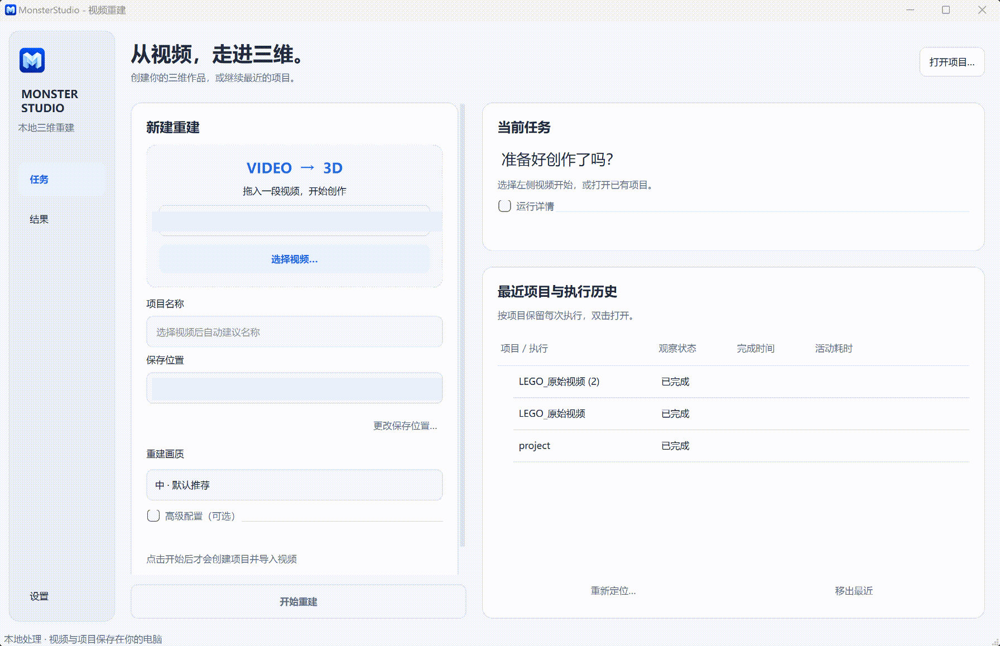

# MonsterEngine


**从视频重建到桌面与 Android 上的 3D Gaussian Splatting 展示。**

MonsterEngine 是使用 C++20 开发的 3D 渲染引擎，提供 Vulkan / OpenGL 后端、PBR 渲染，以及基于 Vulkan Compute Shader 的 3DGS 管线。当前主要开发与验证平台为 **Windows / Android+ Vulkan**。

| 应用 | 用途 |
| --- | --- |
| **MonsterStudio** | Windows Qt 工作台：本地视频重建、项目与执行历史、暂停 / 恢复、嵌入式 Vulkan 结果预览 |
| **MonsterEngine.exe** | Windows 桌面查看器：加载 3DGS 模型、交互漫游、LOD / 分页流式渲染与相机序列 |
| **Android App** | 移动端 Vulkan 查看器：场景导入、交互查看、有界 LOD 构建与恢复 |

[效果展示](#效果展示) · [快速开始](#快速开始) · [核心能力](#核心能力) · [构建与运行](#构建与运行) · [文档](#文档) · [测试与贡献](#测试与贡献)

## 效果展示

### MonsterStudio · 视频重建

使用 MonsterStudio 重建场景，并在工作台内查看三维结果。项目管理、重建任务与 Vulkan 预览集中在同一窗口。

(示例场景从导入视频-重建-显示 总耗时2分15秒)



### MonsterEngine · Bicycle 桌面渲染

MonsterEngine.exe 中的 Bicycle 场景展示。桌面查看器提供 GPU 投影与排序、Tile 合成、LOD 选择、异步分页加载和相机控制。


### Android App · Bonsai 场景展示

Android 客户端中的 Bonsai 场景查看与交互，复用引擎的 Vulkan 3DGS 渲染与分页流式路径。


<details>
<summary>更多渲染示例与历史视频</summary>

**3DGS · Bonsai**


[Bonsai 桌面漫游视频](docs/images/samples/bonsai_monsterengine_path_window.mp4) · [Bicycle 桌面窗口录屏](docs/images/samples/bicycle_monsterengine_path_window.mp4) · [Bicycle 1080p 导出视频](docs/images/samples/bicycle_3dgs_full_1080p.mp4) · [Android 历史漫游视频](docs/images/samples/bicycle_3dgs_android.mp4)

**PBR · Helmet**

Cook–Torrance BRDF、Metallic–Roughness 材质、IBL、法线贴图与环境光遮蔽。


**场景与光照**

2048×2048 Shadow Map 与 3×3 PCF 阴影示例。


</details>

## 快速开始

先按下方[构建与运行](#构建与运行)准备程序与依赖。模型和生成的分页数据需要自行准备。

| 想做什么 | 入口 |
| --- | --- |
| 从视频重建三维场景 | 启动 `MonsterStudioQt.exe`，配置本地重建工具环境后创建项目、导入视频并开始重建 |
| 查看已有 3DGS 模型 | 在仓库根目录运行下方命令 |
| 在 Android 上查看场景 | 按 [Android 指南](android/README.md)准备资源、构建并安装 APK，在应用中导入场景 |

```powershell
./build/bin/Release/MonsterEngine.exe --splat "path/to/model.ply"
```

输入应是包含高斯属性的 3DGS PLY；普通点云 PLY 不能直接视为兼容模型。模型准备与分页构建见 [3DGS 使用指南](docs/3dgs.md)。

## 核心能力

| 模块 | 能力 |
| --- | --- |
| 3DGS 渲染 | PLY 加载、最高 SH3、GPU 投影、前缀扫描、稳定 48 / 64 位基数排序、16×16 Tile 合成 |
| LOD / Streaming | 离线 LOD 构建、屏幕空间误差选择、异步页面读取、CPU 缓存、GPU 页池与资源预算 |
| MonsterStudio | 本地视频重建、质量预设、项目与执行历史、安全暂停 / 恢复、嵌入式三维预览 |
| Android | `arm64-v8a` / `x86_64`、最低 API 26、Vulkan 1.1、场景导入、有界 LOD 构建与生命周期恢复 |
| PBR 与场景 | Cook–Torrance、Metallic–Roughness、IBL、法线贴图、阴影、glTF 加载 |
| 引擎基础 | RHI、内存管理、容器、异步 I/O、日志、纹理与资源管理 |
| 调试与工具 | ImGui 控制面板、JSON 配置、相机关键帧、遥测与 MP4 导出（需要 FFmpeg） |

3DGS 桌面与 Android 展示使用 Vulkan；Android 与 Windows 共享 `FSplatViewerSession` 和 `FSplatStreamingController`。OpenGL 提供桌面后端实现，其能力与验证范围以对应模块为准。

## 构建与运行

从源码构建 MonsterEngine：

```powershell
git clone https://github.com/liyanliang-auto/MonsterEngine.git
cd MonsterEngine
cmake -S . -B build -G "Visual Studio 17 2022" -A x64
cmake --build build --config Release --target MonsterEngine SplatLODBuilder
```

需要 MSVC、CMake 3.20+ 和 Windows SDK；3DGS Shader 编译需要 Vulkan SDK 提供的 `glslc`。仓库包含第三方头文件及部分预编译库。构建后的程序位于 `build/bin/Release/`，从项目根目录运行以读取 Shader 和资源。

工具集、依赖与其他构建方式见 [Windows 构建指南](BUILD.md)。模型与生成的 3DGS 分页数据需要自行准备。

Android 客户端通过 PowerShell 脚本构建（需要 PowerShell 7、JDK 21、Android SDK / NDK、`glslc` 与 `spirv-val`）：

```powershell
./Tools/Android/build_android.ps1 -Variant Debug
```

先构建宿主 `SplatMobileLODBuilder`，准备指南要求的内置 PLY，并设置 `SPLAT_MOBILE_LOD_BUILDER`。脚本构建 `arm64-v8a` 与 `x86_64` 双 ABI APK，产物位于 `android/app/build/outputs/`。环境变量、打包与安装步骤见 [Android 客户端指南](android/README.md)。

### MonsterStudio Qt 工作台

MonsterStudio 提供项目管理、视频重建任务、暂停 / 恢复及 Vulkan 3DGS 预览。最新 Qt 工作台需要 Qt 6.8 或更新版本的 MSVC x64 开发包：

```powershell
cmake -S . -B build -G "Visual Studio 17 2022" -A x64 `
  -DMONSTER_BUILD_STUDIO_QT_PRODUCT=ON -DCMAKE_PREFIX_PATH="<Qt MSVC x64 安装目录>"
cmake --build build --config Release --target MonsterEngine MonsterStudioQt MonsterStudio
./build/bin/Release/MonsterStudioQt.exe
```

运行 Qt 工作台前，将 Qt 的 `bin` 加入当前进程 PATH，或用该 Qt 安装中的 `windeployqt --release` 部署其运行库。视频重建还需要单独准备可准入的本地重建工具环境；Qt 工作台本身不包含完整训练工具链。预览支持左键拖动、滚轮缩放、R 复位与 F11 全屏。

<details>
<summary>高画质展示、FPS 与录制配置</summary>

MonsterEngine 默认场景使用 Bicycle 模型，窗口标题栏约每秒更新 `Render FPS`，按实际提交的渲染帧统计。对外展示可使用全量 SH3、原生 1920×1080 内部渲染，隐藏控制面板。该配置关闭 validation 与 benchmark，需要原始 PLY 和足够的 GPU 内存：

```powershell
Remove-Item Env:MONSTER_SPLAT_DIAG -ErrorAction SilentlyContinue
./build/bin/Release/MonsterEngine.exe `
  --splat-config resources/3dgs_sequences/bicycle_full_quality.json `
  --splat-render-width 1920 --splat-render-height 1080 --splat-no-ui
```

细节优先的流式展示可将配置换为 `bicycle_lod_high.json`，保留上述 1080p 参数并添加 `--splat-quality 0.1`。场景 manifest 与 pages 应在同一真实目录树内；指向树外 pages 的 junction / symlink 会被资源路径校验拒绝，运行时可用 `--splat-scene <真实场景目录中的manifest>` 指定原始资源位置。

如需额外构建不显示标题栏 FPS 的展示版，配置独立构建目录时添加 `-DMONSTER_WINDOW_FPS_TITLE=OFF`；默认 ON 保留实时 FPS。OFF 仅显示应用与渲染后端名称，不改变帧计数、画质或模型。复用原资源运行的本地构建可另加 `-DMONSTER_COPY_RUNTIME_RESOURCES=OFF`，跳过链接后的大型 resources 复制；Shader 与 GLFW DLL 仍部署，从仓库根目录运行或显式指定资源路径。

Android 默认场景由 `resources/point_cloud/bonsai_30k.ply` 离线生成分页资源。Release 关闭 Java / JNI 调试与 profileable，实时 FPS 默认开启，也可用 Gradle 属性 `-PMONSTER_ANDROID_FPS_OVERLAY=ON` 显式开启。录制前进入画质面板应用“最高画质”，关闭面板并等待分页加载稳定；该请求使用最长边 1920、最多 2073600 内部像素及完整 SH3，实际尺寸与细节仍受窗口和内存准入限制。FPS 约每 1.5 秒更新，表示提交 / present 返回节奏。

无外部签名配置时 Release APK 为 unsigned，需签名后安装；本地录制可使用本地测试签名，正式分发使用发布密钥。安装已签名 APK 后启动：

```powershell
adb -s <设备序列号> install -r <已签名的Release.apk>
adb -s <设备序列号> shell am start -n com.monsterengine.viewer/.MainActivity
```

上述命令用于准备展示配置；已有录制素材的实际参数以其采集记录为准。

</details>

## 使用 MonsterEngine

### 加载 3DGS 模型

准备训练好的 PLY 文件，在项目根目录运行：

```powershell
.\build\bin\Release\MonsterEngine.exe --splat "path\to\model.ply"
```

| 操作 | 按键 |
| --- | --- |
| 前后与左右移动 | WASD |
| 升降 | 空格 / C |
| 环顾 | 右键拖动 |
| 调整视野 | 滚轮 |
| 显示 / 隐藏控制面板 | F1 |
| 退出 | Esc |

控制面板提供相机、渲染、LOD / Streaming、性能和序列工具。预算以 GiB 显示，每帧上传量以 MiB 显示，高斯与排序容量以百万（M）显示。

### 运行 Bicycle 配置

仓库提供全量展示与 LOD 配置。先按 [3DGS 使用指南](docs/3dgs.md)准备模型及分页资源，再运行：

```powershell
# 原始全量：用于高画质作品展示
.\build\bin\Release\MonsterEngine.exe --splat-config resources/3dgs_sequences/bicycle_full_quality.json

# 高画质 LOD / 流式加载
.\build\bin\Release\MonsterEngine.exe --splat-config resources/3dgs_sequences/bicycle_lod_high.json

# 实时作品展示：720p 内部渲染，高质量放大至 1080p 窗口
.\build\bin\Release\MonsterEngine.exe --splat-config resources/3dgs_sequences/bicycle_realtime_1080p.json
```

| 配置 | 活动高斯容量上限 | 场景 GPU 预算 | 细节误差 |
| --- | ---: | ---: | ---: |
| 日常 LOD：`lod_streaming_defaults.json` | 150 万 | 1 GiB | 2 px |
| 实时 1080p 展示：`bicycle_realtime_1080p.json` | 140 万 | 2 GiB | 2 px |
| 高画质 LOD：`bicycle_lod_high.json` | 613 万 | 2 GiB | 1 px |
| 原始全量：`bicycle_full_quality.json` | 613 万 | 2 GiB | — |

高画质配置同时提供 6400 万排序容量和 4 GiB 临时 GPU 预算。场景预算是其中一项资源上限，总显存还包含排序、渲染及其他资源；较低的 LOD 预算会减少细节。

### 在 C++ 中运行 3DGS 应用

现有应用入口封装了窗口、相机和渲染管线。下面展示与 `main.cpp` 一致的生命周期调用，可用于自定义入口：

```cpp
#include "SplatSceneApplication.h"

int main()
{
    MonsterRender::SplatSceneApplication app("path/to/model.ply");
    int exitCode = app.run();
    app.shutdown();
    return app.HasRunFailed() ? 1 : exitCode;
}
```

渲染管线实现见 [SplatPipeline](Source/Renderer/Splat/SplatPipeline.cpp)，应用集成见 [SplatSceneApplication](Source/SplatSceneApplication.cpp)。PBR 示例入口见 [CubeSceneApplicationPBR](Source/CubeSceneApplicationPBR.cpp)。

## 文档

| 文档 | 内容 |
| --- | --- |
| [构建指南](BUILD.md) | Windows 环境、CMake 与 Visual Studio 构建 |
| [Android 客户端指南](android/README.md) | Android Vulkan viewer、双 ABI 构建、场景恢复与验证边界 |
| [源码导航](CODE_WIKI.md) | 模块职责、关键调用链与源码入口 |
| [Shader 系统](Shaders/README.md) | Shader 组织、编译与渲染模块 |
| [3DGS 使用指南](docs/3dgs.md) | 模型准备、LOD 构建、预算配置、相机序列与视频导出 |
| [3DGS 验证记录](docs/validation/3dgs/README.md) | CPU、GPU 与集成测试结果及验证范围 |

## 资源与工具

- `resources/3dgs_sequences/`：运行预算配置与相机路径。
- `Tools/SplatLODBuilder/`：将 PLY 转换为场景清单和分页数据。
- `Shaders/Splat/`：3DGS Compute Shader 与呈现 Shader。
- `docs/images/samples/`：引擎截图、预览和展示视频。

3DGS 模型与生成的分页数据不随仓库分发。模型坐标系会影响相机路径，使用其他模型时应调整相机。视频导出和资源构建命令见 [3DGS 使用指南](docs/3dgs.md)。

## 测试与贡献

3DGS 包含 CPU、GPU 和集成三套正式 C++ 测试。测试结果应与具体源码、Shader、设备和构建身份对应；历史结果及验证范围见 [验证记录](docs/validation/3dgs/README.md)。

```powershell
cmake -S . -B build/verify -G "Visual Studio 17 2022" -A x64 -DSPLAT_BUILD_CPU_TESTS=ON -DSPLAT_BUILD_GPU_TESTS=ON -DSPLAT_BUILD_INTEGRATION_TESTS=ON
cmake --build build/verify --config Release --target SplatLODTestsCPU SplatLODTestsGPU SplatLODTestsIntegration
ctest --test-dir build/verify -C Release --output-on-failure
```

GPU 与集成测试需要真实 Vulkan 运行时及本次编译的 Shader。Android 构建、模拟器、真机性能和实际 16 KiB 页运行分别验证；历史记录不代表当前工作区全部通过。

欢迎通过 Issue 或 Pull Request 讨论与改进。提交时请说明问题、改动与验证方法；涉及 RHI 接口时检查对应后端，涉及 GPU 生命周期时提供相关测试结果。

## 目录结构

| 目录 | 职责 |
| --- | --- |
| `Include/` | 引擎公共接口，按 Core、RHI、Renderer、Platform 等模块组织 |
| `Source/` | 模块实现、应用示例与正式 C++ 测试 |
| `Shaders/` | 图形与 Compute Shader |
| `Tools/` | 离线资源处理工具 |
| `android/` | Android 客户端、Gradle 工程与构建/发布文档 |
| `resources/` | 运行配置与示例资源 |
| `cmake/` | 构建模块与测试目标 |
| `3rd-party/` | 第三方头文件、库与许可证 |
| `docs/` | 使用文档、验证记录与作品素材 |
| `devDocument/` | 架构设计与开发文档 |

## 依赖与致谢

使用 Vulkan、GLFW、Dear ImGui、STB 和 cgltf。架构与渲染学习参考 [Unreal Engine](https://github.com/EpicGames/UnrealEngine)、[Google Filament](https://github.com/google/filament)、[Vulkan Tutorial](https://vulkan-tutorial.com/) 和 [LearnOpenGL](https://learnopengl.com/)。

## 许可证

本项目用于学习与开发。第三方代码和素材遵循各自许可证；相关声明见 `3rd-party/` 中的许可证文件与对应源码。外部训练模型的获取与使用需遵循其发布方的授权说明。
