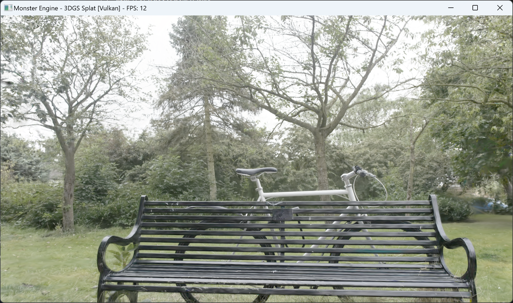
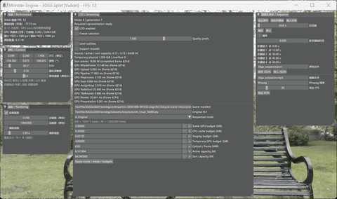
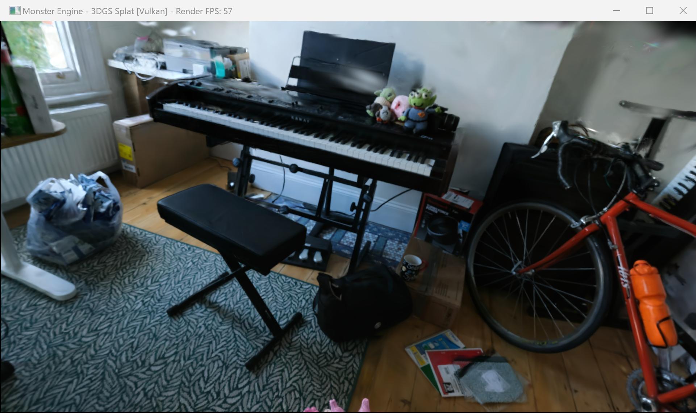
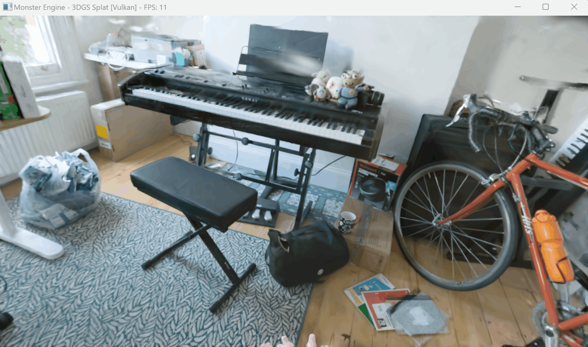
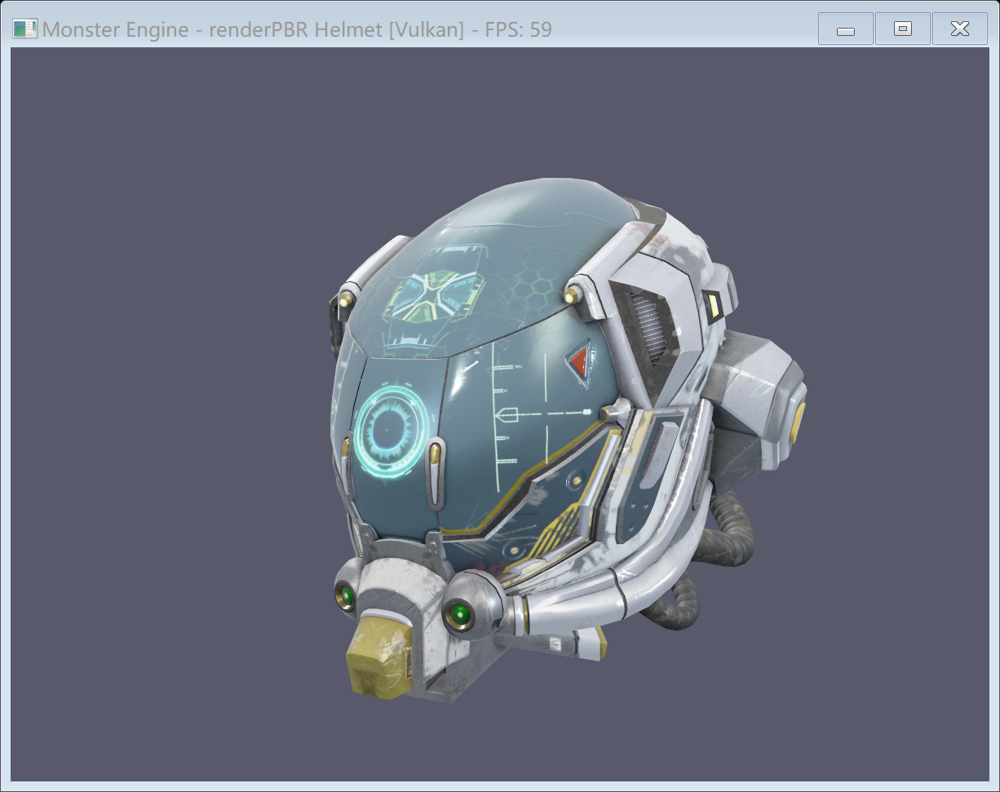
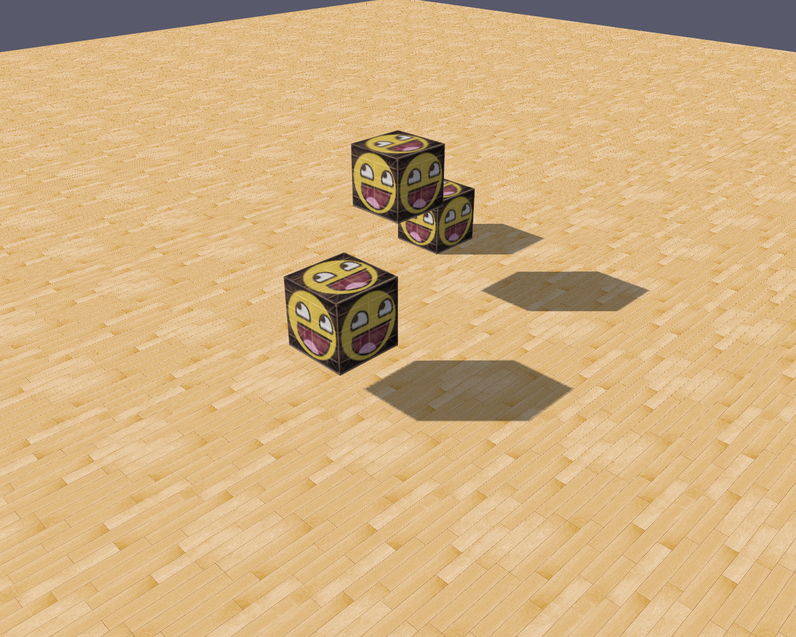

# MonsterEngine


MonsterEngine 是使用 C++20 开发的 3D 渲染引擎，提供 Vulkan / OpenGL 渲染后端、基于物理的渲染（PBR），以及基于 Vulkan Compute Shader 的 3D Gaussian Splatting（3DGS）。引擎围绕 RHI、场景、材质和资源管理组织代码。

项目目前以 **Windows + Vulkan** 为主要开发与验证环境。3DGS 管线支持百万级高斯渲染，并提供离线 LOD 构建、异步分页加载、显存预算控制和相机序列工具。

## 示例效果

### 3D Gaussian Splatting · Bicycle

全量画质：约 613.2 万个高斯 · SH3 · 1920×1080 内部渲染分辨率 



<a href="docs/images/samples/bicycle_monsterengine_path_window.mp4">
  
</a>

[观看真实窗口录屏](docs/images/samples/bicycle_monsterengine_path_window.mp4) · [观看 1080p 高清导出视频](docs/images/samples/bicycle_3dgs_full_1080p.mp4)


Bicycle 使用外部训练的 3DGS 模型。本项目实现模型加载、GPU 渲染与排序、LOD 构建与选择、异步流式加载、交互控制及视频导出。

### 3D Gaussian Splatting · Bonsai



<a href="docs/images/samples/bonsai_monsterengine_path_window.mp4">
  
</a>


### PBR · Helmet

Cook–Torrance BRDF、Metallic–Roughness 材质、基于图像的光照（IBL）、法线贴图和环境光遮蔽。



### 场景与光照

笑脸立方体使用 2048×2048 Shadow Map 与 3×3 PCF，在木地板上投射阴影。




## 获取与构建

从源码构建 MonsterEngine：

```powershell
git clone https://github.com/liyanliang-auto/MonsterEngine.git
cd MonsterEngine
cmake -S . -B build -G "Visual Studio 17 2022" -A x64
cmake --build build --config Release --target MonsterEngine SplatLODBuilder
```

需要 MSVC、CMake 3.20+ 和 Windows SDK；3DGS Shader 编译需要 Vulkan SDK 提供的 `glslc`。仓库包含第三方头文件及部分预编译库。构建后的程序位于 `build/bin/Release/`，从项目根目录运行以读取 Shader 和资源。

工具集、依赖与其他构建方式见 [Windows 构建指南](BUILD.md)。模型与生成的 3DGS 分页数据需要自行准备。

## 文档

| 文档 | 内容 |
| --- | --- |
| [构建指南](BUILD.md) | Windows 环境、CMake 与 Visual Studio 构建 |
| [引擎架构](devDocument/引擎的架构和设计.md) | RHI 分层、渲染与资源系统的设计说明 |
| [Shader 系统](Shaders/README.md) | Shader 组织、编译与渲染模块 |
| [3DGS 使用指南](docs/3dgs.md) | 模型准备、LOD 构建、预算配置、相机序列与视频导出 |
| [3DGS 验证记录](docs/validation/3dgs/README.md) | CPU、GPU 与集成测试结果及验证范围 |

## 功能特性

### API 与渲染后端

- Native C++ API，应用生命周期、窗口与输入接口。
- RHI 抽象层：设备、资源、命令列表、管线和交换链。
- Vulkan 后端：图形 / Compute 管线、资源上传与 GPU 同步。
- OpenGL 后端：对应的设备、资源与命令接口。

3DGS 展示与本次 GPU 验证使用 Vulkan 后端。其他平台与后端的能力以各模块实现为准。

### PBR 与场景渲染

- Cook–Torrance 微表面 BRDF 与 Metallic–Roughness 工作流。
- IBL、法线贴图、环境光遮蔽和 PBR 材质参数。
- 场景、相机、网格与光源管理。
- 阴影深度与投影 Pass，立方体 / 地面场景示例。
- glTF 资源加载与纹理读取。

### 3D Gaussian Splatting

- PLY 模型加载，高斯属性解码与最高三阶球谐（SH3）求值。
- GPU 高斯投影、可见性处理、前缀扫描与 Tile 分配。
- 稳定基数排序，支持 48 / 64 位排序键。
- Tile 内高斯透明度合成与窗口呈现。
- 相机漫游、视野与裁剪控制、高斯调试显示。

### LOD 与流式加载

- `SplatLODBuilder` 离线工具：稀疏八叉树、代理高斯与独立分页资源。
- 屏幕空间误差驱动的 LOD 选择，父子节点覆盖替换。
- 异步页面读取、CPU 缓存与 GPU 页池。
- 场景、暂存与临时 GPU 内存预算，活动高斯与排序容量控制。
- 页面生命周期管理，等待 GPU 完成后回收资源。
- 上传量、排序溢出、驻留内存与 GPU Pass 耗时遥测。

### 引擎基础与工具

- 自定义内存管理：`FMemory`、`FMemoryManager`、`FMallocBinned2`。
- 容器与字符串：`TArray`、`TMap`、`TSet`、`FString`、`FName`、`FText`。
- 智能指针、异步文件 I/O、日志和纹理资源管理。
- 纹理流式加载与虚拟纹理模块。
- Dear ImGui 控制面板、JSON 配置与相机关键帧序列。
- MP4 视频导出（需要 FFmpeg）及正式 C++ 测试。

## 使用 MonsterEngine

### 加载 3DGS 模型

准备训练好的 PLY 文件，在项目根目录运行：

```powershell
.\build\bin\Release\MonsterEngine.exe --splat "path\to\model.ply"
```

| 操作 | 按键 |
| --- | --- |
| 前后与左右移动 | WASD |
| 升降 | 空格 / C |
| 环顾 | 右键拖动 |
| 调整视野 | 滚轮 |
| 显示 / 隐藏控制面板 | F1 |
| 退出 | Esc |

控制面板提供相机、渲染、LOD / Streaming、性能和序列工具。预算以 GiB 显示，每帧上传量以 MiB 显示，高斯与排序容量以百万（M）显示。

### 运行 Bicycle 配置

仓库提供全量展示与 LOD 配置。先按 [3DGS 使用指南](docs/3dgs.md)准备模型及分页资源，再运行：

```powershell
# 原始全量：用于高画质作品展示
.\build\bin\Release\MonsterEngine.exe --splat-config resources/3dgs_sequences/bicycle_full_quality.json

# 高画质 LOD / 流式加载
.\build\bin\Release\MonsterEngine.exe --splat-config resources/3dgs_sequences/bicycle_lod_high.json

# 实时作品展示：720p 内部渲染，高质量放大至 1080p 窗口
.\build\bin\Release\MonsterEngine.exe --splat-config resources/3dgs_sequences/bicycle_realtime_1080p.json
```

| 配置 | 活动高斯容量上限 | 场景 GPU 预算 | 细节误差 |
| --- | ---: | ---: | ---: |
| 日常 LOD：`lod_streaming_defaults.json` | 150 万 | 1 GiB | 2 px |
| 实时 1080p 展示：`bicycle_realtime_1080p.json` | 140 万 | 2 GiB | 2 px |
| 高画质 LOD：`bicycle_lod_high.json` | 613 万 | 2 GiB | 1 px |
| 原始全量：`bicycle_full_quality.json` | 613 万 | 2 GiB | — |

高画质配置同时提供 6400 万排序容量和 4 GiB 临时 GPU 预算。场景预算是其中一项资源上限，总显存还包含排序、渲染及其他资源；较低的 LOD 预算会减少细节。

### 在 C++ 中运行 3DGS 应用

现有应用入口封装了窗口、相机和渲染管线。下面展示与 `main.cpp` 一致的生命周期调用，可用于自定义入口：

```cpp
#include "SplatSceneApplication.h"

int main()
{
    MonsterRender::SplatSceneApplication app("path/to/model.ply");
    int exitCode = app.run();
    app.shutdown();
    return app.HasRunFailed() ? 1 : exitCode;
}
```

渲染管线实现见 [SplatPipeline](Source/Renderer/Splat/SplatPipeline.cpp)，应用集成见 [SplatSceneApplication](Source/SplatSceneApplication.cpp)。PBR 示例入口见 [CubeSceneApplicationPBR](Source/CubeSceneApplicationPBR.cpp)。

## 资源与工具

- `resources/3dgs_sequences/`：运行预算配置与相机路径。
- `Tools/SplatLODBuilder/`：将 PLY 转换为场景清单和分页数据。
- `Shaders/Splat/`：3DGS Compute Shader 与呈现 Shader。
- `docs/images/samples/`：引擎截图、预览和展示视频。

3DGS 模型与生成的分页数据不随仓库分发。模型坐标系会影响相机路径，使用其他模型时应调整相机。视频导出和资源构建命令见 [3DGS 使用指南](docs/3dgs.md)。

## 测试与贡献

3DGS 包含 CPU、GPU 和集成三套正式 C++ 测试。最近一次独立源码构建验证通过 **94 项检查**：CPU 47、GPU 33、集成 14；构建归属与日志见 [验证记录](docs/validation/3dgs/README.md)。

```powershell
cmake -S . -B build -DSPLAT_BUILD_CPU_TESTS=ON -DSPLAT_BUILD_GPU_TESTS=ON -DSPLAT_BUILD_INTEGRATION_TESTS=ON
cmake --build build --config Release --target SplatLODTestsCPU SplatLODTestsGPU SplatLODTestsIntegration
ctest --test-dir build -C Release --output-on-failure
```

欢迎通过 Issue 或 Pull Request 讨论与改进。提交时请说明问题、改动与验证方法；涉及 RHI 接口时检查对应后端，涉及 GPU 生命周期时提供相关测试结果。

## 目录结构

| 目录 | 职责 |
| --- | --- |
| `Include/` | 引擎公共接口，按 Core、RHI、Renderer、Platform 等模块组织 |
| `Source/` | 模块实现、应用示例与正式 C++ 测试 |
| `Shaders/` | 图形与 Compute Shader |
| `Tools/` | 离线资源处理工具 |
| `resources/` | 运行配置与示例资源 |
| `cmake/` | 构建模块与测试目标 |
| `3rd-party/` | 第三方头文件、库与许可证 |
| `docs/` | 使用文档、验证记录与作品素材 |
| `devDocument/` | 架构设计与开发文档 |

## 依赖与致谢

使用 Vulkan、GLFW、Dear ImGui、STB 和 cgltf。架构与渲染学习参考 [Unreal Engine](https://github.com/EpicGames/UnrealEngine)、[Google Filament](https://github.com/google/filament)、[Vulkan Tutorial](https://vulkan-tutorial.com/) 和 [LearnOpenGL](https://learnopengl.com/)。

## 许可证

本项目用于学习与开发。第三方代码和素材遵循各自许可证；相关声明见 `3rd-party/` 中的许可证文件与对应源码。外部训练模型的获取与使用需遵循其发布方的授权说明。
