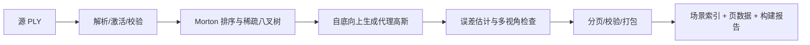
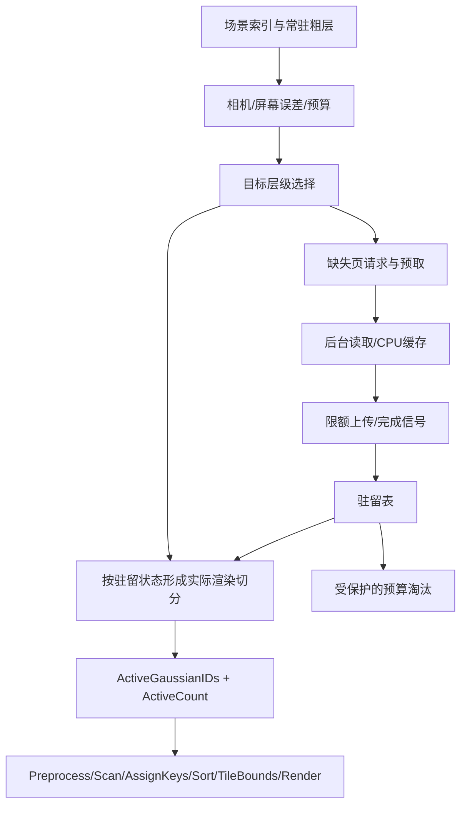
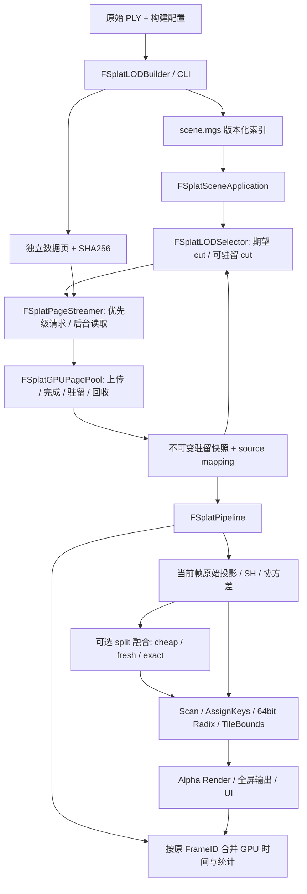

# MonsterEngine 3DGS LOD 和流式加载开发文档

> 状态：按用户2026-10-10更新后的目标，优先完成功能与交互流畅性；历史严格交付门槛留作参考，不再作为本轮必需条件。本轮功能闭环已完成，结果、使用范围及素材见第28章。
> 创建日期：2026-10-05；实现记录更新日期：2026-10-11（北京时间）。
> 当前结果：保守空间LOD、本地流式加载回收与默认Bicycle展示已完成功能验证；实验融合和旧严格交付门槛留作后续目标。详见第28章。
> 阅读顺序：第28章是当前功能闭环结果；第17–27章是实现演进与历史证据；第 1–16 章保留最初获批方案，其中“拟定、尚未实现”等描述仅代表 2026-10-05 的历史状态。实际源码与带配置/hash 的原始证据优先。
> 工作方式：按用户要求，本会话停用 spec-forge；采用单问题实验、失败即停止该方向、相关测试先行、稳定后完整回归。原代码、数据、成功和失败证据全部保留。
> 基础文档：[Vulkan 原生 Splat Pass 开发文档](<D:/code/MonsterEngine/devDocument/3DGS/Vulkan原生3DGS_splat_pass开发文档.md>)。
> 测试资产根目录：`D:/code/MonsterEngine/TestFile/3DGSLODStreaming`。大模型、构建、脚本、日志、截图均在此目录；正式实现与正式测试保留在源码目录。

当前章节导航：[实现状态](#17-当前实现状态与证据边界) · [架构](#18-实际架构与源码导航) · [详细设计](#19-详细实现设计) · [模型与环境](#20-真实模型与实验环境) · [验收](#21-验收流程与实测记录) · [截图](#22-真实截图与效果对照) · [问题记录](#23-bug失败实验与解决方案) · [复现](#24-证据索引与复现方法) · [剩余工作](#25-剩余开发与交付检查表)

---
## 1. 范围与交付定义

### 1.1 必须完成

1. PLY 离线构建工具：生成空间层级、粗级代理、场景索引和独立读取的数据页。
2. 稀疏八叉树 LOD：屏幕空间误差选择、迟滞、完整覆盖的层级切换、渲染预算控制。
3. 本地磁盘流式加载：后台读取、CPU 缓存、分批 GPU 上传、资源驻留、预取、取消、淘汰及粗层兜底。
4. 接入现有六阶段 Splat 管线，正确处理动态高斯数量、排序计数、空场景和多帧资源生命周期。
5. 配置和调试界面：LOD 开关、质量阈值、预算、冻结选择、层级着色、加载状态与性能统计。
6. 自动化 CPU/GPU/集成测试、固定相机序列截图、可复现性能评测及交付报告。
7. 从公开数据源取得至少一个代表性真实 PLY，并保存来源、版本、校验值、数据统计和使用条件。

### 1.2 本次交付边界

- 首个交付平台是 Windows + Vulkan，数据源为本地磁盘；网络 HTTP、移动端、WebGPU 和 XR 适配留作扩展。
- 第一版保留 FP32 数据，使用简单独立页格式；压缩与量化不是完成本地流式加载的前提。
- CPU 执行层级选择和加载调度；GPU 完成活跃高斯预处理、计数和排序。GPU 层级遍历依据实测瓶颈再决定，不以“使用了 GPU 八叉树”为交付标准。
- 完整训练管线、神经 anchor/MLP、在线重建和透明高斯跨级渐变不在首版范围；粗级表示仍必须达到本文画质门槛。
- 保留原始 PLY 全量渲染路径，作为兼容入口与画质基线。

### 1.3 完成标准

能从源 PLY 构建资源、启动粗层画面、随相机运动加载细层，并在受限预算下持续漫游；无缺块、重复层级混合、越界、资源提前释放或无限缓存增长。功能、画质、性能门槛均有可复现证据，不能只以“能显示”或“Gaussian 数量减少”宣布完成。

## 2. 当前实现核对

当前数据路径：`FSplatPLYLoader → FSplatGPUData → FSplatPipeline`。

| 位置 | 已确认行为 | 对新功能的影响 |
|---|---|---|
| `Include/Renderer/Splat/SplatPLYLoader.h` | positions/scales/rotations/opacities/SH 五组 GPU buffer，全量上传 | 拆分 CPU 解析、资源构建与页上传，避免运行时读入全量高斯 |
| `Shaders/Splat/splat_preprocess.comp` | 线程索引直接索引输入和输出，全量 dispatch | 引入源资源索引和本帧紧凑索引 |
| `Shaders/Splat/Sort/splat_prefix_sum.comp` | 当前逐步累加输出 inclusive scan | 总条目数读取末项；AssignKeys 对第 i 项使用 scan[i-1]，不可额外加最后一个 tilesTouched |
| `Source/Renderer/Splat/SplatSortPass.cpp` | 64 位 key，8 轮、每轮 8 bit radix | 保留 tileID 和深度完整排序语义；旧文档中的 4 轮描述不能作为依据 |
| `Source/Renderer/Splat/SplatPipeline.cpp` | 相机/设置变化后同步提交、等待、读回排序计数 | LOD 选择、页驻留和预算变化都要使计数失效；最终动态路径应使用同帧 GPU 计数 |
| `FSplatPipeline::initialize` | 按 gaussianCount × maxTilesPerGaussian 分配排序容量 | 改为明确的临时内存预算，64 位检查容量乘法与字节数 |
| `Include/RHI/IRHICommandList.h` | 有普通 dispatch，尚未在该接口看到 indirect dispatch | 核查后补齐必要 RHI 与 Vulkan 能力，不假设已有异步上传/时间戳接口 |
| `FSplatCameraSequence` | 已有关键帧、插值和 JSON 保存/加载 | 尽量复用固定相机回放，按采样时间复现，不依赖实时帧率推进 |

源码检查提示一个前置正确性任务：当前计数逻辑中的“exclusiveSum + lastTiles”与实际 inclusive scan 不一致。阶段 P0 必须用 CPU oracle 和 GPU 读回核实并修复，不把旧路径的计数错误带入 LOD。本文未修改该代码，也未执行新基线测试。

已有纹理流式加载/虚拟纹理测试可提供调度和缓存参考；正式实现先阅读其接口，能复用的基础设施应复用，但高斯的父子覆盖和排序生命周期仍独立建模。

## 3. 核心架构

### 3.1 离线构建



### 3.2 运行时



“目标切分”表达需要的精度，“实际切分”表达当前能够安全渲染的互斥节点集合。二者不能混用；未就绪资源不能出现在实际索引中。

### 3.3 模块职责（拟定名称）

| 模块 | 职责 |
|---|---|
| `FSplatCPUData / FSplatPLYReader` | 解析、统一布局、合法性校验；供离线工具与全量路径共用 |
| `FSplatLODBuilder` | 八叉树、粗级代理、误差元数据和分页 |
| `FSplatSceneManifest / FSplatPageReader` | 资源格式、索引和范围读取校验 |
| `FSplatLODSelector` | 目标切分、实际切分、迟滞和预算细化 |
| `FSplatStreamingManager` | 请求队列、后台 I/O、CPU 缓存、取消、优先级和淘汰 |
| `FSplatGPUPagePool` | GPU 分配、上传、驻留表、句柄代数和延迟回收 |
| `FSplatActiveSet` | 本帧活跃索引、数量、版本与页使用标记 |
| `FSplatPipeline` | 消费本帧活跃集，执行 GPU 管线和临时预算检查 |
| `FSplatBenchmarkRecorder` | 时间戳、帧指标、图像、CSV/JSON 与对比报告 |

## 4. 稀疏八叉树与粗级表示

### 4.1 树构建规则

- 使用扁平节点数组和索引，非空子节点以 mask/range 表示；避免运行时逐节点堆分配。
- 高斯中心唯一归属一个叶节点；用 Morton code 稳定排序，相同输入和配置应产生一致输出。
- 叶节点阈值、最大深度和最小空间尺寸共同决定停止划分；重复位置或极细区域不能无限细分。
- 节点分别记录划分 cell bounds 与 rendering support bounds。后者包围本节点代理及后代高斯的有限支撑范围，用于保守剔除。
- 高斯无限尾部以明确 sigma/贡献阈值截断；格式保存截断策略。长椭球跨越多个 cell 时不复制原始高斯，使用扩展包围范围避免边缘漏渲染。
- 根节点的粗表示常驻；需要时采用多根森林，但所有根必须可在启动预算内加载。

### 4.2 代理生成

叶节点保留原始高斯。父节点代理由子树简化生成，输出普通高斯参数，不要求运行时 MLP。

拟采用空间局部、颜色/SH/协方差差异约束下的逐对合并。先用固定版本的 splat-transform 做可行性验证；正式资源构建明确采用引擎内确定性实现或固定工具依赖，并记录版本。工具必须输出本文场景格式；不能要求用户手动准备各级 PLY 才能运行。

归一化权重下，位置与协方差初始化采用矩匹配：

\[
\mu=\sum_i w_i\mu_i,\quad
\Sigma=\sum_i w_i[\Sigma_i+(\mu_i-\mu)(\mu_i-\mu)^T]
\]

- 权重策略显式配置并记录；质量试验比较不透明度与体积相关权重，不能把 opacity 当作天然概率质量。
- 对称协方差特征分解后恢复 scale/rotation，检查正定性、有限值和四元数约定。
- SH 在统一系数布局下估计；不透明度需通过明确近似和多视角检查确定，不能简单求和。
- 合并不能跨过明显颜色/形状边界；代理过大造成 tile 开销上升时，停止合并或保留更多代理。
- 若无训练图像，结果是基于已有 PLY 的近似；无法承诺论文训练级画质。若不满足质量门槛，调整分块、代理数量或拟合策略，不能靠直接随机删点交付。

### 4.3 误差定义

每个节点保存几何/分布近似误差估计和外观误差辅助信息。世界空间误差用于选择启发式，多视角图像指标用于验收，二者不能等同。

初始屏幕误差估计：

\[
E_{px}\approx \frac{\max(f_x,f_y)\,e_{world}}{z_{safe}}
\]

`z_safe` 根据节点包围范围最靠近相机的正深度保守计算；节点跨越近裁剪面或相机位于包围范围内时，强制细化到可驻留精度。FOV、分辨率变化自然影响选择。

包围尺寸仅可作为初期启发式，不能称为严格图像误差界。外观误差较大时拒绝该粗代理或增加细化优先级。父子误差关系应保守单调化并通过测试验证。

## 5. 可流式加载的资源格式

### 5.1 拟定目录

```text
scene.mgs.json       # 格式版本、源 SHA256、统计、配置、坐标/SH约定
scene.nodes.bin      # 扁平节点、子范围、包围盒、误差、页范围
scene.pages.bin      # 页目录：文件位置、大小、数量、校验、codec
scene.data          # 可范围读取的独立页载荷
build-report.json    # 构建耗时、质量样本、各层/页统计
```

扩展名和布局在 P1 固定。节点不是 I/O 页：一个节点可以包含多页，多个小节点也可共享一页。每个被选择节点的表示必须整体就绪后才参与替换。

### 5.2 格式约束

- 明确 little-endian、magic、版本、字段宽度、对齐、SH degree/stride、激活后参数和坐标约定；不直接把带 padding 的 C++ struct 写盘。
- 偏移、文件长度和 CPU 字节数使用 64 位；GPU 32 位索引在转换前检查上限。
- 页载荷第一版使用可独立解码的 FP32 SoA。后续压缩以 codec ID 扩展，页间不能有隐式解码依赖。
- 保存页 checksum、源 SHA256、工具版本、构建配置、各层统计；错误页不能直接上传。
- 构建输出先写临时资源，再发布完整索引；失败不能留下看似有效的半成品。
- 启动仅加载索引和粗层；全量 leaf 数据不应为了流式路径被解析进 CPU/GPU 内存。
- 离线构建内存峰值单独计量；首版可使用较高离线内存，但必须报告输入上限，不能将其与运行时有界内存混淆。

## 6. LOD 选择与完整覆盖

### 6.1 选择步骤

1. 从粗层出发，对 support bounds 做保守可见性判断。
2. 按误差收益与估计渲染/驻留成本优先细化；同时遵守活跃数量、页预算和临时排序预算。
3. 请求目标节点所需数据；未就绪时沿用驻留祖先。
4. 形成互斥实际切分，生成本帧活跃索引和 selectionVersion。
5. 标记相关页本帧使用，固定本帧驻留映射，后续 GPU 提交完成前不可复用其地址。

### 6.2 必须保持的约束

- 对需要显示的原始叶区域，实际切分提供一个有效表示；父节点与其后代不能同时完整贡献。
- 第一版父→子替换在所有必需子表示页就绪后于帧边界一次完成。
- 细→粗降级先确认粗表示就绪，再移除子表示；避免先卸载后补粗层。
- 原始高斯拥有稳定逻辑身份；物理 GPU slot 可变，映射使用 page handle + generation/local index 或经检查的等价方式。
- 裁剪导致节点完全不可见与资源未加载是不同状态，不能用“未加载”当作剔除。
- 如最粗表示本身超过预算，应在加载前返回明确错误或降低构建粗层大小，不能隐式超预算。

### 6.3 迟滞与预算参数

默认试验阈值：质量阈值 1.0 px，细化边界 1.2 px，合并边界 0.8 px；通过测试再确定默认值。这些数值不是已验证的误差保证。

参数包括 `qualityThresholdPx`、`maxActiveGaussians`、`maxSortEntries`、GPU/CPU/staging 预算、每帧上传量、读取并发数和预取范围。预算策略必须报告降级原因；参数变化也更新 selectionVersion。

## 7. 流式加载与资源生命周期

### 7.1 页状态机

```text
Unloaded → Queued → Reading → CPUReady → Uploading → GPUReady
                                                   ↓
                                              EvictPending → Unloaded
读取/校验/上传失败 → Failed（有界重试，保留祖先）
取消或场景切换 → 丢弃过期结果，按完成信号安全释放
```

CPU 解码缓存与 GPU 驻留应独立计量和管理；GPU 被淘汰后 CPU 缓存可能保留，不能由单一枚举推断所有缓存都释放。

### 7.2 线程职责

- 工作线程：范围读取、校验、解码；通过完成队列交付结果，不直接修改帧内渲染选择。
- 主/渲染线程：预算、驻留表发布、切分替换、GPU 命令记录。
- 每个请求携带 scene generation、page ID 与 request generation，丢弃取消或旧场景的完成结果。
- 去重以 scene/page 身份为键；失败重试具有次数和退避上限，避免无限读取。
- 停止和切换场景时关闭请求、等待或取消后台工作，并安全清理未完成上传。

### 7.3 上传与回收

- GPU 页池使用固定容量或预算内 slab，保持五组数据的索引一致；按 SH stride 分类或统一固定 stride，不能混读。
- staging 环形分配器按提交完成信号回收；non-coherent 内存正确 flush/invalidate。
- copy 完成后执行正确 buffer barrier；使用独立 transfer queue 时处理 queue family ownership 与 semaphore。先使用图形队列异步提交，独立传输队列作为后续可选优化。
- 上传资源仅在 GPU 消费可见后标记 GPUReady；上传描述符和页映射按帧更新。
- frame fence/timeline completion 控制页复用，不能用固定“等两帧”替代完成证明。
- 实际切分页、替换过程的父子页和常驻粗层有 pin/reference 保护。
- 预算应为父子替换预留过渡空间；不足时细化不发生，不能进入“父页被 pin，子页永远装不下”的死锁。

### 7.4 调度策略

优先加载当前可见且误差收益大的页；再考虑运动方向的邻近预取。代价结合字节数和预计上传成本。实现请求去重、过期请求降权、LRU/近期可见保留、预取预算上限和每帧上传上限。LRU 只能选择未 pin 且 GPU 已停止使用的页。

遥测记录目标页、驻留页、等待页、命中率、磁盘吞吐、取消/失败次数、替换延迟和预算降级。快速来回移动测试必须揭示读盘抖动，不能只测静止视角。

## 8. Splat 管线与 RHI 接入

### 8.1 索引语义

```glsl
uint activeIdx = gl_GlobalInvocationID.x;
if (activeIdx >= activeCount) return;
uint sourceIdx = activeGaussianIDs[activeIdx];
// positions/scales/rotation/opacity/SH 使用 sourceIdx
// pointsXY/depth/bbox/tilesTouched/conic/rgb 使用 activeIdx
```

AssignKeys 的 value 使用 activeIdx，Render 仅读取紧凑预处理输出。源池地址来自本帧冻结的页映射，完整叶层验证时可与原始路径按稳定源 ID 比较。

### 8.2 动态计数

- 区分资源池容量、ActiveCount、实际 Gaussian–tile 条目数和缓冲容量。
- inclusive scan 的最后一项是总条目数；统一 CPU/GPU 语义，增加非零尾项测试。
- ActiveCount=0：不读取 count-1，不伪造一个未初始化排序条目；清零 tile ranges 并输出透明图像。
- 选择、驻留、相机、缩放和分辨率变化均影响计数。中间版本同步读回时必须更新失效条件；最终动态路径使用同帧 GPU count。

### 8.3 容量溢出

`sum(tilesTouched)` 才是排序数量，粗 Gaussian 变大可能减少高斯但增加排序开销。所有加法、乘法、buffer 范围都检查溢出；GPU 不得在计数溢出后继续写入。

采用预检/overflow flag 与 fail-safe 路径：超预算帧不进行不完整的 AssignKeys/Sort，保留上一张有效输出并报告降级，下一帧收紧选择或在预算内增长容量。仅按高斯数量降级不保证条目数下降，因此必须重新测量；持续无法容纳时返回明确状态。正常验收路径要求无 overflow，故障注入验证安全降级。不能把截断排序数组当作成功渲染。

### 8.4 GPU 驱动计数与排序

- 补齐 count/indirect args buffer、dispatchIndirect、同步和必要的 timestamp query 能力，并覆盖 Vulkan 命令记录/回放及其他后端的能力检查。
- Scan 和 AssignKeys 写 GPU count，GPU 生成排序 workgroup 参数。
- Radix histogram/scatter、TileBoundaries 从相同 count buffer 获取数量；只改 dispatchIndirect 而仍通过 CPU push constants 提供数量不算完成。
- 排序全局前缀、尾 workgroup、零元素和 64 位键八轮一致性都需验证。
- 正常漫游帧不使用 submitAndWait/vkDeviceWaitIdle 读取计数；遥测延迟读回允许，不能改变本帧渲染决策。
- 分阶段 timestamp 结果异步读取；记录硬件 timestamp 能力和精度，不能用 CPU 包围 dispatch 的耗时冒充 GPU 时间。

## 9. 阶段计划与退出条件

| 阶段 | 工作和产物 | 退出条件 |
|---|---|---|
| P0 基线与正确性 | 核对源码、构建/现有测试、计数 oracle、数据布局、硬件记录、固定路径；修复阻碍正确基线的问题 | 原路径可复现；inclusive scan、零元素、64位排序正确；新基线有证据 |
| P1 格式与构建 | CPU reader、树/页协议、参考代码固定版本、离线工具、小型确定性 fixture | round-trip、bounds、树与页完整性通过；源叶层无损 |
| P2 粗层质量 | 合并、协方差恢复、SH/opacity 策略、误差与图像评估 | 至少三种有效精度；粗层达到约定门槛，细层可恢复原图 |
| P3 常驻 LOD | 活跃索引、CPU选择、互斥切分、迟滞、界面和排序容量处理 | 数量切换正确，无父子重复和空洞；关闭LOD回归通过 |
| P4 流式加载 | 后台I/O、CPU/GPU缓存、staging、就绪发布、粗层兜底、延迟回收 | 限预算加载/淘汰实际发生；延迟/失败/场景切换测试通过 |
| P5 GPU与调度优化 | 同帧GPU计数、间接调度、优先级/预取/预算细化、遥测 | 正常路径无同步计数等待；缓存有界，无上传/复用竞态 |
| P6 实测与交付 | 真实Garden、bonsai回归、压力/图像/性能矩阵、说明和报告 | 第12章全部交付门槛有证据，重大问题清零 |

顺序依赖为 P0→P1→P2→P3→P4→P5→P6。测试随阶段加入；每阶段保留可运行入口。阶段完成不等于最终交付，不能停在常驻 LOD 或只实现读盘线程。

用户 review 本方案后再开始实现。进入代码阶段按项目适用的开发流水线执行需求检查、任务分解、基线、实现、测试、代码审查、回归与证据核验；不得以流水线 WARN 自动替代本文的硬性交付门槛。

## 10. 测试计划

### 10.1 自动化测试矩阵

| 编号 | 层级 | 内容与可观测断言 |
|---|---|---|
| T01 | CPU | PLY degree 0–3、属性顺序、激活、NaN/Inf/非法参数；解析结果匹配小型已知fixture |
| T02 | CPU | 相同输入构建一致；重复位置、空输入、退化bounds、最大深度正确终止 |
| T03 | CPU | 叶身份唯一、父子coverage完整；support bounds包围约定支撑范围，跨cell长椭球不漏 |
| T04 | CPU | 已知双高斯矩匹配、正定性、协方差↔scale/rotation往返；颜色/opacity不越界 |
| T05 | CPU | 格式round-trip、页校验、坏版本/短文件/非法offset/溢出被拒绝，无大尺寸误分配 |
| T06 | CPU | LOD误差/FOV/分辨率/近面变化、迟滞；切分中无祖先后代重复且覆盖完整 |
| T07 | CPU | 父多页/子部分就绪时不提前替换；预算不足仍显示父；降级先保证父就绪 |
| T08 | CPU | mock I/O注入乱序、延迟、失败、取消、旧场景结果；请求去重且重试有界 |
| T09 | CPU/GPU | fake completion与真实fence验证pin页不能淘汰，未完成slot不能复用，generation拒绝旧结果 |
| T10 | GPU | ActiveCount=0/1/非256倍数；sourceIdx与activeIdx不同；SH输入stride正确 |
| T11 | GPU | inclusive scan对CPU oracle，特别覆盖非零末项；AssignKeys实际条目数一致 |
| T12 | GPU | 64位键跨tile/depth排序、尾组、零/一条、稳定性要求、TileBoundaries正确 |
| T13 | GPU | count/args与同帧选择一致；相机不动但预算/驻留变化也更新；容量恰好/超过边界安全 |
| T14 | 图像 | 关闭LOD、全叶层、流式最终全叶层对原路径；块边界、视口外椭球、透明背景 |
| T15 | 集成 | 固定漫游、快速转向/往返/跳转、resize、场景切换、停止退出；无残影/缺块/竞态 |
| T16 | 压力 | 多轮加载淘汰和低预算30分钟漫游；内存平台稳定、无泄漏/device lost/validation错误 |
| T17 | 性能 | 固定路径、模式矩阵、冷热加载、质量与吞吐并行评估；输出原始记录可重算 |

小型CPU测试不依赖网络或大模型；GPU测试依赖可用Vulkan设备，缺设备标记未验证而不是PASS。测试应覆盖状态不变量和结果，不只复制实现步骤。使用现有测试框架或独立轻量target，正式接入CMake/VS构建并提供明确失败退出码。

### 10.2 图像评估

- 同一相机、分辨率、背景、曝光、SH degree和渲染参数，比较LOD关闭的同源PLY基线。
- 全叶层重排可能改变同深度条目的累积顺序，因此不强求逐bit相同；报告误差图、PSNR/SSIM和最大/分位误差。
- 分开评估“资源完全就绪后的空间质量”和“运动加载过程的跳变/缺块”；不能用稳定截图掩盖过渡问题。
- 保存近景、远景、叶边界、细枝叶、反光/细纹理ROI。黑色/透明区域不能占据指标大部分而掩盖局部错误。
- 以全量PLY的渲染质量为比较基线；现有模型在极近景的模糊不能被声称由LOD恢复。

## 11. 代表性模型与性能评测

### 11.1 数据选择

主候选：Mip-NeRF 360 的 Garden 对应公开 3DGS PLY。原因：室外植被、细结构、密度变化和远近跨度，能观察合并损失、LOD切换与tile覆盖成本。

已查到 [dylanebert/3dgs 数据目录](https://huggingface.co/datasets/dylanebert/3dgs/tree/main) 包含 garden；本轮未下载或验证具体PLY文件，不能假定文件名、数量或许可证。P0/P1由开发代理完成文件选择、使用条件核对、下载、SHA256、PLY属性和相机元数据验证，记录到 dataset-manifest.json。模型不可用时从同一公开目录选择 Bicycle，记录替换原因，不能无说明换成仅有小规模人造点云。

回归模型：现有 `resources/point_cloud/bonsai_30k.ply`；`30k/7k` 表示训练迭代命名，不能据此宣称高斯数量。实际数量以PLY头和解析结果为准。

压力数据：在真实模型上降低驻留预算，使细层总数据明确大于可用预算，必须触发真实加载/淘汰。必要时补充真实多区域大模型。平移复制模型仅用于分配/调度压力测试，明确标为合成场景，不能替代真实模型质量结论。

保存源相机或固定JSON回放。原始大文件和生成资源不默认加入Git，提供下载/构建脚本及校验；小型fixture可以入库。

### 11.2 对比模式

| 模式 | 目的 |
|---|---|
| A 原始全量路径 | 当前可交付基线，先修复已确认正确性问题 |
| B 新活跃路径，全叶、全驻留 | 测量接入开销与原图等价性 |
| C LOD开启、全驻留 | 分离LOD本身的数量/排序/画质收益 |
| D LOD + 磁盘流式，预算充足 | 测量异步加载与驻留管理成本 |
| E LOD + 磁盘流式，受限预算 | 验证真正工作集有界、降级和反复加载表现 |

### 11.3 测量协议

- Release，固定分辨率先用1920×1080；记录GPU/CPU/RAM、驱动、Vulkan版本、磁盘、构建commit、shader hash、源模型和配置hash。
- 关闭VSync/帧率上限和高频诊断读回；validation正确性跑与性能跑分开，报告各自配置。
- GPU时间分解：选择/索引上传、Preprocess、Scan、AssignKeys、RadixSort、TileBounds、Render；若CPU选择则单独记录CPU时间。
- 热态：预热至少10秒，固定路径采样至少60秒，至少3轮，报告median/p95/p99帧时间与吞吐；同一路径按时间采样，不能因快帧率走得更远。
- 冷启动单独记录索引读取、粗层首次可用、首张有效画面、目标精度收敛时间。进程重启不等于OS缓存冷；无法控制磁盘缓存时明确标注warm-file-cache/unknown，不冒称冷盘成绩。
- CPU、GPU、staging、预处理/排序缓冲分别计量峰值；记录allocator实际分配、保留容量和逻辑驻留量，不用Gaussian数量推算代替显存测量。
- 同时记录N_active、N_sort、tile列表分布、磁盘字节、上传字节、cache hit、替换次数、等待页数、overflow和fail-safe次数。
- 记录图像与指标，禁止靠大幅降画质换取性能后只展示FPS。

报告模板至少包含：模式、质量档、GPU总时长、CPU选择时长、帧p95/p99、各Pass时间、显存峰值、CPU缓存峰值、首画面、收敛时间、PSNR/SSIM及ROI问题。CSV/JSON保存逐帧原始数据，Markdown报告保存汇总、截图和局限。

## 12. 拟定验收门槛

下列是review用目标，尚无实测；P0固定硬件与路径后锁定可复现参数。达不到时修复或明确报告未达标，不能自行降低门槛后宣布完成。

| 项目 | 门槛 |
|---|---|
| 正确性 | T01–T16全部通过；GPU/集成运行无新增validation错误、越界、缺块、重复父子贡献和提前复用 |
| 全叶等价 | 相对同源原路径，建议PSNR≥45dB、SSIM≥0.995；无可见系统性差异，ROI同样检查 |
| LOD质量 | 默认质量档就绪后，建议PSNR≥30dB、SSIM≥0.95；无持续块边界/空洞，运动检查无频繁振荡 |
| 接入开销 | B相对A热态GPU总时长中位数增幅≤5%；超过须定位解释并优化 |
| LOD收益 | 预先登记的远/中景路径，质量合格时C相对B GPU总时长中位数下降≥25%，p95不恶化；近景单独报告 |
| 流式驻留 | E的细层总资源至少为有效场景GPU预算的2倍，真实出现加载与淘汰；常驻粗层/过渡余量计入预算 |
| 内存 | CPU缓存、GPU场景池、staging和临时缓冲各自不超配置硬上限；驱动/交换链开销单列，总量不混算 |
| 稳定性 | 30分钟受限预算漫游无崩溃/device lost、无持续增长；pin/延迟释放和页计数闭合 |
| 帧等待 | 正常路径没有同步计数读回的submitAndWait/vkDeviceWaitIdle；无主线程磁盘读取 |
| 加载体验 | 同硬件同缓存条件，首次粗层画面时间优于全量路径；报告具体时间与收敛延迟，粗层未就绪有明确加载状态 |
| 流式开销 | 预算充足、数据就绪时D相对C p95帧时间增幅≤10%；低预算场景允许降精度，但不得靠丢块维持帧率 |
| 溢出 | 正常验收路径overflow=0；故障注入触发安全降级，不能输出截断排序造成的错误图像 |

PSNR/SSIM计算空间、背景处理和有效ROI在P0固定。目标不是全硬件统一60FPS；最终报告必须给出本机实际帧率和适用条件。

## 13. 拟定文件落点与操作入口

```text
Include/Renderer/Splat/LOD/          # 类型、选择器、场景协议
Source/Renderer/Splat/LOD/           # 构建、选择、误差
Include/Renderer/Splat/Streaming/    # 请求、缓存、GPU页池接口
Source/Renderer/Splat/Streaming/     # I/O、上传、驻留与回收
Tools/SplatLODBuilder/               # 离线构建CLI
Shaders/Splat/                       # 活跃索引、GPU count/args
Source/Tests/3DGSLODStreaming/        # CPU/GPU/集成测试与评测脚本
resources/3dgs_sequences/            # 固定相机序列
devDocument/3DGS/LODStreaming/       # 数据清单、报告、配置和证据索引
```

改动现有 SplatTypes/Pass/Pipeline/PLYLoader、RHI命令接口、Vulkan后端及记录回放、应用控制界面、CMake和VS工程。新名称按已有命名规范最终确认。

拟定CLI契约（尚未实现，交付时提供实际可运行命令）：

```text
SplatLODBuilder --input <source.ply> --output <scene-dir> --config <build.json>
MonsterEngine --splat-scene <scene.mgs.json> --splat-config <runtime.json>
SplatLODTests --suite cpu|gpu|integration
SplatBenchmark --scene <path> --sequence <camera.json> --mode A|B|C|D|E --output <dir>
```

操作界面包含LOD开关、质量阈值、预算、冻结选择、节点bounds/层级颜色、驻留/等待页、各Pass时间、N_active/N_sort及overflow提示。切换性能可视化模式时不混入正式画质采样。

## 14. 风险与处理

| 风险 | 处理与验证 |
|---|---|
| 合并损失透明度/纹理 | 多视角评估，边界约束，增加代理或拒绝低质量粗层 |
| 粗高斯覆盖tile更多 | 同时预算N_sort与GPU时间，不能只限制N_active |
| 根bounds过大、八叉树很深 | 最大深度/最小cell/叶数量阈值，必要时多根森林 |
| 细层加载不完整 | 原子父子替换、常驻祖先；失败保留父，不销毁有效覆盖 |
| 预算无法容纳替换 | 过渡预留、预算可行性检查、拒绝细化并可观测降级 |
| 上传/描述符/回收竞态 | scene/page generation、帧快照、完成信号回收和故障注入 |
| 现有计数或排序bug污染成绩 | P0 oracle与修复后基线；保留原始记录，明确必要正确性修复 |
| 模型来源/下载不稳定 | 固定数据revision与SHA256、说明使用条件和替代候选 |
| 帧时间被I/O或日志污染 | 异步I/O、上传限额、性能跑关闭高频读回，分开冷热测试 |

## 15. 参考来源与开发复现

| 来源 | 使用方式 |
|---|---|
| [PlayCanvas splat-transform](https://github.com/playcanvas/splat-transform) | 参考逐对简化、空间局部性和多级分块输出；固定commit与工具版本 |
| [PlayCanvas engine](https://github.com/playcanvas/engine) | 参考驻留、加载优先级与LOD渲染接入；正式开发按源码核对 |
| [Hierarchical 3D Gaussians](https://github.com/graphdeco-inria/hierarchical-3d-gaussians) | 参考层级构建、后优化和预算；不将训练依赖直接引入运行时 |
| [Octree-GS](https://github.com/city-super/Octree-GS) | 参考LOD空间组织与选择思想；原版MLP资源不等同普通PLY |
| [Mip-Splatting](https://github.com/autonomousvision/mip-splatting) | 尺度采样与抗锯齿参考，不作为减少高斯数量的替代 |
| [公开3DGS数据目录](https://huggingface.co/datasets/dylanebert/3dgs/tree/main) | Garden/Bicycle候选，下载后验证具体PLY和元数据 |

参考仓库放在 `D:\code\me-viewer-refs\`，记录URL、commit、阅读模块和算法来源。代码复用前核对仓库许可证与依赖条件；不能将所有研究仓库视为相同授权。本文截至2026-10-05进行方案级资料核对，尚未完成逐文件源码审计或下载模型。

## 16. 最终交付物与证据索引

- 完整实现及正式构建入口，兼容原始PLY渲染。
- 离线工具、格式说明、默认构建/运行时配置、下载和校验脚本。
- 测试源码、命令、失败退出码、测试结果和需求→测试映射。
- 真实模型清单、源/资源hash、资源构建统计、固定相机JSON。
- A–E性能CSV/JSON、图像/误差图、质量档对比和GPU调试证据。
- 受限预算30分钟报告、页生命周期/失败注入结果、显存和CPU曲线。
- 使用说明：从下载PLY到构建、运行、调预算、测试与复现性能的完整步骤。
- 最终报告明确通过/未通过项、已知限制和硬件条件，不保留未实现功能作为“已完成”。

当前review重点：确认Windows/Vulkan本地磁盘交付范围、八叉树+独立页架构、Garden主测试候选、粗层生成路线和第12章拟定质量/性能门槛。用户review后根据反馈修订同一文档，再进入实现阶段。

---

## 17. 当前实现状态与证据边界

> 本章保留2026-10-10核对时的历史状态；2026-10-11功能目标的最新完成情况见第28章。

本章起记录实际开发情况。截至本次更新，最初十个实现任务已有代码；“任务实现完成”不等于画质、性能及交付验收完成。最近实际执行记录来自 10 月 7 日的实验资产；10 月 10 日核对时没有运行中的开发代理、构建或测试进程。日期更新不代表重新执行过全部测试。

| 功能 | 实现情况 | 验证范围与限制 |
|---|---|---|
| PLY 校验、激活、离线构建 | 已实现 | 有正式 CPU/CLI 测试与真实 Bicycle 构建数据 |
| Morton 空间排序、稀疏八叉树、多级代理 | 已实现 | 原始叶数据身份保留；粗代理质量仍受图像门槛约束 |
| 版本化索引、独立页、校验 | 已实现 v1–v5 | v5 新增叶自身分组；最新 v5 检查目前部分为实验辅助程序，待纳入正式测试 |
| SSE 选择、迟滞、完整覆盖、预算回退 | 已实现 | 对真实数据的外观误差定义经过修正，不能仅凭选择器单测证明代理质量 |
| 异步 I/O、取消、重试、CPU 缓存 | 已实现 | 有生命周期/预算相关测试；30 分钟持续加载回收待做 |
| GPU 页池、分批上传、pin、generation、回收 | 已实现 | 真实 Vulkan 生命周期检查已做；最终 E 压力验收未闭环 |
| 活跃源索引、同帧 GPU 计数、间接执行、排序 | 已实现 | CPU oracle、GPU/溢出检查已做 |
| 实时投影融合与时序证书 | 已实现实验路径 | 默认 `projectedFusion=false`，保留 scalar/split 切换；完整覆盖候选仍有图像失败 |
| 32 lane exact/fresh 融合优化 | 已实现且保留 | actual GPU 阶段耗时显著下降，完整场景性能目标仍未达成 |
| 配置、控制、相机回放、证据采集 | 已接入 | 原控制路径与新参数语义修复有测试；最终 runbook 待统一 |
| 正式测试与交付 | 部分完成 | 一轮 86 项测试通过；新增改动不能继承旧版全回归结论 |

状态用语：**PASS** 仅表示指定配置下指定门槛通过；**FAIL** 表示有真实失败证据；**UNVERIFIED** 表示未完成或证据不足。`RECORDED` 只表示记录结束，不是验收 PASS。不用主观百分比代替上述状态。

## 18. 实际架构与源码导航

### 18.1 分层架构



八叉树用于世界空间组织、分页、可见性、请求及完整覆盖；实时融合是其上的可选细节减少路径，负责适应当前相机投影。两者不能混为一谈。磁盘请求与细节选择分离：期望细层未就绪时，实际 cut 保留完整祖先，不把缺页直接变成空洞。

### 18.2 生产源码职责

下面路径均以 `D:/code/MonsterEngine/` 为根；源文件与同名 Include 头文件共同定义契约。

| 源文件/目录 | 职责 |
|---|---|
| `Source/Renderer/Splat/LOD/SplatLODBuilder.cpp` | Morton/层级构建、代理、误差和分组生成 |
| `Tools/SplatLODBuilder/main.cpp` | PLY 构建、参数校验、增量分组与新目录输出 |
| `Source/Renderer/Splat/LOD/SplatSceneFormat.cpp` | 索引/页读写与版本、范围、身份完整性校验 |
| `Include/Renderer/Splat/LOD/SplatLODTypes.h` | Gaussian、节点、页、manifest、配置、快照与分组 ABI |
| `Source/Renderer/Splat/LOD/SplatLODSelector.cpp` | SSE、迟滞、实际/期望 cut、回退及请求 |
| `Source/Renderer/Splat/Streaming/SplatPageStreamer.cpp` | 后台 I/O、encoded/decoded lease、去重、取消、重试 |
| `Source/Renderer/Splat/Streaming/SplatGPUPagePool.cpp` | 五组源 buffer、slot generation、上传、pin 和回收 |
| `Source/Renderer/Splat/SplatPipeline.cpp` | 活跃映射、预算预检、帧资源、同帧 GPU 执行 |
| `Source/Renderer/Splat/SplatSplitFusionPass.cpp` | 八个专用资源、稀疏分组、队列、证书、提交确认 |
| `Shaders/Splat/` | 预处理、融合、计数与渲染；`Sort/` 保存排序实现 |
| `Source/RHI/SplatGPUPrimitives.cpp` / Vulkan 后端 | 间接执行、屏障、完成事件、时间戳与物理分配统计 |
| `Source/SplatSceneApplication.cpp` | 场景/配置/控制/回放与模式接入 |
| `Source/Renderer/Splat/LOD/SplatLODBenchmark.cpp` | 逐帧统计、GPU scope join、CSV/JSON 输出 |
| `Source/Tests/3DGSLODStreaming/` | 正式 CPU/GPU/集成用例与测试支持 |

### 18.3 核心数据契约

`FSplatGaussian` 保存 position、正标准差 scale、wxyz quaternion、激活 opacity、coefficient-major RGB 的 48 个 SH 系数和 originalId。磁盘页记录为 252 字节；内存结构为 256 字节，不能用磁盘长度代替 decoded lease。

源 GPU 五组数据按 position16 + scale16 + rotation16 + opacity4 + SH192 = **244 字节/高斯**。此值用于容量推导；最终预算仍以 Vulkan 真实 memory requirements/backing 为准。

`FSplatResidentPage` 包含 pageId、sourceOffset、gaussianCount、generation 和 ready。紧凑 activeIdx 与源 sourceIdx 不等价；所有 gather、SH 读取与融合成员映射必须遵守 source mapping。原始高斯身份用于检验每个源只贡献一次。

## 19. 详细实现设计

### 19.1 构建与协议演进

离线解析保留归一化/激活后的原始叶数据，按 Morton 组织稀疏八叉树，自底向上生成非叶代理。原始字段与模型坐标不能为了 LOD 指标随意改写。索引记录源 SHA256、builderVersion/hash、configHash、支持范围、SH/坐标/旋转布局与页 SHA256。

| manifest 版本 | 增量语义 |
|---|---|
| v1 | 早期场景索引、叶与代理、独立页 |
| v2 | coverageAreaUpper：保守世界投影支撑面积信息 |
| v3 | centerBounds：当前表示及后代中心范围，支持 RMS/center-depth 判据 |
| v4 | 原始高斯分组：叶父节点中记录最多四个原始成员 |
| v5 | 可记录叶自身分组，补齐原 v4 不覆盖的区域 |

manifest 版本、builderVersion 字符串、页协议版本是不同字段。当前 v5 对应 builder 字符串 `MonsterEngine-SplatLOD-6-CompleteOriginalFusionGroups`；页仍是 v1，不能据此重解释旧页。

v5 增量构建复用旧原始/代理页及原父分区，验证后硬链接到新目录，仅为未覆盖叶补分组。旧目录不覆盖；旧 reader 拒绝未知 v5，新 reader 兼容 v1–v5。校验包括缺失/重复/越界成员、叶与父语义、页区间、未知版本。GPU 映射优先已有父分组，再应用叶自身分组；父节点在序列化数组前或后都必须得到相同语义。

### 19.2 SSE 与覆盖不变量

几何、外观与 Gaussian footprint 的误差必须映射到当前投影尺度。早期将累积 appearanceError 与固定 0.1 比较，使真实非叶永远细化，已经修正其误差语义与选择路径。树的 support bounds 用于可见性，centerBounds 用于中心深度相关误差；避免长椭球支持范围把距离估计错误拉近。

每帧读取不可变驻留快照，计算期望 cut 与可安全渲染 cut。子表示只有全部页真实 ready、容量及过渡允许时才能替换父；否则父继续显示。祖先/后代不得同时贡献。冻结选择仍须检查驻留与 scene generation，不能冻结失效映射。质量阈值、Gaussian scale、near/far 与 distance culling 都参与相应判据，原控制开关不能被 LOD 绕过。

### 19.3 流式加载与 CPU 预算

请求携带 sceneGeneration 与优先级。worker 读取指定页区间、校验、解码，主/渲染线程消费结果并安排上传；正常帧不在主线程同步读磁盘。过期请求与结果通过 generation/tombstone 取消，重试次数和退避有界。

逻辑状态链为请求/读取 → verified encoded/decoded completion → 等待上传 → submitted → completion observed → ready → 可回收；状态名以源码 enum 为准。CPU encoded、decoded、排队结果、任务/元数据与正在转交的对象都占预算。**先预留，再 I/O/分配**，不能先申请大块内存后才检查预算。

取消 worker 的 payload 必须在 admission lock 下实际析构之后释放额度；否则另一个 worker 会在旧块仍存活时获得同一额度。缓存/lease 持有到真正销毁，不能把“从队列移除”视作“释放内存”。

v5 CPU 分组元数据较大，应用在 GPU 分配前计算两 worker 的最小前进空间。真实模型元数据预留 239,173,236 B；256 MiB 中剩余 29,262,220 B，高于该场景估计的 20,387,576 B 最小空间。255,000,000 B 不足配置被立即拒绝，实际 reserved/used/dedicated 均保持 0→0。此实验不是允许忽略运行期峰值的理由。

### 19.4 GPU 驻留、上传与回收

页池按 source slot 记录 generation，分块 staging 遵守每帧上传限额。必须观察实际提交完成后才发布 ready；计划上传或记录命令不能发布 ready。

根/当前 cut/切换过渡页和 in-flight 引用有独立 pin。提交帧使用的页不能在 GPU 读完前淘汰或复用；GPU completion event 与 generation 联合拒绝旧映射。回收先解除真实完成引用，再归还 slot，避免未来帧误读复用数据。

预算分别记录 logical resident、pooled used、pooled reserved、dedicated committed；共享 backing 去重计账。buffer/image 创建前查询真实 requirements 并预检。不能以 `count×stride` 或设备“空闲显存”替代物理 backing 限额。正常帧无需 `vkDeviceWaitIdle`；退出时先完成 Idle 证明，再释放引用、销毁资源并 drain deferred release。

### 19.5 动态 Splat 管线

GPU 当帧计算有效 count、tilesTouched、inclusive scan 与间接参数。AssignKeys 第 i 项起点来自 scan[i-1]；总数是末项，不再额外加最后一项 tilesTouched。排序使用 tileID/depth 组成的 64 位 key，八轮 8 bit radix；尾组、零输入、source mapping 与 SH stride 有独立检查。

容量采用 64 位安全乘法与明确 temporary budget，不按最坏 tiles/高斯无限放大。正常验收 overflow 必须为 0；注入超容量时同帧 indirect/render 状态拒绝截断结果，保留上一帧有效图像。相机静止时驻留、预算、选择或配置变化也会更新计数。

两组完成保护的输入槽与三组读回槽支持异步执行。GPU 时间/计数按原 FrameID 关联，128 帧 pending ring 保留 missing/late 显式状态；不能删除缺失样本后统计“合格帧”。

### 19.6 实时融合与 split 架构

静态世界代理不能直接保证当前视角的颜色与 alpha。实验路径逐帧投影原始成员，计算 SH、过滤协方差和当前深度，以有序 alpha 合成 RGBA 拟合候选。每组最多四个原始成员，尝试 4/2/fine，guard 拒绝时保留细高斯。相对 RGBA 连续 L2 的内部阈值 `.2/.3` 与最终 PSNR/SSIM 是不同指标；前者通过仍可能发生跨组排序图像失败。

split pass 拥有八个 buffer：两槽稀疏 8B 分组描述、48B counter、432B/checkpoint 的缓存、fresh/exact 两队列及两间接 args。checkpoint 容量 ceil(active/4)，队列容量 ceil(active/2)，所有新资源计入 temporary physical budget。

- cheap 阶段重新计算当前拟合，用共同 2D affine warp 后的误差/范数及 drift 上界证明时序重用安全；不渲染旧缓存属性。
- 证书不通过的旧 tree 放入 exact queue；32 lane 合作计算精确积分。失败本帧 fine，下次再搜索。
- fresh queue 用 32 lane 搜索/积分，shared kernel、inverse、排序索引与分布式写回减少重复 refit 和私有数组。
- checkpoint 每 32 帧过期；source/order/visibility/scene/settings 不符时失效或 fine。稳定 manifest ID、sceneGeneration 与 GPU tag 防误用。
- 实际 submit token 被接受后才 ConfirmSubmitted 清除状态；丢弃 recording 后下一次真实提交重清。fresh/exact 溢出进入同帧安全降级。

scalar 作为对照保留；A/B/全细 D 绕过融合。当前默认仍关闭实验融合，不把失败候选自动推广为用户默认画质。

## 20. 真实模型与实验环境

| 项目 | 实际记录 |
|---|---|
| 主模型 | Bicycle，6,131,954 个原始 Gaussian，SH3 |
| 原始文件 | `D:/code/MonsterEngine/TestFile/3DGSLODStreaming/datasets/bicycle/point_cloud_30000.ply` |
| PLY 大小 | 1,520,726,124 B；30000 是迭代名，不是点数 |
| PLY SHA256 | `64d357cb25bd85f710f8551a18d830f8497277fbd8c5805adfd72ffe9ca78227` |
| 来源与 revision | dylanebert/3dgs，`703d19c2a4a1ac5bda01c4453e74fefd7372d145` |
| cameras.json | 77,427 B；SHA256 `5f0ebcb6b33e415061a485ed9961fb277cf7e875586f0d82d88b746d9d9fd502` |
| 数据清单 | [dataset-manifest.json](<D:/code/MonsterEngine/TestFile/3DGSLODStreaming/datasets/bicycle/dataset-manifest.json>) |
| 替换说明 | Garden 原始 PLY 未取得，镜像 reduced.splat 不可等同原始 PLY，因此使用 Bicycle |
| 授权边界 | 镜像未明确声明许可证，记录事实，不擅自承诺可再分发；大文件不提交仓库 |
| GPU/驱动 | RTX 3060，Windows driver 32.0.15.9636 / 596.36（实验记录值） |
| 主机 RAM | 约 59.9 GB；CPU/设备细节见每次 metadata |
| 构建/渲染 | Release，1920×1080，SH3，IMMEDIATE，无 VSync/应用帧率上限 |
| 图像空间 | sRGB present 前线性 RGBA8；黑色 RGB、透明 alpha，exposure=1 |
| 标准资源预算 | source 2 GiB、CPU 256 MiB、staging 32 MiB、temporary 4 GiB、upload 8 MiB/frame、2 workers |

原场景 3,659 节点、3,685 页，约 204 万代理。完整 v5 分组共 1,533,439，新增叶自身分组 485,583，覆盖全部 6,131,954 原始身份；源页未经重建或属性改写。v5 运行观测 CPU peak 267,958,600 B < 268,435,456 B；source backing 1,994,462,112 B；含捕获的 temporary 2,812,127,552 B。这些是指定运行峰值，不等于 E 的长期证明。

## 21. 验收流程与实测记录

### 21.1 固定流程

每个实验先保存 config、preregistration、源码/EXE/SPV/manifest hash，再执行。先 CPU/格式/预算不变量，后真实 GPU 生命周期与固定图像；画质通过且成本有依据后才跑长性能协议。稳定后执行完整回归及最终 A–E。

A=原 PLY；B=新活跃路径全细全驻留；C=LOD 全驻留；D=充足预算流式；E=受限预算流式。所有比较用相同相机/场景/分辨率/SH/颜色空间，不能把通用 bbox 优化只加到 C 再归因于 LOD。

画质检查全帧、前景、四象限及 foliage/bench/grass/material/edge 等登记 ROI。数值验收保留原始 GPU 读回坐标；文档展示图另生成逐行垂直翻转的无损副本，与窗口 present 方向一致。参考、候选、误差图同步翻转，原始 PNG/RGBA 与指标不覆盖。原 raw 坐标的 upper/lower ROI 名称在展示空间上下对应交换；单个 raw 像素 (x,y) 对应展示 (x,H-1-y)。误差图 `error_x8.png` 是可视化放大，不用于重新计算指标。

性能预热 ≥10 s，原登记 60 s 路径运行三轮；按时间回放，报告 GPU WholeFrame median/p95/p99、CPU 与六原始阶段、Upload/Presentation/Pipeline 及四融合 scope。WholeFrame 从 Upload 前到全屏/UI draw 与 render-pass 结束屏障，不含系统 compositor/queue presentation 延迟；重叠 scope 不相加。捕获/等待样本明确 excluded；missing join、loading/degraded/overflow 不得偷偷过滤。

E 要求细层总资源 ≥有效物理 source allocation 的 2 倍，真实 load/evict，累计 1800 s 采样。路径 fmod 循环，不在终点静止冒充漫游。记录 RSS、全部预算峰值、页/slot generation、Vulkan 错误与关停归零。冷启动区分进程重启与 OS 文件缓存；无法证明冷盘时标 unknown。

### 21.2 门槛与当前状态

| 门槛 | 当前判定 |
|---|---|
| A↔B/全细 D：PSNR≥45、SSIM≥.995 | 有指定基线检查；最终统一版本 A–E 待补 |
| 默认 LOD：PSNR≥30、SSIM≥.95，各登记 ROI 合格 | v4 `.3` 八视角通过；完整 v5 `.3` t0 FAIL，不得转移 PASS |
| B 热态 WholeFrame 开销≤5% | 最终版本三轮对照 UNVERIFIED |
| C vs B median GPU下降≥25%，p95不退步 | 实测最佳已登记 moving 约 11.1%，FAIL |
| D 就绪 p95≤1.1×C | 最终 UNVERIFIED |
| E 真加载回收、资源至少2×预算、1800 s稳定 | UNVERIFIED，未完成 |
| 新旧正式回归、零新增 Vulkan 错误、关停闭合 | 部分已通过，最新改动完整回归待做 |

### 21.3 主要实测里程碑

| 版本/实验 | 真实结果 | 结论 |
|---|---|---|
| scalar `.2` 固定 t15 | full约41.79 dB/.98893，WholeFrame约91.7 ms vs B约60.7 ms | 画质可行，成本失败 |
| tree cache `.2` | 与旧固定图像一致，WholeFrame72.6–77.1 ms | 仅缓存不够，停止单独路线 |
| split 首版 moving | B59.744704 ms，C65.390912 ms；C慢9.45%，p95也恶化 | 性能 FAIL，定位 exact queue成本 |
| shared-refit exact，原190 s协议 | B59.744704 ms，C53.105808 ms，中位下降11.112%；p95 B90.2092/C75.7055 ms | 优化保留，仍未达25% |
| fresh shared，固定 t15 | full42.086049/.989554，foliage42.525377/.986937；阶段下降35.5–56.3% | 相关验证通过；没有新版 moving25%证据 |
| 原覆盖 `.3` 八视角 | 全帧、前景、象限及登记ROI通过；最差full34.741/.9842 | 限于该分组/版本的质量证据 |
| 完整 v5 `.3` | t0 full32.709929/.965436；lower_left29.964825/.957734；t15/30/45通过 | 一个ROI PSNR FAIL即停止，不跑近景/holdout/190 |
| parent-only v5 归因 | t0 full34.773/.9778、lower_left32.497/.975；99.971%新增局部MSE消失 | 证明主要问题来自新增叶融合，不是交付方案 |
| rank-only node278 | 813源、204组；局部tile3444→3137，异常像素MSE减约97% | 局部改善，不证明全景 |
| 最新 global rank count辅助实验 | 相同3,519,692源；control tiles11,346,088，rank11,522,668（约多1.56%） | 未出现全局tile收益；不含完整图像/WholeFrame，不能声称成功 |

最后一行直接核对 `global-rank-t0-run3/result.json`；辅助程序使用固定 local cache ID/固定视角且 CPU working/readback 在应用预算外，明确仅用于算法诊断。

正式测试曾完成 CPU42/GPU25/integration10/CLI9，共86项；legacy --test-all 21 PASSED/121 OK。历史 `regression-evidence.json` 同时含整体 FAIL（真实代理选择被误差门槛禁用），说明单测全绿不代表功能正确。后续 split/v5 helper 的 PASS 必须迁移到正式测试并在最终版本重跑。

## 22. 真实截图与效果对照

以下展示真实 GPU 图像的方向修正副本，只进行上下行交换，无重采样、颜色修改或模型替换。已验证全部 7 张图逐像素等于原图行序反转；原始证据保留。每组 JSON 指标仍在原始读回坐标计算，见第24章索引。

### 22.1 原覆盖方案：中远景 t0 的通过候选

原始全量参考：


LOD 候选（该八视角集合通过30/.95，不代表完整v5）：


放大8倍误差：


### 22.2 完整 v5 覆盖：必须保留的失败效果

候选全帧32.7099 dB/.9654看似合格，但lower_left仅29.9648 dB，验收FAIL。局部高亮与细结构误差不能被全帧均值掩盖。


### 22.3 归因对照：只停用新增叶融合

parent-only保留同v5排列、分组ID、原`.3`判据与父融合，新增叶保留fine；此配置用于定位，不能冒充完整覆盖优化已验收。


### 22.4 前端最小深度排序的失败方案

只改代理sort depth为成员minZ，原拟合与准入不改；少数异常像素改善，但整体28.3068/.9289，造成更多区域错误。因此没有合入生产shader。


## 23. Bug、失败实验与解决方案

### 23.1 已处理的正确性与工程问题

| 问题/触发条件 | 原因 | 修复与验证边界 |
|---|---|---|
| inclusive scan后排序总数多算 | 又加lastTiles，与scan定义冲突 | 使用末项总数、scan[i-1]偏移；CPU oracle/GPU测试验证 |
| 真实数据所有内部节点被强制细化 | 固定appearance阈值比较累积世界误差 | 修正RMS/footprint/center-depth语义，检查真实选择；仍需图像oracle |
| LOD路径绕过GS scale/distance控制 | 新选择/预处理未统一原参数语义 | R1同步scale、SSE、near/far开关，控制测试与相关GPU检查 |
| 全量PLY容量不足时先大分配 | 预算检查太晚 | R2在实际创建前预检，64位长度/尺寸检查 |
| GPU计时漏上传/UI等，帧关联污染 | 只记局部pass、异步样本关联不足 | R3 WholeFrame扩展，按FrameID join，显式missing/late；禁过滤补成绩 |
| 页ready重复/取消结果仍进入上传 | 请求/结果/提交状态不一致 | R4 generation、取消及真实完成发布ready |
| 逻辑显存低但实际backing超预算 | pooled reserved/used/dedicated混淆 | R5物理requirements预检、共享backing去重、统计分列 |
| submitted页被提早复用 | pin未绑定真实GPU完成 | R6 completion event保护页/slot，负向测试检查不可回收 |
| 取消payload未析构即归还CPU额度 | worker lease/admission竞态 | R7锁内析构再release；三种缓存生命周期负向旧控制失败，新控制通过 |
| abandoned recording污染融合cache | 未真正提交却发布初始化完成 | ConfirmSubmitted/DiscardRecording分开；实际GPU abandon/reclear检查 |
| 新队列溢出仍执行截断draw | overflow未闭合到原消费者 | fresh/exact OR入同帧间接状态；实际注入两个队列溢出检查 |
| 新v5 CPU metadata挤占解码空间 | 未估算两worker最小前进空间 | 创建GPU资源前preflight；不足预算0→0拒绝，足预算实际3685页完成 |
| UI缺SPV导致启动失败 | 打包仅复制Splat SPV | 保留失败日志，补齐ImGui等运行资产与正确cwd |
| 测试v1 fixture失败 | 新fixture未清coverageAreaUpper | 修fixture保持v1旧契约，不修改生产协议来迎合fixture |
| rank构建第三轮产生>4成员 | 只限制轮数未限制合并后宽度 | 仅辅助builder增加合并后≤4约束；无合法进展保留剩余组，不强迫quarter |

早期计数/选择问题不能以“目前能显示”掩盖；验证必须覆盖反例。fixture/辅助程序错误也保留第一次失败记录，避免后期误以为生产算法失败或从未失败。

### 23.2 性能实验与停止条件

| 方向 | 结果 | 处理 |
|---|---|---|
| triangle conservative bound | 仅32.35%粗候选可cheap证明 | 不足以解决瓶颈，停止 |
| 3×3 Gauss-Hermite近似 | 最终false admission4.16%，true L2最高.455 | 安全性失败，停止，不以近似替代exact |
| 单独时序证书 | 真实路径样本约75%reuse、shadow零违规，但预估成本不足 | 证书保留为split组件，不宣称单独达标 |
| cooperative32lane proof | full187667组3.86ms；quarter47046组.963ms | 有真实GPU依据才进入split集成 |
| shader `-O` | 图像一致，exact未改善 | 不修改生产编译策略 |
| exact shared-refit | moving exact14.437→2.014ms，WholeFrame下降11.1% | 保留；不把阶段84–85%当全帧收益 |
| fresh shared | 阶段35.5–56.3%改善，相关图像通过 | 保留；float/FMA差异披露，不宣称全景bit-identical |
| fused-only保守bbox | tile仅少约10.3% | 停止生产推广 |
| all bbox crop | B/C都少约45.8%tiles | 通用优化，不能仅给C记LOD收益；未推广 |
| 世界cov+SH complete-link硬阈值 | 大量singleton，收益消失 | 停止硬拒绝方向，不扫阈值 |

### 23.3 未解决的跨组排序错误：实际因果证据

在v5 t0像素(574,668)，原source287236（node278/page274/row240）alpha=.9454、z=34.718319，本应先遮挡后方亮贡献。组95737拟合代理alpha=.9798、weighted z=34.724110，越过亮组95738的z=34.723351，导致原RGB83/84/72变成255/255/255。

GPU抓取实际tile排序记录后，CPU逐ray回放在三个登记像素对candidate及immutable A均逐byte匹配。隔离组连续RGBA与实际clip差约1.6e-7，bbox覆盖正确；该病例主因是外部深度交错，不是0.99 alpha clamp、1/255 cutoff或全局曝光。

恢复单个遮挡组可得到75/75/62；局部外部tile-depth-block guard得到82/83/71，但拒绝162/168叶融合，收益几乎消失，因此停止。minZ排序在全图明显变差，也停止。**尚无满足全图质量和性能的生产解决方案。**

分组诊断发现原rank忽略完整旋转协方差与opacity，row522/222 thin-normal夹角85.13°。一次rank-only实验采用完整Gaussian Bhattacharyya中心/shape距离加原SH cue，无硬门槛、同Morton lookahead16。node278异常像素变112/113/105，MSE约减97%，但遮挡proxy深度并未恢复原始次序；全局count反而多约1.56%tiles。局部改善不足以推广，下一步必须有全图/成本依据。

### 23.4 不能重复的误判

减少Gaussian/tile数量不保证WholeFrame更快；局部组L2不保证跨组alpha正确；全帧PSNR不覆盖失败ROI；固定姿态capture不是190s moving；86项旧测试PASS不是新v5全回归；helper预算外working set不是应用预算证明；无竞争进程不代表任务自动在后台执行。所有结论均绑定实际配置和证据。

## 24. 证据索引与复现方法

### 24.1 目录约定

证据根目录为 `D:/code/MonsterEngine/TestFile/3DGSLODStreaming`。本轮主要目录是 `continuation-20261006-041033-bxgr/fix1/`，下面简称 F；`F/split-integration/shared-refit/` 简称 S。这些简称仅方便定位，不是新的构建参数。

| 证据 | 根目录下的实际相对位置 |
|---|---|
| 最新交接与逐次实验决策 | `continuation-20261006-041033-bxgr/fix1/resume-note.md` |
| 历史正式测试/失败代理选择 | `continuation-20261006-041033-bxgr/regression/regression-evidence.json` |
| 首版split moving失败 | `F/split-integration/moving-summary.json` |
| exact优化moving实测 | `S/moving-summary.json` |
| 原覆盖`.3`八视角 | `S/guard03/summary.json`、`mid_far-quality-summary.json`、`near-quality-summary.json` |
| fresh阶段对照 | `S/fresh-shared/profile-summary.json`及`run-profile.ps1` |
| 完整v5画质/预算 | `S/complete-coverage-v5/summary.json`与`mid_far-quality-summary.json` |
| 实际GPU像素因果trace | `S/complete-coverage-v5/pixel-trace/summary.json`及raw/replay文件 |
| minDepth失败 | `S/complete-coverage-v5/front-subset-depth/summary.json` |
| 代表node rank-only | `S/complete-coverage-v5/world-group95737/node-replay.json` |
| global rank-only count | `S/complete-coverage-v5/world-group95737/global-rank-t0-run3/result.json` |
| 固定模型及来源 | `datasets/bicycle/dataset-manifest.json`、PLY与cameras.json |
| 本次文档备份/检查 | `documentation-update-20261010/` |

直接入口：[交接记录](<D:/code/MonsterEngine/TestFile/3DGSLODStreaming/continuation-20261006-041033-bxgr/fix1/resume-note.md>)、[移动性能汇总](<D:/code/MonsterEngine/TestFile/3DGSLODStreaming/continuation-20261006-041033-bxgr/fix1/split-integration/shared-refit/moving-summary.json>)、[完整v5汇总](<D:/code/MonsterEngine/TestFile/3DGSLODStreaming/continuation-20261006-041033-bxgr/fix1/split-integration/shared-refit/complete-coverage-v5/summary.json>)、[原覆盖质量](<D:/code/MonsterEngine/TestFile/3DGSLODStreaming/continuation-20261006-041033-bxgr/fix1/split-integration/shared-refit/guard03/summary.json>)。

### 24.2 复现顺序与命令边界

先读取对应run的config、metadata、exit、hash与preregistration，而不是随意用最新EXE重跑旧JSON。相机、scene version、shader组合、capture坐标和cache条件都必须一致。历史配置中的output应改为新的TestFile子目录，避免覆盖证据。

现有builder实际支持：

```text
SplatLODBuilder --input <source.ply> --output <NEW_DIRECTORY> --config <build.json>
SplatLODBuilder --augment-fusion <supported_scene.mgs> --output <NEW_DIRECTORY>
SplatLODBuilder --augment-fusion-complete <existing-v3-or-v4-scene.mgs> --output <NEW_DIRECTORY>
```

输出目录必须新建；complete augmentation不传input/config、不重解析PLY。正式测试入口与执行方式以仓库CMake、对应测试程序及 `regression/run_bounded.ps1`、`run_quality.ps1`、`run_cli_artifact_redirect.ps1` 为准；CLI测试优先PowerShell7，保留旧PowerShell5错误日志。本文不编造未核实的应用命令参数。

现有构建目录分别在TestFile下 `build/vs`、`build/cmake`及相应verification目录。VS2019/CMake路径、运行DLL、UI SPV与 `MONSTER_SPLAT_SHADER_DIR` 要与run记录一致。不能在性能运行期间替换SPV。fresh与queue_args是成对ABI，回滚必须同时切换；scalar、旧shared和failed候选包全部保留。

复现前保存git状态和源hash；确认无正在执行的engine/builder/perf进程；只运行所需测试，不并行竞争GPU。结果必须保留逐帧CSV/JSON、所有退出码、missing/excluded、物理分配与关停状态。最终报告不得只留下summary而丢原始样本。

## 25. 剩余开发与交付检查表

> 这是旧严格交付目标清单。用户后续降低本轮门槛，当前功能结果见第28章，未勾选的严格验收项不再阻塞本轮功能完成。

- [x] 主体LOD/页格式/流式/GPU接入与真实模型资产建立。
- [x] CPU预算取消竞态、GPU完成保护与计时/计数关键修复。
- [x] split exact/fresh并行优化及局部相关验证。
- [x] 完整v5分组覆盖与不足预算早期拒绝。
- [ ] 解决跨组alpha/depth混合问题，并在登记近远/ROI/时序检查中全部通过。
- [ ] 同版本同画质原moving协议达到C中位WholeFrame下降≥25%、p95不恶化。
- [ ] 将split/v5/资源预算/父优先映射/取消/溢出相关helper检查纳入正式Source/Tests；未知版本fixture使用确实不支持的值，不能继续把已支持v5当错误版本。
- [ ] 冻结候选后完成未参与调参的holdout视角（source IDs17/171），不读取holdout反复调参。
- [ ] 最新Release/Debug与全部相关正式测试、CLI、原控制/导出/legacy完整回归。
- [ ] 完成正式A–E三轮硬件计时与所有图像、冷/热条件、首画面和收敛记录。
- [ ] E细资源≥2×有效预算，真实load/evict，1800s动态循环，RSS/CPU/GPU/staging/tmp有界、关停闭合。
- [ ] 最终默认配置、运行包、构建/数据校验脚本、runbook、限制与可重算交付报告。

下一步应围绕一个明确因果问题推进，不重复已失败的minDepth、硬兼容阈值或未改变条件的长性能跑。完成全部必需项并保留真实证据后，才把文档状态改为“可交付”；当前保持**未验收完成**。

## 26. 截图方向修正与视频归档（2026-10-10）

### 26.1 方向原因与修正边界

本次文档首次插图直接用了 raw GPU 行序，导致上下翻转；此前写明“保持读回方向”不适合用户查看，现已修正。`Shaders/Splat/splat_present.frag` 明确使用 `uv.y=1-fragUV.y`，而 `verification/compare_captures.py` 把 compute texture y=0 行直接写成 PNG 顶行。因此本文初次截图确实遗漏raw→展示行序转换，但后续完整链路核对还发现负高度viewport与片段UV的重复翻转；因此初次只归因于截图层的结论不完整，最终修复见第28章。没有为修截图修改相机、投影、训练相机或渲染结果。

文档内全部参考、候选与误差 PNG 已生成垂直翻转副本并替换展示链接。原图、RGBA、ROI 与指标 JSON 不变。1080 高度下原问题像素(574,668)在展示图为(574,411)；原 `lower_left` 在展示方向对应左上区域。图像方向修正不会让失败指标变成PASS。

脚本、输入/输出SHA256与逐像素验证保存在 `TestFile/3DGSLODStreaming/documentation-update-20261010/`；`media/media-manifest.json` 为归档索引。新增截图的展示层需采用同一规则，不能翻转后继续用旧ROI坐标计算指标。

### 26.2 已有 MP4：保存与查看

仓库检索找到两份既有视频，来源是 `Source/Tests/3DGSControl/validation/`。本次按原字节复制到指定TestFile目录、保存关联相机序列和运行日志，未重新编码。提取首帧确认画面为正向，并完整解码检查；不对这些已正向视频再次翻转。

| 视频 | 保存路径 | 证据用途 |
|---|---|---|
| 控制效果历史视频 | [control_effects.mp4](<D:/code/MonsterEngine/TestFile/3DGSLODStreaming/documentation-update-20261010/media/originals/control_effects.mp4>) | 0.60秒，1920×1080/10fps/H.264；早期控制/导出验证，不是当前Bicycle LOD验收 |
| 导出历史视频 | [export_test.mp4](<D:/code/MonsterEngine/TestFile/3DGSLODStreaming/documentation-update-20261010/media/originals/export_test.mp4>) | 0.20秒，1920×1080/10fps/H.264；早期导出验证，不是流式回收或30分钟稳定性证据 |

本节最初归档时 Bicycle LOD/流式验收目录未找到 MP4、AVI、WebM 或 MKV；现已新增原生测试视频，见第28章。已有移动性能 CSV 与固定截图不能冒充录屏。后续必须补拍实际 A–E/加载回收演示，记录场景/构建/SPV/config hash、相机与帧时间关联；保持展示方向一致。编码/读回有等待的录像运行独立于正式性能采样，不能把视频帧率当GPU性能。

源导出器 `FSplatVideoExporter` 读取 present 前纹理，本节初次归档时 ffmpeg 参数本身没有显式 vflip；本轮已修复，见第28章。不同旧资产的方向不能靠文件名猜测；新Bicycle录制须核对实际首帧与窗口方向后统一导出，避免双重翻转。本节归档后，本轮已修复生产导出方向与播放时LOD设置保持，并完成新视频实际录制与完整解码。


## 27. 当前目标调整与功能闭环（2026-10-10）

用户明确取消本轮严格交付/性能门槛，要求功能完整、实际操作不卡顿。当前路线：可靠默认LOD → 低预算加载回收 → 日常操作与流畅性 → 使用说明和演示。原25%性能、完整A–E数值门槛和30分钟压力不再阻塞本轮完成；历史结果与失败记录全部保留。崩溃、缺块、资源误用、持续加载振荡仍必须修复。

默认展示改为真实Bicycle PLY派生的空间LOD场景（v3 center/RMS），实验projectedFusion关闭，避免已知跨组混合错误。无参数或单独--splat加载resources/3dgs_sequences/lod_streaming_defaults.json；显式--splat <PLY>仍支持bonsai等原始路径。默认初始相机来自Bicycle登记序列。预算初值为source512MiB、CPU256MiB、staging32MiB、temporary2GiB，1280×720；最终可用配置以本轮实测为准。

本轮测试、脚本、日志、截图与视频目录：D:/code/MonsterEngine/TestFile/3DGSLODStreaming/functional-completion-20261010。Bonsai_30k实际为1,244,819个高斯，文件名30k代表训练迭代。待本轮功能验证完成后记录其真实截图和渲染帧率；编码帧率不算渲染性能。


## 28. 功能闭环结果与使用说明

更新日期：2026-10-11（北京时间）。当前结论按用户最新要求：**Windows/Vulkan、本地磁盘、保守空间LOD与流式加载功能已闭环**。不把旧25%GPU收益、严格图像门槛或30分钟压力当作本轮完成条件，也不宣称那些旧验收已经通过。当前默认关闭实验projectedFusion，完整v5融合的历史画质问题仍保留为后续优化事项。

### 28.1 默认展示与可用功能

默认模型已改为真实 **Bicycle PLY（6,131,954个原始高斯）**。无参数或单独`--splat`加载`resources/3dgs_sequences/lod_streaming_defaults.json`，使用由该PLY构建的v3 center/RMS分页场景；不再默认加载bonsai。默认相机来自Bicycle源相机序列，未改变原始高斯坐标或SH。

默认配置：1280×720、SH3、active上限1,000,000、sort上限16,000,000、qualityPixels=2、GPU场景池512MiB、CPU256MiB、staging32MiB、temporary上限2GiB、每帧上传8MiB、两I/O worker、实验融合关闭。其目的是交互流畅与完整覆盖；预算不足时保留粗层，细结构会比原始全量模糊。这是实际截图中的效果，不做修图掩盖。

已经接通离线构建、版本化分页、空间选择与迟滞、完整覆盖回退、异步读取与取消、上传、真实完成发布ready、页/slot generation、防提前回收、真实淘汰与重新加载。UI支持LOD开关、quality、freeze、层级/包围盒、加载与预算统计；`Apply scene / mode / budgets`在安全帧边界重建场景资源。预算小到无法全细时，关闭LOD仍保留有界回退并显示降级，不假称所有细页都已驻留。

### 28.2 本轮修复与反例验证

| 问题 | 原因与修复 | 实际验证 |
|---|---|---|
| 低预算上传反复拒绝 | 选择器只计缺失子页，页池保护完整兄弟集；统一计入已ready兄弟的transition占用 | 新增双节点部分兄弟就绪用例；真实上传拒绝最终为0 |
| 细层驻留后重新加载中间父页 | 每帧从根开始，已淘汰中间表示阻断细层重用 | 根据当前可见性递归解析完整resident frontier，保留细层直至粗层ready；新增缺父/粗化测试 |
| 静止相机仍循环加载/淘汰 | 稀疏父AABB可见但所有子不可见，有效空分支不在previous cut中，被误判缺失 | 不依赖previous cut的祖先标志证明覆盖；当前可见子集为空也视为完整；新增正式反例测试，真实静止末5秒加载/淘汰增量均0 |
| 预算紧张时预取争用 | 目标仍加载或预算降级时又安排lookahead | 必需请求优先，降级/未完成目标时不发额外prefetch；SSE迟滞基于previous desired，不随加载进度抖动 |
| Bicycle窗口与视频方向不一致 | VulkanPendingState负高度viewport已翻转，present片段又flip导致抵消 | present使用原UV；MP4编码显式vflip，PNG显示副本同步；新实际视频方向检查及完整解码通过 |
| 新构建被旧shader实验包覆盖 | main自动设置旧pipeline/shaders环境目录 | 删除隐式旧包覆盖；默认采用当前build生成目录，显式环境覆盖仍支持；无参数启动实测通过 |
| 播放/导出重置LOD质量、freeze等 | 相机关键帧不存LOD字段，Sample返回默认值覆盖live设置 | 播放/视频保留原live LOD设置，仅采样相机/渲染动画参数；修复后再录制测试视频，集成11项通过 |
| 旧T05“坏版本”fixture已变成合法版本 | 协议演进后旧数字可被解析 | 使用255作为真正未知版本；正式补v1–v5 roundtrip及叶self分组缺失/重复/越界/v4拒绝 |

严格capture等待全部目标与短功能capture是不同策略。新增显式`functionalSmoke=true`允许短采样以及加载中的resident fallback截图，metadata写明不是严格性能/30分钟验收；默认false仍保持旧协议约束。早期2秒图像非常粗，已另保存每视角等待10秒的截图，均保留原始RGBA/相机和对应CSV。不删除失败/早期结果。

### 28.3 功能与流畅性实测

同机RTX3060，1280×720/SH3、黑色透明背景、未知文件缓存条件；计时路径无VSync/帧率上限。Bicycle在限制预算下按原60秒相机路径回放，预热10秒，采样一轮60秒，validation开启。平均FPS用`1000 / mean(frame_ms)`，包括主机更新、渲染与呈现帧间隔；不拿编码fps或`1000/GPU_ms`代替它。

| 测试 | 实际结果 |
|---|---|
| Bicycle低预算E功能漫游 | 平均 **61.12 FPS**；p95帧时间 **21.78 ms**；p99 **24.62 ms** |
| GPU WholeFrame中位数 | **6.99 ms**，与CPU/呈现帧率分开记录 |
| 实际加载/回收 | uploaded **11,481页**、evicted **10,696页**；fine数据约1.496GB，大于两倍实际source backing536,870,768B |
| 正确性统计 | sampled missing/late GPU为0；upload rejection=0、overflow=0；测试日志无新增VUID/device lost |
| 关停 | CPUReservationsAfterShutdown=0，CPUTransfersAfterShutdown=0 |
| 最终默认静止检查 | 平均 **56.59 FPS**；active **999,677**；末5秒uploaded/evicted/request计数增量分别 **0/0/0**；pendingReads=0 |
| 实际无参数入口 | EXE无参数加载默认配置成功；5秒预热+3秒诊断平均64.145FPS、正常退出；仅短启动检查，不替代60秒漫游 |
| 正式回归 | CPU **46/46**、GPU **25/25**、integration **11/11**、CLI **9/9**，共 **91项**；legacy --test-all及--test-splat-controls退出0 |

运行所有帧（含启动）的观测峰值：CPU charge **268,435,008B**、source backing **536,870,768B**、live staging **8,388,476B**、temporary **473,962,752B**，分别低于配置上限。加载/相机跳变有短时开销，不能把本机结果推广到所有硬件。当前默认采用1百万活跃上限；2百万实验静止仅约27FPS，因此未选作默认。

[可重算汇总](<D:/code/MonsterEngine/TestFile/3DGSLODStreaming/functional-completion-20261010/functional-summary.json>) · [回归退出码](<D:/code/MonsterEngine/TestFile/3DGSLODStreaming/functional-completion-20261010/regression-exits.json>) · [逐帧E数据](<D:/code/MonsterEngine/TestFile/3DGSLODStreaming/functional-completion-20261010/streaming-final/frames.csv>)。

### 28.4 当前Bicycle效果截图

以下为真实渲染纹理的无损读回，只翻转显示行序；每个固定相机等待10秒后截图。受预算和当前驻留影响，仍可能显示粗层，不标为全量质量等价。

t=0：


t=30：


完整0/15/30/45四视角与raw/camera JSON保存在`functional-completion-20261010/bicycle-settled-captures/`；正向PNG保存在同目录的`media/`。

### 28.5 实际测试MP4与下载归档

[查看/保存Bicycle LOD与流式测试视频](<D:/code/MonsterEngine/TestFile/3DGSLODStreaming/functional-completion-20261010/media/bicycle-lod-streaming-controls.mp4>)。

视频是原生render texture录制（无UI），不是桌面录屏；H.264/yuv420p、1280×720、12fps、**12.08秒**，压缩后的相机序列把原60秒路径缩短为12秒。编码fps不代表渲染fps；加载中的粗层/模糊和切换是实际输出。已检查方向并完成全视频解码（exit0）。录像含明确wait与编码开销，独立运行，不加入上节性能样本。旧video-final及所有中间视频未覆盖。


[截图与测试视频ZIP](<D:/code/MonsterEngine/TestFile/3DGSLODStreaming/functional-completion-20261010/测试截图和视频.zip>)包含四视角PNG、bonsai PNG、当前MP4、配置/序列、汇总和hash清单。不包含1.5GB源PLY；保持原数据授权与不提交大文件的约定。

### 28.6 bonsai_30k截图与真实帧率

本项使用仓库**实际文件**`resources/point_cloud/bonsai_30k.ply`，共 **1,244,819个高斯**、308,716,644B、SH3。文件名不作为模型语义或点数证明；此文件当前画面为室内钢琴/自行车场景，命名与常见公开bonsai盆景场景不符；本轮按用户指定的仓库实际文件测量，不替换文件或借用外部盆景图。其SHA256记录在本轮media-manifest.json，截图如下。


固定相机位置(0,0,0)，yaw80/pitch-10/**roll180**/FOV60，匹配本次显示方向；与旧roll0截图不是同一相机姿态。原数据没有修改，截图和计时均使用同一新序列。1280×720、全量A路径、UI关闭、无VSync/上限、预热10秒、采样30秒、validation关闭、文件缓存unknown：平均 **80.39 FPS**，帧时间中位数 **12.47ms**，p95 **13.29ms**，GPU WholeFrame中位数 **11.57ms**。这是指定硬件/视角成绩，不是所有视角稳定80FPS的承诺。

[逐帧bonsai计时](<D:/code/MonsterEngine/TestFile/3DGSLODStreaming/functional-completion-20261010/bonsai-timing-functional-upright/frames.csv>) · [相机序列](<D:/code/MonsterEngine/TestFile/3DGSLODStreaming/functional-completion-20261010/configs/bonsai-upright-sequence.json>)。

### 28.7 启动、操作与复现

本工作区已经有源模型和分页资源；新工作区须按dataset-manifest与builder入口准备数据，不能仅复制EXE就假定大模型存在。

默认Bicycle入口（脚本会切到工程根目录并选择当前shader包）：

```powershell
& 'D:/code/MonsterEngine/TestFile/3DGSLODStreaming/functional-completion-20261010/start-bicycle.ps1'
```

[可运行EXE](<D:/code/MonsterEngine/TestFile/3DGSLODStreaming/functional-completion-20261010/deployed/MonsterEngine.exe>)位于deployed；从工程根目录无参数运行也会选择Bicycle。显式指定PLY仍可用于原始全量路径。查看本次bonsai固定视角：

```powershell
& 'D:/code/MonsterEngine/TestFile/3DGSLODStreaming/functional-completion-20261010/start-bicycle.ps1' -ConfigPath 'TestFile/3DGSLODStreaming/functional-completion-20261010/configs/bonsai-viewer.json'
```

F1开关UI，WASD移动、鼠标视角、滚轮FOV、ESC退出；LOD/Streaming面板可调整quality/freeze/显示层级和bounds，应用scene/mode/budgets触发安全场景重建。小预算关闭LOD不能突破分配上限，面板会说明降级。实际scene switch/resize/退出有集成测试，真实大模型漫游另有帧记录；本次没有桌面录屏验证，ImageGrab在执行环境失败，未将其记为PASS。

复现脚本和配置都在本次TestFile子目录：`run-functional-regression.ps1`、`run-cli.ps1`、`summarize-functional.py`、configs、logs、deployed与media。脚本使用当前生成的shader与构建，重跑须用新output目录保留历史。最终集成播放修复之后的11项检查和新MP4另有日志；其余91项回归及数据保留各自exe/config/hash，不能混称全部来自同一个二进制快照。

### 28.8 后续可选工作

跨组融合质量修复、v5默认推广、原25%性能收益、全A–E严格图像与1800秒压力是后续工作，不阻塞当前已批准的功能目标。当前功能范围仍为Windows/Vulkan与本地磁盘；网络加载、移动/XR/压缩训练等不在本轮。若用户后续恢复严格交付目标，应继续复用已有证据与代码，而非从头开始。

### 28.9 默认分辨率更新（2026-10-11）

默认 Bicycle 窗口与内部渲染现为 1920×1080；bonsai-viewer 交互配置同步改为 1920×1080。启动时窗口配置取运行配置的 width/height，1920×1080 在内部渲染上限内，因此按 1:1 渲染，无需重新编译主程序。第 28 章已有截图、视频和帧率仍为此前 1280×720 的历史证据，不代表 1080p 性能。默认配置集成断言同步更新。


## 29. 1080p 默认 Release 交互修复与验证（2026-10-11）

本章取代第28章关于当前默认体验的完成判断，保留第28章及旧 `functionalComplete:true` 为历史证据。用户取消的25% GPU收益、严格A–E画质、30分钟压力门槛没有恢复；本轮没有使用spec-forge、重建场景或清理旧产物。证据目录为 `TestFile/3DGSLODStreaming/interactive-1080p-20261011/session-repair`。

### 29.1 最终运行入口与配置

推荐从工程根目录运行：

```powershell
& 'D:/code/MonsterEngine/TestFile/3DGSLODStreaming/start-bicycle.ps1'
```

入口启动本轮 `deployed-final/MonsterEngine.exe` 和同包shader，默认Bicycle、本地D模式。旧 `functional-completion-20261010/start-bicycle.ps1` 转发到新入口；旧部署EXE/shader原样保留，旧启动脚本另存 `start-bicycle-before.ps1`。VS Release/Debug都已重建并读取相同JSON，日常运行使用Release|x64。没有偷偷将VS Debug配置替换成Release。

默认窗口、swapchain和内部渲染均为1920×1080；普通窗口诊断日志同时记录surface/currentExtent、最终swapchain extent和Splat startup为1920×1080。大窗口resize的既有内部缩放策略没有改变。默认活动容量150万、排序容量1600万、GPU页池1 GiB、CPU cache 256 MiB、staging 32 MiB、每帧上传8 MiB、2个I/O worker、qualityPixels=2、hysteresis=0.2、projectedFusion=false。JSON显式validation=false/vsync=false，普通启动现在遵守validation字段，validation=true的测试入口仍有效。

### 29.2 代码修复与实际输入问题

选择器使用优先队列避免反复扫描候选集，使用页引用计数维护共享/固定页的精确源容量；细化按平方误差收益/新增记录成本分配预算。父子原子替换、当前可见覆盖、回退、freeze/hysteresis和transition reserve保持。平方误差是调度策略，不能将其宣称为认证图像误差界。

GPU排序每轮先统一计算直方图偏移，避免每个scatter工作组重扫全部直方图；标记使用32位共享原子。tile数量≤65536时可跳过两个恒零高字节排序轮，保留完整32位float深度和稳定顺序；通用64位排序仍可用。CMake、VS和batch shader构建都登记新offsets shader。

普通可见UI发现额外问题：共用的顶点/索引/投影上传缓冲存在帧间GPU读写重叠风险；一轮普通启动约26秒后device lost并异常退出。UI上传现按两个Vulkan帧槽复用，在当前槽fence完成后更新；容量判断按实际需求，避免把预留slack当成额外需求反复扩容。失败日志与截图保存为 `second-*`，未删除。

默认ImGui键盘导航会持续占用相机按键；Splat关闭导航的自动键盘捕获，活动控件/文本仍可捕获。Application将输入边沿和鼠标delta清理放到pollEvents之前，避免清掉本帧回调刚写入的事件。最终可见UI验证使用Windows WM_KEYDOWN/UP经GLFW回调，WASD期间相机从(3.60,0.24,1.44)移动到(2.03,0.24,0.69)等位置，约46秒运行及Esc退出返回0，错误日志为0。这是窗口消息输入与真实桌面截图验证，不是物理键盘到显示延迟测量。初次全局键盘注入未生效、一次超时结束；失败脚本和 `first-*` 素材保留。

### 29.3 最终同一版本的性能与预算

本机RTX 3060，关闭validation/VSync，10秒预热+60秒单轮完整相机路径，functionalSmoke。最终EXE SHA256：`cb5d5e66243a64c0eeac88949d3fe02ec379c464296f631d8daba0f469432674`；与 `deployed-final` 包及本轮普通输入验证相同。数据在 `final-interactive-path/frames.csv` 和metadata，最终截图/视频均重新由这一版本生成。

| 条件 | 平均FPS | p95帧时间 | 最大帧时间 | CPU选择/调度均值 | GPU整帧中位 |
| --- | ---: | ---: | ---: | ---: | ---: |
| 旧Release、1080p、100万活动/512 MiB页池、独占GPU基线 | 44.143 | 28.673 ms | 35.061 ms | 6.451 ms | 14.759 ms |
| 最终Release、1080p、150万活动/1 GiB页池 | 36.799 | 34.659 ms | 45.715 ms | 5.936 ms | 19.698 ms |
| VS Debug、同最终预算的短诊断（UI修复前） | 3.787 | 311.814 ms | 337.279 ms | 245.554 ms | 15.400 ms |

新默认用更多高斯保留细节，GPU耗时高于旧粗层配置，不能称其为旧严格GPU收益达标。最终2208个计时帧，超过50/100 ms均为0；上传9185页、淘汰7538页，读取失败、overflow、missing、late均为0。活动峰值1,499,995；驻留峰值1,072,048,404 bytes，CPU charged峰值268,375,052 bytes，均在对应预算内。degraded比例100%表示目标细化受活动预算限制，不代表丢失父子覆盖，也不表示完全达到qualityPixels阈值。

UI修复前的 `final-path` 数据仍保留，不能和本章最终EXE hash混称同一版本。`baseline-path`、`optimized1m-path`、`optimized3m-path`受到构建/短GPU测试干扰，只作诊断；干净旧基线为 `clean-baseline-path`。3m/pool1g候选画质更细但初始视角GPU很慢，未推广。局部Debug /O2先被PCH忽略，关闭相应PCH后仍不足以解决交互慢帧；实验设置撤回，XML/日志/CSV均保留。Debug慢帧尚未闭环，最终交互结论限定于Release。

### 29.4 画质、静止收敛与媒体

`final-interactive-captures` 为默认D，`final-interactive-full-captures` 为原始613万PLY的A，同一EXE、同一相机0/15/30/45秒，每视角等待10秒。保留原始RGBA、PPM和精确相机JSON，展示PNG的垂直变换沿用已修复的Vulkan显示约定，没有将翻PNG作为显示代码修复。自行车和长椅横条明显优于旧默认，背景、细边仍与全量有差异；四个视角线性RGB全图PSNR约19.23/23.20/22.70/22.25 dB，仅说明差异，不声称等同全量。


UI修复前第一视角5–9.9秒158行的upload/evict/request delta均为0，pending reads/uploads=0；这是截图静止收敛证据，不混入性能计时。最终普通窗口桌面静态图为 `normal-desktop-before.png` / `normal-desktop-after.png`，另有窗口消息、坐标与退出日志。桌面截图可能被显示缩放影响，内部/swapchain分辨率以日志为准。

最终原生纹理视频 `bicycle-1080p-interactive-final.mp4`，H264/yuv420p、1920×1080、24编码FPS、60.04秒、1441帧，完整解码退出0。原始60秒路径不压缩；导出含初始异步加载，不是桌面录屏或实时24FPS证明，实时帧率看独立CSV。旧720p视频和第一次1080p视频均保留。

### 29.5 回归与限制

CPU47、GPU33、integration13、CLI9，共102项；legacy --test-all和--test-splat-controls退出0。GPU覆盖百万条48/64位稳定排序、非零最高字节与重复键的CPU oracle；新增integration覆盖可见UI多帧上传及窗口输入press/release边沿。日志 `cpu-priority.log`、`gpu-final-high-byte.log`、`integration-ui-fixed.log`、`cli-interactive-final.log` 等分别记录，构建和媒体hash见artifact-manifest。

本轮验证支持本机Release的默认1080p体验，不能推广为Debug流畅、任意近场/大幅漫游、全部硬件或长期稳定性结论。UI缓冲修复后的约46秒普通窗口无异常不等于30分钟稳定性通过。未擅自恢复自动跟进任务，也未提交代码。

## 30. 面试作品展示与真实窗口验证（2026-10-11）

新增独立高画质 D / 全量 A 展示配置（6131954 活动容量、2 GiB 场景预算、qualityPixels=1、6400 万排序容量、4 GiB 临时预算），原日常默认 JSON 保留。D 与 A 四个固定视角线性 RGB PSNR 约 76.60/54.75/59.77/80.74 dB；D 请求失败计数 206 包括调度预算拒绝，不能宣称流式压力无异常。首次作品素材为全量 A 清晰图和原始 60 秒路径逐帧导出视频，详细证据在 portfolio-20261011/README.md。

用户进一步要求保留真实标题栏、关闭 UI 的主图，以及先显示参数再关闭 UI 并移动相机的真实录屏。UI 五个面板按独立区域固定排布，预算输入/占用统一 GiB，上传 MiB、容量 M、时间 ms/s、尺寸 px、旋转 °、空间值为场景单位；输入转换回字节，JSON 字段兼容。原普通 A 分支忽略配置排序容量的问题已修复：配置场景启动沿用显式预算，避免自动 16777216 排序容量导致的黑屏。新回归测试加既有集成共 14/14 通过；本次没有修改低层排序 shader，旧 102 项不能当作新构建的重跑总数。

新包 portfolio-20261011/deployed-window-ui 的 EXE SHA256 为 `e88ef4fc731583048f084f2a1c3597344dbcf66643b045dd8a5856ca1df41004`，通用/展示脚本均使用此包。旧部署与媒体保留。README 主图 `bicycle_monsterengine_window.png` 来自实际 DWM 窗口边界桌面像素；真实 MP4 约 28 秒、1924×1140（含标题栏），内部渲染 1920×1080，前 5 秒显示 UI，随后 F1 关闭并 WASD 移动。全量真实约 12 FPS；录屏 24 编码 FPS 不作为实时帧率。完整视频解码成功，UI 确认 64 M 排序容量、overflow=0，相机日志与输入事件关联。未提交或推送 GitHub。
