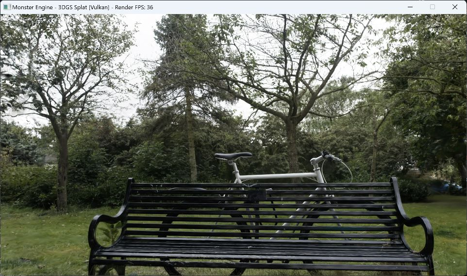

# 3DGS渲染性能优化：Raster共享内存批处理

> 更新：2026-10-17（Asia/Shanghai）。Spec-forge批次：`20261016-230853-kr4g`。当前结论：按用户简化验证范围，开发、必要正确性检查、唯一一组Bicycle性能对比及图像差异调查完成，限定范围回归PASS；独立review APPROVE。保留原Raster默认0，共享batch64通过开关启用。独立证据核验PASS，spec-forge流程COMPLETE；按约定范围完成闭环。

## 1. 需求确认、范围与结论

本轮落实P01第一轮：保留原Raster；新增最多64个Gaussian一批的共享内存路径；保持16×16工作组、排序、FP32属性、透明度阈值和混合顺序。重点处理完成线程、边缘线程与barrier，避免非法退出、未初始化读取和提前覆盖共享槽。没有调整排序、精度、阈值、批次大小或其它渲染算法。

按用户最新要求，验证采用必要功能检查与一组同场景性能对比；发现问题后只修复fixture并补一次原Raster图像对照，没有重复性能配对或增加场景矩阵。唯一Bicycle 1080p配对显示Raster均值11.483→7.058ms（下降38.54%），WholeFrame GPU30.867→26.242ms（下降14.99%）。首次生产图像差异已量化；追加原路径对照与shared图像逐字节一致，同时两次原路径之间复现首次全部差异，未发现shared特有的输出回归。确切跨进程变化来源未隔离，不能承诺原路径完全确定性。

参考[总计划](D:/code/MonsterEngine/devDocument/3DGS/3DGS渲染性能优化总计划.md)与[Tight Tile Culling专题](D:/code/MonsterEngine/devDocument/3DGS/3DGS渲染性能优化_Tight_Tile_Culling.md)。需求、任务与各阶段证据见[spec](D:/code/MonsterEngine/specs/20261016-230853-kr4g/spec.md)、[任务清单](D:/code/MonsterEngine/specs/20261016-230853-kr4g/job-manifest.json)。严格零差异工具的原始FAIL保留，不改写成PASS；当前PASS指用户要求的限定功能、实测与差异调查范围。

## 2. 接口、代码与启用方式

| 模式 | 行为 | 采用决策 |
| --- | --- | --- |
| 0 | 原逐像素读取和有序遍历路径 | 保守默认与回退 |
| 1 | 每批最多64条有序FP32属性进入共享内存 | 可切换优化路径 |

运行时JSON字段`rasterSharedMemoryMode`只接受整数0或1，省略默认0；负数、2、小数、布尔、字符串、null及超范围值均拒绝，失败解析不修改输出。程序化`FSplatRenderSettings`中不支持的值规范化为0。完整Pipeline支持0→1→0及非法值回退。开关记录进配置身份、metadata、capture身份和逐帧CSV的`raster_shared_memory_mode`列。

| 文件 | 变更 |
| --- | --- |
| [splat_render.comp](D:/code/MonsterEngine/Shaders/Splat/Render/splat_render.comp) | 原函数保留，新增renderShared与模式分发 |
| [SplatRenderPass.h](D:/code/MonsterEngine/Include/Renderer/Splat/SplatRenderPass.h) / [cpp](D:/code/MonsterEngine/Source/Renderer/Splat/SplatRenderPass.cpp) | 模式设置与push constants传递 |
| [SplatTypes.h](D:/code/MonsterEngine/Include/Renderer/Splat/SplatTypes.h) / [SplatPipeline.cpp](D:/code/MonsterEngine/Source/Renderer/Splat/SplatPipeline.cpp) | 设置字段、规范化与Pipeline传播 |
| [SplatLODBenchmark.h](D:/code/MonsterEngine/Include/Renderer/Splat/LOD/SplatLODBenchmark.h) / [cpp](D:/code/MonsterEngine/Source/Renderer/Splat/LOD/SplatLODBenchmark.cpp) | 严格JSON解析、CSV/捕获身份 |
| [SplatSceneApplication.cpp](D:/code/MonsterEngine/Source/SplatSceneApplication.cpp) | 配置应用与元数据 |
| [SplatRasterSharedTests.h](D:/code/MonsterEngine/Source/Tests/3DGSLODStreaming/SplatRasterSharedTests.h) | 真实生产SPIR-V定向GPU检查 |
| [测量工具README](D:/code/MonsterEngine/TestFile/3DGSLODStreaming/raster-shared-20261016/README.md) | 固定协议、启动器、哈希与分析器 |

主机`FRenderPushConstants`与shader一致为5个uint32，共20字节；mode位于offset16，sizeof/offsetof静态断言保证ABI。pipeline layout range与push调用均使用sizeof，旧路径也使用同一新ABI。

启用示例：在现有有效运行配置中增加`"rasterSharedMemoryMode":1`，随后执行`MonsterEngine.exe --splat-config <配置绝对路径>`；设为0或省略字段回退原路径。`FSplatRenderSettings::rasterSharedMemoryMode=1`可程序化切换，无需重新构建shader。

## 3. 共享批处理与同步设计

每个Tile仍由256个invocation处理，按已有tile range从前到后划分连续批次。前64个lane分别加载一条XY(vec2)、conic/opacity(vec4)、RGB(vec3)、原始Gaussian ID及valid。共享属性不量化，float向量均为FP32；消费者按j=0..batchCount−1的原顺序执行每像素混合。保留原gaussIdx，wireframe仍按`(gaussIdx & 255u)==0`选择，不能改用共享槽编号。

共享声明的逻辑数据量为`64×(8+16+12+4+4)+4=2820`字节，最后4字节为完成计数。vec3可能被编译器按16字节步长布局，此时相应计算为3076字节，另有实现填充；未读取最终驱动分配，不把逻辑字节数当作实测硬件占用或occupancy。

同步规则：

1. 首个barrier前只允许工作组一致的dispatch state、forceClear、空/钳制range分支返回。图像外lane只置done，禁止因像素越界单独退出。
2. lane0把图像外lane数量计入`completedPixels`。加载线程先把valid置0；仅有效范围及合法ID读取属性，尾批只消费batchCount，避免陈旧槽。
3. 加载后第一次`barrier()`发布属性及初始完成计数。完成像素停止贡献计算，仍参与协作加载及全部barrier；越界像素不读写图像。
4. 有效像素只在首次未完成→done时`atomicAdd(completedPixels,1)`。第二次barrier保证所有消费者已读完，再允许下一批覆盖，并发布完成计数。
5. 全组看到计数达到256才一致退出。下一批发布barrier必须等所有lane结束上一次计数检查，避免跨批完成更新打乱该判断。

原算术源码顺序保持如下，未通过代数展开重排FP32运算：

```glsl
float power = -0.5 * (con_o.x * d.x * d.x + con_o.z * d.y * d.y)
              - con_o.y * d.x * d.y;
if (power > 0.0) continue;
float alpha = min(0.99, con_o.w * exp(power));
if (alpha < 1.0 / 255.0) continue;
float T_next = T * (1.0 - alpha);
C += rgb * alpha * T;
T = T_next;
if (T < 0.0001) /* 本像素完成 */;
```

原路径已有透明度提前终止，不能计作本轮新增成果。`forceClear=0`保留state guard、range count钳制和非法Gaussian ID跳过；`forceClear=1`仅清理合法像素并统一返回；`forceClear=2`保留原state bypass。overflow guard保留旧图，空range清透明，混合结束的wireframe合成与RGBA8输出语义保持。

## 4. 开发、测试与修复记录

| 阶段 | 实际证据与结论 |
| --- | --- |
| 需求/拆分 | spec与job manifest确认范围；未修改用户已有无关文件 |
| 开发前基线 | [baseline report](D:/code/MonsterEngine/specs/20261016-230853-kr4g/baseline-regression-report.md)：374项通过，另legacy/control exit0；不代表新功能正确 |
| 实现与独立审查 | 两项coding任务集成；[review](D:/code/MonsterEngine/specs/20261016-230853-kr4g/review-report.md)最终APPROVE，无行动性缺陷 |
| 首次完整构建/回归 | Release全构建exit0；CPU47、GPU289、integration20、CLI9、旧Python22、新分析器6，共393项断言通过；另legacy/control exit0 |
| 首次回归发现问题 | 断言通过但新增fixture有Vulkan usage/layout错误；生产零差异分析器也FAIL，见[原始失败回归](D:/code/MonsterEngine/specs/20261016-230853-kr4g/regression-conclusion-round1.md) |
| fixture定向修复 | 补ShaderResource usage并提交初始SRV→GENERAL转换；仅改fixture设置，断言、预期数据、阈值不变，生产实现未改 |
| 修复验证 | GPU目标重建exit0；原GPU289/289再次通过；新底层日志VUID-/Validation Error/SYNC-HAZARD/UNASSIGNED-匹配均0 |
| 差异调查 | 仅追加一次mode0图像对照，结果与shared图像相同；没有第二组计时实验 |
| 当前回归判定 | 按用户简化范围PASS，沿用已验证不变的生产身份与实测；独立证据核验PASS，spec-forge全部阶段及两项coding任务通过，完成门禁未阻塞 |

定向真实GPU用例使用生产SPIR-V、20字节push ABI及17×19图像（4个含边缘lane的Tile），覆盖0/1/63/64/65/128/193条记录、range起点3、尾批、多批复用、阈值/alpha cap/positive power、部分/全部early done、非法ID、state钳制、overflow保留、forceClear及wireframe实际产生轮廓。完整Pipeline用例覆盖模式切换和非法值回退；结果为实际RGBA8 GPU读回，非CPU模型。分析器6例覆盖身份、坏采样和图像差异统计。

历史错误定位：首次`final/tests/logs/gpu-engine.log:66274`报`VUID-VkImageMemoryBarrier-oldLayout-01211`，STORAGE/TRANSFER纹理进入SHADER_READ_ONLY布局缺少SAMPLED；`:66306`报InvalidImageLayout，submit期待GENERAL。此前“无验证错误”的文字判断错误，已按原始日志纠正。修复日志为[fix-build.log](D:/code/MonsterEngine/specs/20261016-230853-kr4g/logs/fix-build.log)、[fix-gpu.log](D:/code/MonsterEngine/specs/20261016-230853-kr4g/logs/fix-gpu.log)、[底层GPU日志](D:/code/MonsterEngine/TestFile/3DGSLODStreaming/raster-shared-20261016-230853-kr4g/fix-gpu/logs/gpu-engine.log)。未宣称启用了可选同步验证。

## 5. 唯一同场景性能配对

同一新Release EXE及匹配SPIR-V，Bicycle全量A、6,131,954源/活跃Gaussian，固定相机t=0、1920×1080、SH3，tightTileCulling=2、radix blocks32、fusion/VSync关闭，IMMEDIATE present，无应用帧率上限。64M排序容量、2GiB源预算、4GiB临时预算；cacheCondition=unknown。除Raster模式外参数一致。

每条件预热3秒、采样8秒、1轮，顺序mode0→mode1；validation关闭且无capture。随后独立capture0→capture1，validation开启、settle3秒、camera0，捕获不进入计时集合。四个run均RECORDED且退出码0。实际时间2026-10-16 23:32:16–23:35:33（Asia/Shanghai），CWD为`D:/code/MonsterEngine/TestFile/3DGSLODStreaming/raster-shared-20261016-230853-kr4g/final/deployed`。渲染窗口保持restored，computer-use只读观察过窗口，未输入或重启实验。

设备NVIDIA GeForce RTX3060，driverVersion原始值2500395008，timestamp period1ns；CPU Intel64 Family6 Model167 Stepping1，RAM59,957,436,416字节。生产捕获日志无相关validation错误匹配。来源[metadata](D:/code/MonsterEngine/TestFile/3DGSLODStreaming/raster-shared-20261016-230853-kr4g/comparison/timing-mode0/metadata.json)。

| 指标/ms | 原均值 | shared均值 | 均值变化 | 原p95 | shared p95 |
| --- | ---: | ---: | ---: | ---: | ---: |
| Raster GPU | 11.4827946 | 7.0576637 | −38.5371% | 13.9114384 | 8.7411120 |
| WholeFrame GPU | 30.8670569 | 26.2415638 | −14.9852% | 33.8169264 | 28.6024000 |
| Frame interval | 31.5857358 | 27.0168392 | −14.4651% | 34.5782100 | 29.4549500 |

原/shared样本数254/296；missingGPUFrames、lateGPUSamples均0，采样行均有GPU/count且无excluded/loading/degraded/overflow。active count始终6,131,954；sort count范围分别4,349,760..4,349,767与4,349,760..4,349,768，未强称条目每帧完全一致。此范围不构成图像变化原因的证明。

变化=(mode1−mode0)/mode0；p95按`(n−1)×0.95`线性插值，median及完整统计在[原始summary](D:/code/MonsterEngine/TestFile/3DGSLODStreaming/raster-shared-20261016-230853-kr4g/comparison/comparison-summary.json)。WholeFrame是GPU硬件区间，包含重叠的Pipeline/Raster，不可相加，不含present/桌面合成延迟；frame interval是帧间隔。单次短配对不提供置信区间、多场景或跨设备收益证明。

## 6. 图像差异、原路径对照与精度边界

每张1920×1080、8,294,400字节线性RGBA8_UNORM，读取shader输出、sRGB present之前的数据。三次capture的尺寸、SH、view/projection、cameraPosition、focal、camera/selection SHA256、tight2及radix32逐项匹配；不是窗口截图比较。

| 对比 | 归一化max | 归一化mean | 变化通道 | 变化像素 |
| --- | ---: | ---: | ---: | ---: |
| 首次原0 vs shared1 | 0.00392156862745098（1/255） | 1.7867004054708301e−6 | 3779 | 3688 |
| 首次原0 vs 追加原0 | 0.00392156862745098 | 1.7867004054708303e−6 | 3779 | 3688 |
| shared1 vs 追加原0 | 0 | 0 | 0 | 0 |

| capture | frame | RGBA SHA256 |
| --- | ---: | --- |
| 首次原0 | 94 | b9e9a8fe807dc7916daa4f6fd68f3f894bc56ba30478cfadb904a8f2428a9d37 |
| 首次shared1 | 110 | c781daa788de9cf1769aebad68729cc361368f55fe9103e0657ad27663ba87ac |
| 追加原0 | 94 | c781daa788de9cf1769aebad68729cc361368f55fe9103e0657ad27663ba87ac |

追加原路径对照仅更换输出目录、未修改已部署生产EXE/shader和场景参数，`captureOnly=true`。metadata为RECORDED且capture完整；detached启动器未持久化退出码，不能声称该额外进程exit0。证据见[调查汇总](D:/code/MonsterEngine/TestFile/3DGSLODStreaming/raster-shared-20261016-230853-kr4g/fix-investigation/investigation-summary.json)及[对照配置](D:/code/MonsterEngine/TestFile/3DGSLODStreaming/raster-shared-20261016-230853-kr4g/fix-investigation/original-control.json)。

两次原路径复现全部初始差异，且追加原路径等于shared，说明首次差异不是shared特有回归的证据。确切上游/跨进程变化来源未隔离，不能特指sort count、FP32收缩或同步。原始零容差分析器FAIL/exit1完整保留；零差异是工具采用的严格门槛，用户要求报告并调查差异，没有要求零字节差异。结合原路径对照、定向GPU验证和源码审查，当前限定功能结论PASS，不把严格FAIL篡改为成功。

RGBA8逐字节相同只证明量化后输出相同；实际fixture也使用RGBA8，没有线性FP32中间值读回。代码保留FP32属性、算术表达式与顺序，但本报告不声称内部FP32逐位一致或原路径完全确定性。

## 7. 复现命令与证据身份

以下为已使用命令的复现说明，本次收尾不再执行。新实验须选择不存在的输出目录，保留原始证据。

```powershell
$project='D:/code/MonsterEngine'
$build="$project/TestFile/3DGSLODStreaming/radix-sort-20261016-162032-h8yx/candidate/build"
$tools="$project/TestFile/3DGSLODStreaming/raster-shared-20261016"
$root="$project/TestFile/3DGSLODStreaming/raster-shared-20261016-230853-kr4g"
$deploy="$root/final/deployed"
$python='C:/Users/Administrator/.cache/codex-runtimes/codex-primary-runtime/dependencies/python/python.exe'
& 'D:/software/VS2019/Common7/IDE/CommonExtensions/Microsoft/CMake/CMake/bin/cmake.exe' --build $build --config Release --parallel 4
& "$root/baseline/run-regression.ps1" -Build $build -Phase final
& $python -m unittest discover -s $tools -p test_comparison_tools.py -v
# 原实验使用 $root/comparison；复现应另选新目录
$out="$root/comparison-new"
& "$tools/run_comparison.ps1" -Executable "$deploy/MonsterEngine.exe" -ShaderDirectory "$deploy/splat-shaders" -OutputRoot $out
& $python "$tools/analyze_comparison.py" "$out/run-manifest.json" --output "$out/comparison-summary.json"
# 追加原路径对照命令（配置的output也必须先换成新目录）
& "$deploy/MonsterEngine.exe" --splat-config "$root/fix-investigation/original-control.json"
```

运行控制对照前使用相同`MONSTER_SPLAT_SHADER_DIR=$deploy/splat-shaders`和部署目录CWD。GPU定向修复实际只重建`--target SplatLODTestsGPU`并运行该入口，详细环境见[fix report](D:/code/MonsterEngine/specs/20261016-230853-kr4g/fix-report.md)。首次不带路径的cmake因PATH不存在而失败，随后用CMakeCache记录的绝对路径恢复；不是源码失败。

| 身份 | SHA256 |
| --- | --- |
| MonsterEngine.exe | df6cb2f66f880afc93920426cc9c812cb79a85890e1d7b838b50ca13c18366a4 |
| splat_render.spv | 187d8040bbe3c8342e04ab0551313d531059952ac2c4f84ce33e10861ff20c66 |
| camera | 777ef4ab36e45b91d49b9766f9b64e932e43f3c5ba4e51ddd5e6768ad4893fa9 |
| selection | 282f65b06dcd2915c83f4404e6ed4f949875788a7038d180f6b52746ab3d938a |
| source | 64d357cb25bd85f710f8551a18d830f8497277fbd8c5805adfd72ffe9ca78227 |
| scene manifest | 4c08c3ad1af925dd22d355bfa3d8daa415736ab0d33d00726b0c7fdaea8cbc30 |
| sequence | 2883ea25622b679871b132fbd0387d619a59422041bdf548366b3b4ff7e61f98 |

所有SPIR-V、配置、输入和raw文件哈希在[run manifest](D:/code/MonsterEngine/TestFile/3DGSLODStreaming/raster-shared-20261016-230853-kr4g/comparison/run-manifest.json)；新部署文件身份在[deployed manifest](D:/code/MonsterEngine/TestFile/3DGSLODStreaming/raster-shared-20261016-230853-kr4g/final/deployed-manifest.json)，每项命令/参数/CWD/exit见[test results](D:/code/MonsterEngine/TestFile/3DGSLODStreaming/raster-shared-20261016-230853-kr4g/final/test-results.json)。单帧frames.csv及gpu_samples/gpu_counts保留在各run目录。场景物理路径为既有Tight Tile Culling部署的`resources/3dgs_scenes/bicycle/scene.mgs`；源PLY和sequence的完整路径见[固定配置](D:/code/MonsterEngine/TestFile/3DGSLODStreaming/raster-shared-20261016/comparison-config.json)，未用历史成绩代替本轮测量。修复后独立testing/review重新核对生产EXE/Raster hash不变，因此性能数字仍对应最终生产候选。

## 8. 收益、采用与限制

收益机制是同一Tile像素复用同一批有序属性，减少重复全局读取；代价是共享内存、协作加载、两次barrier和已完成lane继续同步。实际配对Raster减少4.4251ms，WholeFrame减少4.6255ms；整帧还受其它阶段和运行噪声影响，不能把差值精确拆为纯Raster贡献。没有硬件计数器，不宣称已证明带宽/occupancy瓶颈。

本轮保留batch64作为可启用优化，默认仍为0。64仅是用户指定第一轮范围，没有证明为所有GPU最优值。Windows/Vulkan单卡、固定Bicycle短配对结果不推广为Android、跨GPU、动态漫游、多场景或长期稳定性结论；未测行覆盖率、内部FP32逐位一致性或可选同步验证。原路径跨进程图像变化已证实但具体原因未隔离，当前范围通过不意味着该独立现象已修复。

需求确认→开发→必要验证→问题修复→性能与差异报告已按用户简化范围完成；[最终回归报告](D:/code/MonsterEngine/specs/20261016-230853-kr4g/regression-conclusion.md)为PASS，首次失败与原始strict FAIL保留追溯。[独立证据核验](D:/code/MonsterEngine/specs/20261016-230853-kr4g/verification-report.md)为PASS，复核57项配对文件哈希、对照素材哈希及原始计时均值，未新增运行测试。CLI最终报告为COMPLETE，全部阶段和两项coding任务通过；未启用自动提交。
## 9. 帧率与实际窗口截图对比（2026-10-17补充）

### 9.1 同一组性能采样的平均帧率

使用第5章已完成的唯一Bicycle 1080p配对，按`平均FPS = 1000 / 平均帧间隔ms`换算，不另增性能实验。原/shared分别为254/296个有效采样帧。这里使用实际frame interval，包含该记录区间的CPU/GPU及提交节奏；不是Raster耗时或WholeFrame GPU耗时的倒数，也不是逐帧FPS的算术平均。

| 指标 | 优化前：原Raster（mode0） | 优化后：共享batch64（mode1） | 变化 |
| --- | ---: | ---: | ---: |
| 平均帧间隔 | 31.5857 ms | 27.0168 ms | −14.47% |
| 对应平均帧率 | **31.66 FPS** | **37.01 FPS** | **+16.91%** |
| 下方实际窗口截图的标题栏实时值 | **32 FPS** | **36 FPS** | 分别采集的短窗观测值 |

### 9.2 包含窗口及原生实时FPS标题栏的截图

以下两图均通过[computer-use skill](C:/Users/Administrator/.codex/plugins/cache/openai-bundled/computer-use/26.1013.31256/skills/computer-use/SKILL.md)的`@oai/sky.get_window_state`直接采集真实MonsterEngine窗口，保留完整边框、原生标题栏与渲染画面。按工具返回PNG原样保存，没有裁剪窗口、绘制FPS文字、改写标题或使用旧专题截图。原生标题更新逻辑位于[Application.cpp](D:/code/MonsterEngine/Source/Core/Application.cpp:173)：steady_clock采样达到1秒时，以`uint32(frameCount / elapsed)`更新`Render FPS`；它是约1秒短窗的整数吞吐，不能代替上表既有性能配对平均值。

两个展示进程使用同一已测Release EXE及shader、同一Bicycle全量A、固定camera t=0、1920×1080、SH3、tight2、radix32、fusion/VSync关闭，均加`--splat-no-ui`隐藏控制面板，仅Raster模式不同。元数据中的EXE、Raster SPIR-V、camera/selection/source/scene/sequence哈希已与原性能配对逐项核对一致。两张PNG均为工具输出的**962×570**，包含窗口边框；工具/DPI捕获尺度与内部**1920×1080**渲染分辨率分别记录，不能用PNG像素反推渲染分辨率。

**优化前：mode0，原Raster。** 标题栏实际可见`Monster Engine - 3DGS Splat [Vulkan] - Render FPS: 32`。保存时间为2026-10-17 09:02:46（Asia/Shanghai）；截图快照先于保存，精确快照时刻未单独记录。


**优化后：mode1，共享内存batch64。** 标题栏实际可见`Monster Engine - 3DGS Splat [Vulkan] - Render FPS: 36`。截图快照时间为2026-10-17 09:03:52（Asia/Shanghai），保存时间09:04:02。两图场景构图与可见细节保持一致；量化图像差异仍以第6章原始GPU读回为准，不从窗口截屏推导零差异。



### 9.3 采集记录与验证范围

截图展示会话位于`TestFile/3DGSLODStreaming/raster-shared-20261016-230853-kr4g/window-fps-20261017`。为留足启动与截图时间，复制配置将sampleSeconds设为300，取图后向对应窗口发送Escape结束；两份metadata因此保留`FAILED / Run ended; numeric acceptance gates require downstream evaluation`，表示未完成所配置的计时周期，不能冒称它们是新的成功性能测试。本次只用于窗口展示，不将其中任何帧追加到第5章254/296帧的性能结果，也未修改原性能/差异证据。

[截图来源与哈希清单](RasterSharedMemory/images/assets-manifest.json)记录PNG原样保存声明、可见FPS、配置/metadata路径与SHA256、身份检查及帧率换算来源；[窗口快照元数据](RasterSharedMemory/images/window-capture-metadata.json)保留工具窗口标识和时间。已目视核对两图均包含完整窗口、原生实时FPS标题栏和同一Bicycle画面，并核对引用文件存在。此次仅补文档及展示资产，未修改渲染代码、重新构建或扩大测试范围；先前spec-forge核验不冒称覆盖本次新增素材。