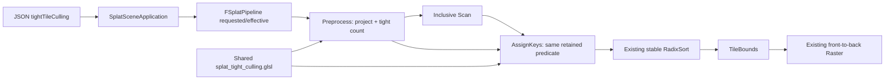
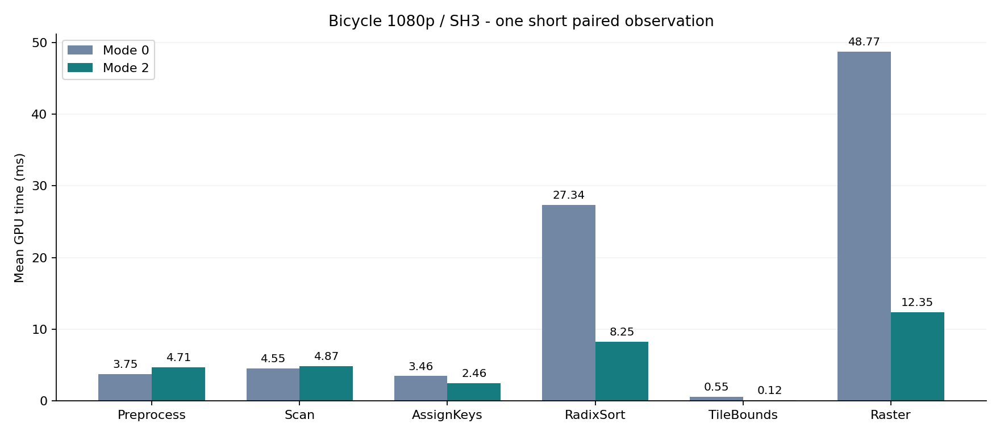
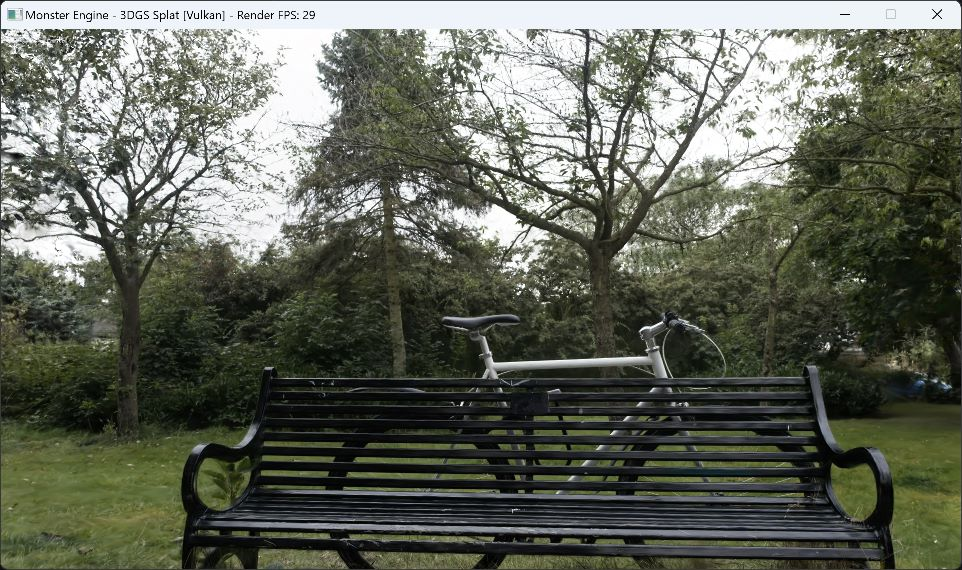
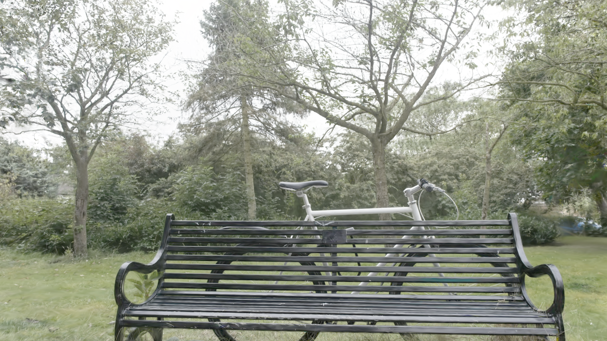
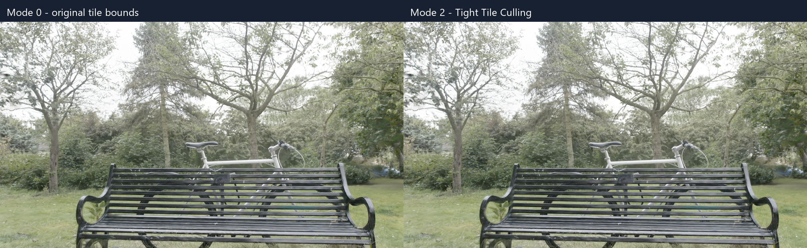
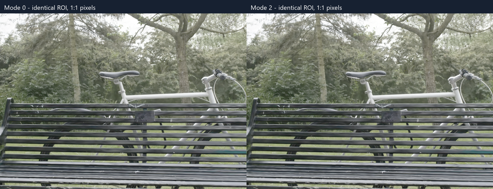

# 3DGS渲染性能优化：Tight Tile Culling

> 更新日期：2026-10-16（Asia/Shanghai）。Spec-forge批次：`20261016-121615-6ib0`。当前状态：Tight Tile Culling已实现，137项回归通过；按用户最新要求完成一组Bicycle短配对及固定图像比较。原严格重复性能协议推迟，默认模式0。实际结果与范围以第10–16章为准；独立最终证据核验PASS，spec-forge流程COMPLETE。

## 1. 目标、范围与闭环

本轮目标是保守地减少无效Gaussian–tile条目，从而降低AssignKeys、排序与Raster的工作量，并建立可复现的工程案例。移动端是后续目标；本轮只完成Windows/Vulkan上的Tight Tile Culling闭环，不包含Android移植、属性压缩和Raster共享内存批处理的实现。

闭环按“需求→计划→当前基线→开发→测试→性能对比→性能决策→验收”推进。完整需求与验收门槛见[spec.md](D:/code/MonsterEngine/specs/20261016-121615-6ib0/spec.md)，文件归属与依赖见[job-manifest.json](D:/code/MonsterEngine/specs/20261016-121615-6ib0/job-manifest.json)。各阶段必须引用本轮原始证据，不能将历史测试总数或历史性能当作本轮结果；失败、阻塞与负收益均保留。

已有同帧GPU计数、间接执行、时间戳、异步上传、安全回收、SSE、迟滞、预算回退，以及排序直方图偏移预计算和安全跳过恒零高字节。这些是本轮复用的能力。历史2208帧RTX 3060/1080p数据只用于选择优化方向，不是本轮性能基线。

## 2. 需求与采用门槛

1. 保留同版本旧路径；默认模式0。新模式不修改FP32属性、深度键与稳定排序、LOD和流式语义。
2. 新候选tile集合必须是旧候选集合的子集。旧路径存在任一有效像素贡献的tile，不允许被剔除。
3. Count与Emit使用完全一致的判定、输入、图像范围和数值裕量；Scan总量必须等于已初始化条目数。空帧、活动索引变化、容量与间接执行均需正确。
4. 原始线性图像的最大绝对色差不超过`1e-6`，同时逐像素oracle零假阴性；图像误差阈值不能代替oracle。
5. 性能采用以整帧GPU重复配对实测为依据：收益超过观察到的运行噪声，p95没有实质退化，配置与选择匹配。条目下降不能独立证明加速，也没有预先承诺25%的收益。
6. 无收益时保留模式0默认，性能验收标记未通过；不能将代码写完称作整个功能闭环完成。

## 3. 算法与正确性推导

### 3.1 旧路径的实际支持域

`Shaders/Splat/splat_preprocess.comp`按屏幕协方差最大特征值计算统一3σ半径，再转换成tile矩形；`Shaders/Splat/Sort/splat_assign_keys.comp`为矩形内每个tile发射条目。`Shaders/Splat/Render/splat_render.comp`在整数`vec2(pixel)`采样，并计算：

```text
Q = a*dx*dx + 2*b*dx*dy + c*dy*dy
power = -Q/2
alpha = min(0.99, opacity*exp(power))
skip if power > 0 or alpha < 1/255
```

这里`(a,b,c)`是二维协方差逆矩阵的conic参数。等于`1/255`仍贡献；旧Raster没有额外逐像素3σ裁剪。因此不能把新椭圆直接截断到3σ，更不能扩大旧候选集合。最终候选始终与旧tile矩形相交。

### 3.2 透明度感知矩形

令`tau=1/255`。对于有限、正定、数值可靠的conic与正opacity，有效alpha支持满足：

```text
Q <= L, L = 2*ln(opacity/tau)
D = a*c - b*b
extentX = sqrt(L*c/D)
extentY = sqrt(L*a/D)
```

这给出椭圆轴对齐包围。转换为tile时必须保守包含整数像素，并覆盖浮点误差与相切边界；不能直接照搬以像素中心加0.5为采样约定的公式。低于阈值的情况也必须考虑FP32舍入，等于阈值不能按空集合处理。具体裕量和退化条件以共享GLSL实现与测试为准，不能仅凭实数推导宣布GPU正确。

### 3.3 Tile二次型最小值

对候选tile形成有效整数像素矩形，右/下边缘按实际图像尺寸裁剪。用该矩形的连续包围计算`Qmin`是保守的：连续域包含所有整数采样点，连续最小值不大于离散最小值。

正定情况下，若椭圆中心在矩形内则最小值为0；否则检查四条边各自的一维二次函数最小值。固定`x`时最优`y=clamp(-b*x/c,yMin,yMax)`；固定`y`时最优`x=clamp(-b*y/a,xMin,xMax)`，其中坐标相对Gaussian中心。只有可靠地证明整个tile的贡献小于阈值才能剔除。只测试中心或四角不保守，细长旋转椭圆可能穿过边而没有任何角落落在椭圆内。

出现非有限值、近奇异矩阵、条件数过大、范围转换不安全或判定接近数值边界时，应保留旧候选。优化增加的拒绝不能比旧路径更激进。回退不会修复旧输入数据，但避免本轮引入新孔洞。

### 3.4 Count/Emit协议

共享文件`Shaders/Splat/splat_tight_culling.glsl`由Preprocess和AssignKeys共同调用，统一矩形与tile保留逻辑。Preprocess只对保留tile计数，Scan生成偏移，AssignKeys以相同顺序对同一保留集合写入；禁止只在Emit跳过而仍按矩形面积计数，否则排序输入会有洞。主机侧模式、图像尺寸和描述符需在两个阶段保持一致，涉及布局变更的shader必须随主机重新构建。

## 4. 实现任务、接口与最终状态

| 任务 | 负责范围 | 依赖 | 当前记录 |
| --- | --- | --- | --- |
| J1-core | 共享GLSL、Preprocess、AssignKeys、主机ABI与Pipeline、CMake依赖 | 基线通过 | 已完成；共享判定、主机ABI与GPU行为验证通过 |
| J2-runtime | JSON校验、设置传递、固定相机/选择证据、线性捕获元数据 | J1-core | 已完成；严格解析、固定相机及身份元数据已运行验证 |
| J3-tools | 串行配对执行、逐帧分析、原始图像比较与身份记录 | 基线通过 | 已完成；工具测试通过，保留严格协议与短测协议的区别 |
| J4-document | 本开发文档与证据索引 | 基线通过 | 已完成；本次补全源码设计、算法、结论与真实窗口截图 |
| 项目验证 | CPU oracle、GPU读回、回归、一组短配对、图像与评审 | 全部coding通过 | 已通过；限用户确认的一组Bicycle短测范围 |

运行时JSON键`tightTileCulling`按契约为整数，默认0，非整数或范围外值必须报配置错误：

| 值 | 行为 | 定位 |
| --- | --- | --- |
| 0 | 旧3σ tile矩形 | 同版本基准与安全默认 |
| 1 | 透明度感知紧致矩形，与旧集合求交 | 区分矩形收益与成本 |
| 2 | 紧致矩形加保守tile二次型测试 | 区分进一步剔除收益与成本 |

`FSplatRenderSettings::tightTileCulling`按契约为`uint32`。所有计时配置固定`projectedFusion=false`；融合实验若不兼容，应走已知安全路径并记录原因，不允许静默忽略开关。以上接口已实现；源码位置、最终回退机制与运行证据详见第11章。

## 5. 已完成的当前版本基线

完整记录见[baseline-regression-report.md](D:/code/MonsterEngine/specs/20261016-121615-6ib0/baseline-regression-report.md)。本基线是进入开发的门槛，不能证明新增功能通过。

| 项目 | 本轮实际结果 |
| --- | --- |
| 全新VS2019 x64 Release配置/构建 | configure exit 0，build exit 0，当前源生成shader |
| CPU | 47/47，exit 0 |
| GPU | 33/33真实设备用例，exit 0 |
| Integration | 15/15，exit 0 |
| CLI | 9/9，exit 0 |
| legacy aggregate与splat controls | 均exit 0 |
| 基线前后源完整性 | 539文件，0变化 |

证据根为`TestFile/3DGSLODStreaming/tight-tile-culling-20261016/baseline`；命令、CWD与退出码在`baseline/test-results.json`，日志在`specs/20261016-121615-6ib0/logs/baseline-*.log`。完整基线不是历史部署复用。

### 5.1 当前D流式基线数据

当前基线运行的是高预算Bicycle正常D流式相机路径：1920×1080、SH3、qualityPixels=1、activeCapacity=6,131,954、sortCapacity=64,000,000、sceneGPUBytes=2 GiB、temporaryGPUBytes=4 GiB、projectedFusion=false、validation/VSync关闭。缓存条件未知。预热10秒、每轮60秒、3轮；这是本次特定配置，不能称为历史默认配置。

| 指标 | 均值 | 中位数 | p95 |
| --- | ---: | ---: | ---: |
| 整体GPU/ms | 43.4150 | 44.0023 | 61.4538 |
| Pipeline/ms | 43.2158 | 43.8090 | 61.2697 |
| Preprocess/ms | 2.0176 | 1.9344 | 2.5152 |
| Scan/ms | 1.8259 | 1.7742 | 2.2769 |
| AssignKeys/ms | 2.0963 | 2.0425 | 3.2526 |
| Radix/ms | 15.0672 | 15.1649 | 22.1150 |
| Render/ms | 21.9353 | 22.4709 | 30.8908 |
| CPU/ms（现有记录器定义） | 58.6460 | 58.5758 | 79.4322 |
| Sort entries | 10,655,216 | 10,771,654 | 15,858,112 |

3,466行中3,048个采样帧，GPU/count有效3,048，缺失均0，overflow 0，采样loading 0；其中255帧带现有degraded标记，保留并披露。三轮整体GPU均值分别43.2387、43.5201、43.4878 ms；这些是顺序流式轮次，不是独立配对A/B试验。没有固定选择等价或图像通过结论。

原始数据为`baseline/performance-D/{metadata.json,frames.csv,gpu_samples.csv,gpu_counts.csv}`，详细统计与容量在`specs/20261016-121615-6ib0/perf-baseline.json`。部署身份在`baseline/deployed-manifest.json`：

- `MonsterEngine.exe` SHA256：`78fbff98c38c60ec2602c5b9163328e06eb2cd7be9378ae75c3646cc5c9c4fce`
- `splat_preprocess.spv`：`1977cb1e386bdfd9d1f61862d3867c30066689bd33ab4974718f54661e369d70`
- `splat_assign_keys.spv`：`c503f7827d8402b6303c6bb6a9e72c2b8211fd746357c5529dfac2cbe3f8f480`

首次性能尝试因原资源pages junction指向场景目录之外而被加载器拒绝，日志为`*junction-failed*`，没有放宽加载器安全检查。通过运行使用CMake输出的物理复制场景`baseline/build/bin/Release/resources/3dgs_scenes/bicycle/scene.mgs`，manifest SHA256与原场景同为`4c08c3ad1af925dd22d355bfa3d8daa415736ab0d33d00726b0c7fdaea8cbc30`；路径纠正记录在`baseline/asset-path-resolution.json`。后续应使用此物理副本或经过验证的包含式pages路径。

## 6. 构建与复现

以下基线命令已执行，工作目录为`D:/code/MonsterEngine`。后续可在同一build树增量编译，但候选部署必须另建目录，不能覆盖基线原始文件与部署。

```powershell
$cmake='D:/software/VS2019/Common7/IDE/CommonExtensions/Microsoft/CMake/CMake/bin/cmake.exe'
$root='D:/code/MonsterEngine/TestFile/3DGSLODStreaming/tight-tile-culling-20261016/baseline'
& $cmake -S . -B "$root/build" -G 'Visual Studio 16 2019' -A x64 '-DCMAKE_GENERATOR_INSTANCE=D:/software/VS2019' -DSPLAT_BUILD_CPU_TESTS=ON -DSPLAT_BUILD_GPU_TESTS=ON -DSPLAT_BUILD_INTEGRATION_TESTS=ON '-DMONSTER_GLSLC=C:/VulkanSDK/1.3.296.0/Bin/glslc.exe' '-DSPLAT_GLSLC=C:/VulkanSDK/1.3.296.0/Bin/glslc.exe'
& $cmake --build "$root/build" --config Release --target MonsterEngine SplatLODBuilder SplatShaders SplatLODTestsCPU SplatLODTestsGPU SplatLODTestsIntegration --parallel 4
```

既有测试入口为`SplatLODTestsCPU.exe`、`SplatLODTestsGPU.exe`、`SplatLODTestsIntegration.exe`、`MonsterEngine.exe --test-all`、`MonsterEngine.exe --test-splat-controls`与`baseline/run-cli.ps1`。实际运行必须保留基线报告中的shader目录、测试artifact环境变量、CWD及控制测试fixture；不要从任意目录直接运行而忽略部署依赖。

实际基线性能入口如下；其CWD为`$root/deployed`：

```powershell
$env:MONSTER_SPLAT_SHADER_DIR="$root/deployed/splat-shaders"
& "$root/deployed/MonsterEngine.exe" --splat-config "$root/performance-D.json"
```

新A/B工具目录为`TestFile/3DGSLODStreaming/tight-tile-culling-20261016`，计划入口为`run_comparison.ps1`、`analyze_comparison.py`和`compare_linear_images.py`。正式参数以交付的README与tools-contract为准；验证阶段将本次真实命令、输出目录和退出码追加到本节，不能将尚未运行的示例当作成功记录。

## 7. 测试与性能实验设计

### 7.1 正确性

CPU oracle逐个检查旧候选tile的全部有效整数像素，按实际alpha语义寻找有效贡献；新路径不允许删除任何存在贡献的tile。覆盖阈值下/等于/上、零与负opacity、相关旋转细长椭圆、病态矩阵、NaN/Inf、屏外与分数中心、相切边、部分tile、1×1和非16倍数图像尺寸及随机输入。

GPU真实读回需验证共享判定、计数前缀、完整初始化键值、零帧与跨帧旧bbox清除、活动索引变化、容量边界和间接计数。相同深度与稳定顺序不能改变。不能用源码字符串检查替代真实GPU行为。

固定相机图像实验先等待驻留并核验选择索引/计数身份，再比较模式0/1/2。保存原始线性数组、分辨率、相机、场景、配置及EXE/shader身份。最大绝对色差≤`1e-6`且无可见孔洞；出现非零差异必须解释，不能通过均值、改LOD或改预算掩盖。

### 7.2 原始严格计时设计（本次按第10章缩减）

用同一个新Release EXE与匹配shader，串行运行模式0与1/2，每个候选至少三组配对。每次至少10秒预热、60秒采样、3轮，validation/VSync关闭；正确性运行单独启用validation。记录配对顺序和设备状态，避免其他GPU工作竞争。

先测相同固定相机、完全相同的已驻留选择，隔离算法成本；再测正常D流式相机路径。启动时设置freeze不能单独证明输入一致。配置除了模式与输出目录应一致，实际相机、选择标识和容量也必须核对。

每组报告整体GPU与Preprocess/Scan/AssignKeys/Radix/Render均值、中位数、p95，排序条目、CPU、内存/容量、overflow以及缺失/无效/降级样本。保留原始CSV，不静默丢弃失败帧。缺少身份、选择不匹配、误剔除、overflow或图像超阈值阻止采用。

分析必须给出逐配对收益与重复运行波动，而非只汇总全部帧。p95“实质退化”的判定与噪声策略须在分析报告中明确；最终默认模式只能依据实测决定。若模式2剔除更多却比模式1慢，应如实保留并选择更合适的路径。

## 8. 最终验收证据矩阵

| AC | 实际结果 | 证据与范围 |
| --- | --- | --- |
| AC1 文档闭环 | PASS | 本文记录需求、设计、实现、测试、实测、失败与范围 |
| AC2 开关与兼容 | PASS | 0/1/2配置与GPU测试，默认0；fusion显式回退 |
| AC3 零误剔除 | PASS（已测输入） | 2040 fixtures、96216 tiles，0假阴性 |
| AC4 Count/Emit | PASS | 18个生产链路用例；无洞、无重复、尾部哨兵正常 |
| AC5 构建回归 | PASS | 137项通过，legacy/control均exit0 |
| AC6 图像 | PASS（RGBA8表示） | Bicycle固定相机原始RGBA逐字节一致；未测量化前FP32 |
| AC7 性能实验 | PASS（用户缩减范围） | 一组Bicycle短配对；原三组重复与优化后D漫游未执行 |
| AC8 采用决策 | 保留默认0 | 观察到短测收益；重复噪声与长期默认采用未验收 |
| AC9 独立核验 | PASS | review APPROVE；653项既有证据哈希匹配 |

spec-forge状态COMPLETE对应用户最后确认的一组短测闭环，不表示Android、长时间压力或原严格重复性能采用门槛通过。后续文档与截图整理没有重新运行该流水线；新增素材另有来源与哈希记录。

## 9. 面试解释与后续路线

本专题可以按“瓶颈证据→数学支持域→保守离散化→GPU Count/Scan/Scatter协议→真实测量→采用决策”解释。重点说明协方差如何变成conic、为何阈值支持域未必等于3σ、为何四角判定会漏、为何FP32边界需要保守裕量，以及为何减少条目仍可能因为两遍判定和分支成本而变慢。完整保留失败实验比只展示收益百分比更有解释力。

后续任务按依赖推进，均尚未在本批次实现或验收：

1. Raster共享内存批处理：复用同tile高斯属性，比较批次、寄存器、共享内存与占用率；完成像素仍须正确参与barrier，不能随意return。
2. 常驻数据与投影数据压缩：分别解决装得下与读得快。评估SH/属性FP16、颜色打包及conic精度；降低显示SH degree不自动缩小常驻Buffer。
3. Android最小链路：在首个专题后尽早验证目标设备Vulkan能力、排序整数键、shader资源与时间戳；小场景完整渲染和图像对照后接入流式。起步规模和分辨率由实机预算决定，不能用桌面收益预测Adreno。
4. 按实机证据优化Radix/Scan、LOD质量成本、持续运行温控与内存预算，再研究Mip滤波、Hardware Raster或Sort-Free对照。

### 运行契约补充（coding阶段）

已协调的runtime字段为`benchmarkFixedCameraSeconds`（>=0表示固定相机时刻，-1表示移动路径）与`benchmarkFreezeSelection`（仅驻留就绪后冻结）。metadata记录`selectionSHA256`、`cameraSHA256`、`selectionSettled`；捕获JSON也应记录`selectionSHA256`。这些字段已实现并在本轮运行记录中核对。

现有捕获导出是线性RGBA8的`.rgba`，不是未量化FP32颜色。归一化最大色差≤`1e-6`在8位数据上等价于逐字节一致，可证明导出图像一致，不能证明量化前浮点颜色误差≤`1e-6`。因此图像报告必须披露精度，零误剔除另由CPU/GPU逐像素oracle证明；若验收解释要求未量化颜色误差，需另行增加对应捕获证据后才可通过，不能用RGBA8冒充浮点证据。

当`projectedFusion`开启时，约定effective culling回退为0以保留实验ABI，并在metadata分别记录requested/effective模式与回退原因；常规A/B固定`projectedFusion=false`。实际字段与回退条件见第11章；core/runtime合同保留为实现依据。

## 10. 本轮实际交付与用户缩减后的验收（最终回归）

用户后续明确要求“简单测试即可，只需要测试一组即可，使用bicycle模型，尽量节省时间”。因此本次按一组短测试交付，原三组独立配对、190秒/条件、模式1诊断、D流式与移动端/温控实验均由用户缩减范围而未执行。本次不能宣称原严格性能采用门槛通过；生产analyzer的长采样规则保持原样。默认模式继续为0。

实现已完成：J1共享保守GLSL与Count/Emit一致性、J2严格0/1/2开关及固定相机/就绪后冻结身份、J3串行对比与证据工具、J4开发文档。Preprocess push range48字节/mode offset32，Assign push range32字节/mode offset16、width20、height24，新增bindings7/8读取conicOpacity/pointsXY。mode0不计算新判定；fusion请求1/2显式回退effective0，受控实验关闭fusion。支持域失败时保留旧候选；数值裕量见core-contract与共享shader。

### 10.1 已执行回归与正确性

最终Release增量构建exit0；CPU47/47、GPU55/55、Integration15/15、CLI9/9、Python11/11，共137项全部通过；legacy及controls聚合入口均exit0。这些是本轮实际运行，完整命令入口`specs/20261016-121615-6ib0/run-final-regression.ps1`，逐项退出码`final-regression/test-results.json`，日志`specs/20261016-121615-6ib0/logs/final-*.log`。

真实GLSL oracle2040 fixtures、96216 tiles、4665有效贡献tiles、57696剔除tiles，零假阴性。18个实际Preprocess/Scan/Emit尾部/模式用例无洞、无越界；257源样本mode0/1/2分别1054/1038/1037条目。full indirect mode0/1/2合成线性RGBA8一致、空帧清理及fusion显式回退通过。独立评审APPROVE，0 critical/high、1 medium顶层分析器行为测试覆盖建议；未阻止本次短实验。

### 10.2 一组Bicycle短配对的实际结果

入口：`pwsh -NoProfile -File specs/20261016-121615-6ib0/run-final-quick.ps1`，随后`D:/software/miniconda310/python.exe specs/20261016-121615-6ib0/summarize-final-quick.py`。四次顺序启动同一新部署（计时0、计时2、质量0、质量2），均exit0。每种模式一个验证开启的固定时刻0图像，计时关闭validation/VSync。固定A全量驻留6,131,954高斯、1920×1080、SH3、sort64M、scene2GiB/temp4GiB，fusion关闭；functionalSmoke=true，3秒预热、8秒采样、1轮。源数据加载耗时不包含在GPU均值中。

| 指标 | 模式0 | 模式2 |
| --- | ---: | ---: |
| 整体GPU（均值/中位数/p95） | 88.6665 / 87.2580 / 97.5694 | 32.9811 / 32.5650 / 36.7412 |
| Preprocess（均值/中位数/p95） | 3.7483 / 3.2830 / 5.3021 | 4.7073 / 4.0888 / 7.0424 |
| Scan（均值/中位数/p95） | 4.5546 / 4.0678 / 5.9637 | 4.8731 / 4.2277 / 6.5139 |
| AssignKeys（均值/中位数/p95） | 3.4591 / 2.8462 / 6.3776 | 2.4579 / 2.1875 / 4.7297 |
| Radix（均值/中位数/p95） | 27.3387 / 27.3041 / 30.6911 | 8.2466 / 8.1676 / 9.9174 |
| Raster（均值/中位数/p95） | 48.7693 / 47.9159 / 57.8308 | 12.3546 / 12.4967 / 15.1955 |
| CPU（均值/中位数/p95） | 89.3763 / 87.7436 / 98.6479 | 33.6205 / 33.2367 / 37.8242 |
| Frame（均值/中位数/p95） | 89.6375 / 87.9161 / 98.7559 | 33.8025 / 33.3804 / 37.9647 |
| Sort entries（均值/中位数/p95） | 16858588.0000 / 16858588.0000 / 16858588.0000 | 4349764.2236 / 4349767.0000 / 4349767.0000 |

采样数mode0=89、mode2=237；无效=0/0，overflow=0/0，loading=0/0，degraded=0/0。GPU/count原始逐帧join已检查，缺失/迟到记录均0。模式2条目范围4349760–4349767，保留实际波动；没有通过筛帧隐藏。

本次观察GPU均值下降62.80%，这是单组短样本现象，不能证明重复收益超过噪声，不用于默认启用。原未改动版本D流式43.415ms与本次A固定全量工作负载不同，不能直接计算优化收益。forge通用适配另使用本次同binary配对基准`perf-quick-paired-baseline.json`与`perf-final.json`；不是原历史D基准替换。

图像比较状态PASS，最大归一化线性RGBA8差=0.0，匹配相机/选择身份。逐字节一致表明已导出图像没有新增可见边缘差异；不等价于未量化FP32误差测量。原始`.rgba`、PPM与capture JSON均保留在`final-regression/bounded-quality-mode0`、`bounded-quality-mode2`。

### 10.3 身份、原始证据与最终决定

新部署`TestFile/3DGSLODStreaming/tight-tile-culling-20261016/final-regression/deployed`，EXE SHA256 `816f672fdabb3c3609b79f29df222f6e272e537c3e75d5ff1f27b8f41c362087`。同部署所有SPIR-V、场景/PLY/相机序列、源文件SHA256、命令、退出码与逐个原始文件SHA256在`final-regression/quick-smoke-summary.json`和`deployed-manifest.json`。关键选择hash `282f65b06dcd2915c83f4404e6ed4f949875788a7038d180f6b52746ab3d938a`；相机hash `777ef4ab36e45b91d49b9766f9b64e932e43f3c5ba4e51ddd5e6768ad4893fa9`。Preprocess SHA256 `f06dd12264949b8f3b326f35218460b76f7a76428af5ec293ac3ced21b8030b4`，AssignKeys SHA256 `477c19daadee8ded9aaa398bff4676e6ccbf9d4fc545a5cb7428929dc13b041f`。

首次本地短测试脚本将空captureTimes序列化为null，程序在GPU启动前拒绝配置exit2；原失败保留于`final-regression/quick-timing-mode0`及`quick-runs.json`。脚本改用显式JSON数组后重新执行成功，没有修改运行时实现或放宽门槛。旧baseline/deployed和历史数据未覆盖，无commit/push。

本轮用户缩减范围下：AC1文档、AC2开关、AC3 oracle、AC4计数/发射、AC5构建测试通过；AC6在可用RGBA8表示上通过（FP32量化前未测）；AC7按一组短配对完成，原重复/流式协议推迟；AC8保留0默认且不声称稳定性能采用；AC9独立review与最终证据核验均PASS。短测综合PASS，严格性能采用未验收。后续若要默认启用，恢复三组重复与噪声/p95验证；批处理、压缩、Android仍为后续路线。

forge适配命令已执行exit0：`node C:/Users/Administrator/.agents/skills/spec-forge/scripts/cli.cjs perf-compare --baseline=D:/code/MonsterEngine/specs/20261016-121615-6ib0/perf-quick-paired-baseline.json --final=D:/code/MonsterEngine/specs/20261016-121615-6ib0/perf-final.json`。日志`specs/20261016-121615-6ib0/logs/final-perf-compare.log`，通用阈值检查PASS；该检查只比较本次短测的吞吐/p99/错误率，不替代被推迟的三组噪声采用规则。人工查看导出PPM转换预览，未见新增孔洞；原始readback方向为上下翻转，模式0/2相同，本轮未修改导出方向。

### 10.4 最终证据核验与流水线完成

独立evidence-verifier核对653项哈希，覆盖当前源码、新部署EXE、19个运行SPIR-V、PLY/场景/相机、oracle证据以及四次短运行的原始文件，全部一致。两张RGBA文件均8,294,400字节且SHA256相同，相机/选择身份匹配；核对构建和137项测试日志，没有追加GPU运行。核验报告为[verification-report.md](D:/code/MonsterEngine/specs/20261016-121615-6ib0/verification-report.md)，原始完整性日志为[evidence-integrity-final.log](D:/code/MonsterEngine/specs/20261016-121615-6ib0/logs/evidence-integrity-final.log)。

spec-forge全部全局阶段、四项编码任务与最终验证已通过，调度器返回done，report状态COMPLETE；本结论限定于用户最新要求的一组Bicycle短测试。默认仍为0，长期稳定性、重复性能采用、移动端和后续优化路线未包含在本次验收。未提交或推送Git。

## 11. 源码架构与代码设计详解

### 11.1 数据流与优化位置



本轮改变的是进入排序和Raster的Gaussian–tile候选集合，不是模型本身。源高斯数量、相机、SH阶数、FP32属性、深度键和alpha合成保持现有语义。固定A路径的6131954个输入高斯在两种模式中相同；条目下降不能描述成“删除了74%的高斯”。

### 11.2 源码导航与模块职责

| 文件（相对工程根目录） | 本轮职责 |
| --- | --- |
| `Shaders/Splat/splat_tight_culling.glsl` | SplatTightSupport、安全域、紧致矩形、二次型及Tile保留判定 |
| `Shaders/Splat/splat_preprocess.comp` | 保留旧bbox计算，选择新矩形，精确统计retained，零贡献提前结束 |
| `Shaders/Splat/Sort/splat_assign_keys.comp` | 读投影中心/conic，与Count重复同一保留判定，紧凑写入key/value |
| `Include/Renderer/Splat/SplatTypes.h` | FSplatRenderSettings与48B预处理push ABI |
| `Include/Renderer/Splat/SplatSortTypes.h` | 32B Assign ABI及7/8号新输入binding |
| `Source/Renderer/Splat/SplatPass.cpp` | 预处理push与现有输出buffer的绑定 |
| `Source/Renderer/Splat/SplatSortPass.cpp` | Assign descriptor、setTightTileCulling、图像尺寸push |
| `Source/Renderer/Splat/SplatPipeline.cpp` | 有效模式统一传递、fusion兼容回退、现有GPU计数/溢出链路复用 |
| `Source/Renderer/Splat/LOD/SplatLODBenchmark.cpp` | JSON严格解析、CSV模式字段、捕获身份与元数据 |
| `Source/SplatSceneApplication.cpp` | 配置应用、固定相机、就绪冻结、相机/选择哈希及19个shader身份 |
| `cmake/SplatLODStreaming.cmake` | 将共享include登记为shader构建依赖，避免只改include却未重编SPIR-V |

同名Include头文件维护相应类的方法和状态。生产接口详见[core-contract.json](../../specs/20261016-121615-6ib0/core-contract.json)与[runtime-contract.json](../../specs/20261016-121615-6ib0/runtime-contract.json)。

### 11.3 主机与shader ABI

| 接口 | 主机range/偏移 | 含义 |
| --- | --- | --- |
| FPreprocessPushConstants | 48B，mode在32B；36B字段加12B填充 | 保留旧输入计数、near/far、scale、source索引/SH stride |
| FAssignKeysPushConstants | 32B，mode16B、width20B、height24B | imageSize必须是实际像素尺寸，不能只给ceil后的tile grid |
| Assign Set0 binding7 | vec4 conicOpacity[] | 已有投影buffer，FP32逆协方差a/b/c与opacity |
| Assign Set0 binding8 | vec2 pointsXY[] | 已有投影中心buffer，采用紧凑activeIdx索引 |
| FSplatPipelineFrameStats | requested/effective/fallback | 证明实际运行路径，不能只记录用户请求值 |

代码用sizeof与offsetof静态断言检查关键偏移。新增binding复用现有投影数据，没有新增“每Tile一条完整高斯”的常驻结构。旧buffer分配容量保留，因此本轮条目减少不自动使已预留排序临时显存下降。

### 11.4 Count与Emit的索引契约

Preprocess通过`activeIdx -> sourceIdx`读取源属性，用activeIdx写投影属性和计数。AssignKeys读取紧凑投影数据，value也写activeIdx，Raster沿用现有紧凑数据。不能在Assign的conic读取处改用sourceIdx。

```text
retained[i] = 通过共享判定的Tile数量
scan[i]     = sum(retained[0..i])       // inclusive
offset(i)   = i == 0 ? 0 : scan[i-1]
total       = activeCount == 0 ? 0 : scan[activeCount-1]
```

模式1的矩形中每Tile均保留；模式2在Count和Emit各执行一次相同Tile判定。这种两遍方式避免存储大规模候选mask，但增加重复ALU和分支，需由整体耗时证明值得。Emit沿原来的tileY/tileX顺序压紧写入，`key=(tileID<<32)|depthBits`，value为activeIdx；本轮不量化深度、不重写Radix稳定性，也不修改alpha顺序。

Count为0时Preprocess保留预清零的bbox/tilesTouched，防止Assign读取上一帧的有效矩形。既有容量预检、GPU count、间接执行和overflow安全路径继续负责越界保护。Emit自身的writeIdx容量guard不能被当成允许正常帧截断条目的验收策略；本轮实测overflow为0。

### 11.5 模式与兼容性

JSON只接受整数0/1/2；`-1、3、1.25、true、"1"、null`被配置测试拒绝。内部settings还做越界防御。Pipeline由单一effective值同时设置Preprocess与Assign，避免两阶段模式不同。

当Pipeline启用了实验projected-fusion能力时，effective固定回退0并写fallback原因，保留既有融合ABI。因而性能证据必须同时满足requested==effective且fallback为空。本轮Bicycle关闭fusion，模式0实际0，模式2实际2。

## 12. 算法实现、数值边界与复杂度

### 12.1 从协方差到透明度有效域

预处理仍计算三维协方差和投影二维协方差。设二维矩阵为Σ，其逆矩阵为`[[a,b],[b,c]]`，像素相对中心位移为d，则二次型`q=dᵀΣ⁻¹d`。由于有效阈值1/255小于alpha clamp的0.99，上界clamp不会改变有效阈值的推导：在可靠正定输入下，需要`q <= 2*ln(opacity*255)`。

若只用最大特征值统一半径，会用正方形覆盖旋转长椭圆的大片空区域；透明度较低时固定3σ还可能保留大量无贡献尾部。新路径先求有效椭圆的轴对齐矩形，再在模式2检查矩形中各Tile。

### 12.2 实际安全域与保守裕量

下面参数是本轮实现的工程保护，不是对所有硬件FP32运算的形式化误差证明；oracle只对已测输入提供证据。

| 条件或步骤 | 实际实现 |
| --- | --- |
| 有限性 | conic、opacity、中心均有限；中心绝对值不超过1048576 |
| 对角范围 | a/c在[1e-12,1e12]内，opacity>0 |
| 正定与条件保护 | det=a*c-b*b，det>1e-4*a*c，min(a,c)>=1e-4*max(a,c) |
| 原始阈值 | rawLimit=2*log(max(opacity,1/255)*255) |
| 阈值padding | limit=max(0,rawLimit)+0.001*max(1,abs(rawLimit)) |
| 轴向extent | 1.01*sqrt(limit*(c,a)/det)+1像素 |
| Tile判断padding | 0.001*max(1,a*dxMax²+c*dyMax²+2*abs(b)*dxMax*dyMax) |
| 不安全情况 | safe=false，直接保留旧矩形与候选Tile |

注意实现没有对opacity<=1/255一刀切剔除：等于阈值且中心恰在整数像素时仍可能有贡献；近阈值浮点舍入也应保留安全余量。极端不可靠输入宁可少剔除，不通过激进拒绝追求条目数。

### 12.3 整数像素、矩形取整与旧支持域交集

Tile大小固定16×16，tileRect是左上包含、右下不包含。紧致边界采用`floor((center-extent)/16)`与`floor((center+extent)/16)+1`，clamp到grid，并与旧tileRect求交。这里求交对象是旧的tile集合，而不是旧3σ浮点包围内的像素集合：旧Raster本身没有额外3σ像素clip。

对Tile(x,y)，有效整数采样范围为`[16x,min(16x+15,width-1)] × [16y,min(16y+15,height-1)]`。本轮1080p高不能被16整除，最后一行Tile真实高度只有8个像素；shader用imageHeight裁剪，避免用不存在的像素推导边界。

### 12.4 连续矩形上的凸二次型最小值

将上述整数采样的包围矩形平移到以Gaussian中心为原点的坐标。若原点在矩形内，最小值是0，保留。否则正定二次型在四条边上取最小：

```text
x=xMin/xMax: y*=clamp(-b*x/c, yMin, yMax)
y=yMin/yMax: x*=clamp(-b*y/a, xMin, xMax)
best=min(q(xMin,y*), q(xMax,y*), q(x*,yMin), q(x*,yMax))
保留条件：best <= limit + margin，或数值不可靠
```

连续矩形覆盖所有离散整数采样，连续最小值<=离散最小值，因此拒绝连续矩形与有效椭圆分离的Tile是保守方向。边上clamp包含角点，不能只测四角，更不能只用Tile中心距离判断长细旋转椭圆。

### 12.5 关键生产代码摘录

以下摘录直接取自当前源码，用来解释生产实现，不是另一套示例算法。

**支持域与数值保护（splat_tight_culling.glsl）：**

```glsl
    SplatTightSupport s;
    s.q = conicOpacity.xyz; s.limit = 0.0; s.extent = vec2(0.0); s.safe = false;
    if (any(isnan(conicOpacity)) || any(isinf(conicOpacity)) ||
        any(isnan(center)) || any(isinf(center)) || any(greaterThan(abs(center), vec2(1048576.0)))) return s;
    float a = s.q.x, b = s.q.y, c = s.q.z;
    float ac = a * c;
    float det = ac - b * b;
    // Avoid inversion and cancellation in ill-conditioned or extreme conics.
    if (a < 1e-12 || c < 1e-12 || a > 1e12 || c > 1e12 ||
        !splatFinite(ac) || !splatFinite(det) || det <= 1e-4 * ac ||
        min(a,c) < 1e-4 * max(a,c) || conicOpacity.w <= 0.0) return s;
    // Padding covers log/exp and FP32 quadratic rounding; equality is retained.
    float rawLimit = 2.0 * log(max(conicOpacity.w, 1.0 / 255.0) * 255.0);
    if (!splatFinite(rawLimit)) return s;
    s.limit = max(0.0, rawLimit) + 0.001 * max(1.0, abs(rawLimit));
    // The 1% inflation also covers inverse-determinant rounding near the
    // conditioning boundary; one extra pixel protects coordinate/tile conversion.
    s.extent = 1.01 * sqrt(s.limit * vec2(c,a) / det) + vec2(1.0);
    if (any(isnan(s.extent)) || any(isinf(s.extent))) return s;
    s.safe = true;
    return s;
}
uvec4 splatTightRect(uvec4 oldRect, vec2 center, SplatTightSupport s, uvec2 grid, uint mode) {
```

**Tile连续最小值与fail-open：**

```glsl
    if (all(lessThanEqual(lo, vec2(0.0))) && all(greaterThanEqual(hi, vec2(0.0)))) return true;
    // Convex quadratic box minimum: origin or one of four clamped edge minima.
    // Continuous box contains every valid integer pixel, including partial tiles.
    float best = min(
        splatQuadratic(vec2(lo.x, clamp(-s.q.y*lo.x/s.q.z, lo.y, hi.y)), s.q),
        splatQuadratic(vec2(hi.x, clamp(-s.q.y*hi.x/s.q.z, lo.y, hi.y)), s.q));
    best = min(best, splatQuadratic(vec2(clamp(-s.q.y*lo.y/s.q.x, lo.x, hi.x), lo.y), s.q));
    best = min(best, splatQuadratic(vec2(clamp(-s.q.y*hi.y/s.q.x, lo.x, hi.x), hi.y), s.q));
    vec2 d = max(abs(lo), abs(hi));
    float magnitude = s.q.x*d.x*d.x + s.q.z*d.y*d.y + 2.0*abs(s.q.y)*d.x*d.y;
    // Fail open on overflow/cancellation uncertainty; reject strict separation only.
    float margin = 0.001 * max(1.0, magnitude);
    return !splatFinite(best) || !splatFinite(margin) || best <= s.limit + margin;
}
#endif
```

**Preprocess先计数，Assign再以相同判定写入：**

```glsl
    uvec4 tileRect = uvec4(rectMin.x, rectMin.y, rectMax.x, rectMax.y);
    SplatTightSupport support;
    if (pc.tightTileCulling != 0u) {
        support = splatTightSupport(vec4(conic, opacities[sourceIdx]), pointImage);
        tileRect = splatTightRect(tileRect, pointImage, support, uvec2(gridX, gridY), pc.tightTileCulling);
    }
    if (tileRect.x >= tileRect.z || tileRect.y >= tileRect.w) return;
    uint retained = (tileRect.z - tileRect.x) * (tileRect.w - tileRect.y);
    if (pc.tightTileCulling == 2u) {
        retained = 0u;
        for (uint y = tileRect.y; y < tileRect.w; ++y)
            for (uint x = tileRect.x; x < tileRect.z; ++x)
                if (splatTileRetained(uvec2(x,y), pointImage, support,
                    uvec2(camera.imageWidth, camera.imageHeight), pc.tightTileCulling)) ++retained;
    }
    if (retained == 0u) return;
    bbox[idx] = tileRect;

    // Step 1.7: SH color
```

```glsl
    SplatTightSupport support;
    if (pc.tightTileCulling == 2u) {
        center = pointsXY[gaussianIdx];
        support = splatTightSupport(conicOpacity[gaussianIdx], center);
    }
    // Emit one entry per tile touched
    for (uint tileY = tileRect.y; tileY < tileRect.w; tileY++) {
        for (uint tileX = tileRect.x; tileX < tileRect.z; tileX++) {
            if (pc.tightTileCulling == 2u && !splatTileRetained(uvec2(tileX,tileY), center,
                support, uvec2(pc.imageWidth,pc.imageHeight), pc.tightTileCulling)) continue;
            // Bounds guard: drop remaining tiles instead of writing out of buffer.
            if (writeIdx >= pc.maxSortElements) return;

            uint64_t tileIndex = uint64_t(tileX) + uint64_t(tileY) * uint64_t(pc.gridX);
            uint64_t key = (tileIndex << 32u) | uint64_t(depthBits);

            sortKeys[writeIdx] = key;
            sortValues[writeIdx] = gaussianIdx;
            writeIdx++;
        }
    }
}
```

设旧候选条目E0、矩形收紧后候选E1、最终保留E2，模式0发射约O(E0)，模式2在Count和Emit中各遍历E1，外加常数次二次型测试；排序与Raster处理规模降到E2。收益依赖椭圆形状、opacity、屏幕投影和Tile内像素分布，不能只按Gaussian数量预测。

## 13. 测试实施与失败修复记录

### 13.1 分层测试与真实结果

| 层次 | 测试内容 | 实际结论 |
| --- | --- | --- |
| 数学参考 | CPU枚举每个有效整数像素，按Raster的exp/alpha判断贡献；不复用逆矩阵、log或解析box-min | 对实际GLSL探针结果检查零误剔除 |
| 真实GLSL | tight_culling_probe.comp调用生产共享include；Vulkan执行后读回 | 2040输入、96216 Tile、4665有效贡献Tile、57696移除，0假阴性 |
| 生产GPU链路 | Preprocess→inclusive scan→Assign，N=0/1/2/255/256/257，各模式组合 | 18项通过；计数尾值等于初始化条目数，无洞/重复/尾哨兵损坏 |
| source映射 | 反向活动源索引，投影缓冲以activeIdx读取，深度位核对 | 通过 |
| 各向异性源 | 257源的真实Count/Emit | 模式0/1/2条目为1054/1038/1037，验证两步确实发生剔除 |
| 完整间接管线 | 合成场景0/1/2图像、active变0的清理与计数 | RGBA8一致，空帧清理通过 |
| fusion兼容 | 请求2、实际0、fallback可见 | 通过，防止静默回退被当作优化收益 |
| JSON与基准控制 | 非法模式、冻结但无固定相机、非法固定时间 | 预期拒绝；合法组合通过 |
| 工具11项 | 图像字节差、相机/选择、raw哈希、shader identity、统计与模式回退 | 修复后11/11通过 |
| 最终原生回归 | CPU47、GPU55、Integration15、CLI9、Python11 | 共137/137；legacy与controls分别exit0 |

本专题新增测试主要位于`Source/Tests/3DGSLODStreaming/SplatTightCullingTests.h`和`Shaders/tight_culling_probe.comp`；注册在SplatLODGPUTests.cpp。137是全部本轮枚举用例数量，不能把2040个oracle输入再次加进137称作额外独立测试用例。没有测得C++/GLSL行覆盖率，不声称100%覆盖。

### 13.2 已发现并修复的问题

第一轮工具测试9/11通过，发现两个证据链缺陷：请求2实际回退0仍可能被接受；rawHashes为空仍可能被接受。fixer仅修改analyze_comparison.py，补充requested/effective及fallback核验、逐采样帧模式核验、唯一安全路径、必要原始文件清单校验。原测试未修改，修复后11/11通过，再次执行原生套件。第一轮FAIL报告与日志保留，不用第二轮PASS覆盖失败历史。

另外，原场景pages junction触发路径越界保护，改用manifest哈希一致的CMake实体副本；短测脚本曾将空captureTimes写成null，修正为JSON数组。两者都保留失败日志，没有放宽产品安全检查或修改渲染算法。顶层分析器完整manifest/统计采用路径的自动化覆盖仍有一个review MEDIUM建议，未把它解释成已完全补齐。

### 13.3 证据入口

- [测试报告](../../specs/20261016-121615-6ib0/testing-report.md)、[AC测试映射](../../specs/20261016-121615-6ib0/test-manifest.json)、[oracle实测及证据哈希](../../specs/20261016-121615-6ib0/tight-culling-oracle-report.json)。
- [独立代码审查](../../specs/20261016-121615-6ib0/review-report.md)、[最终回归结论](../../specs/20261016-121615-6ib0/regression-conclusion.md)、[独立证据核验](../../specs/20261016-121615-6ib0/verification-report.md)。
- 原始最终退出码：[test-results.json](../../TestFile/3DGSLODStreaming/tight-tile-culling-20261016/final-regression/test-results.json)。

## 14. 测试前后性能对比与收益归因

### 14.1 可比条件与指标口径

对比在同一RTX3060上、同一个Release EXE和19个匹配SPIR-V进行。固定相机t=0、1920×1080、SH3、原始Bicycle全量A、6131954源高斯、64M排序容量、2GiB源预算、4GiB临时预算。validation/VSync关闭、fusion关闭、IMMEDIATE、缓存条件unknown。每条件预热3秒，采样8秒，1轮，顺序0→2。样本数不同是每条件相同墙钟时长下吞吐不同，未通过挑选相同帧数制造收益。

`gpu_ms`为GPU WholeFrame硬件时间区间，覆盖上传到全屏/UI绘制及末尾屏障，不含队列present/桌面合成延迟。Pipeline包含子Pass，不能把WholeFrame、Pipeline和所有子Pass相加。`frame_ms`按现有帧间隔记录；`cpu_ms`是现有记录器的主机区间，可能包含等待，不能由其下降推出CPU算法同幅度加速。固定A本轮selection_ms为0，不证明LOD选择器已优化。

### 14.2 均值、p95及变化

| 指标 | 模式0均值 | 模式2均值 | 均值变化 | 模式0 p95 | 模式2 p95 |
| --- | ---: | ---: | ---: | ---: | ---: |
| WholeFrame GPU | 88.6665 | 32.9811 | -62.80% | 97.5694 | 36.7412 |
| Preprocess | 3.7483 | 4.7073 | +25.58% | 5.3021 | 7.0424 |
| Scan | 4.5546 | 4.8731 | +6.99% | 5.9637 | 6.5139 |
| AssignKeys | 3.4591 | 2.4579 | -28.94% | 6.3776 | 4.7297 |
| RadixSort | 27.3387 | 8.2466 | -69.84% | 30.6911 | 9.9174 |
| TileBounds | 0.5519 | 0.1188 | -78.48% | 1.0745 | 0.1216 |
| Raster | 48.7693 | 12.3546 | -74.67% | 57.8308 | 15.1955 |
| Pipeline | 88.4417 | 32.7752 | -62.94% | 97.3807 | 36.5560 |
| Frame interval | 89.6375 | 33.8025 | -62.29% | 98.7559 | 37.9647 |
| CPU recorder interval | 89.3763 | 33.6205 | -62.38% | 98.6479 | 37.8242 |

时间单位ms；变化=(模式2−模式0)/模式0，负值表示降低。单次短测GPU均值比值约2.69倍、时间下降62.80%；不是多轮统计置信结论。Frame均值计算的观测吞吐约11.16→29.58 FPS；这与后续真实窗口截图标题栏的瞬时/短窗Render FPS不是同一统计区间，不能相互替代。



### 14.3 条目、输入规模与显存

| 采样期指标 | 模式0 | 模式2 |
| --- | ---: | ---: |
| Sort entries均值 | 16,858,588.00 | 4,349,764.22 |
| activeCount | 6,131,954.00 | 6,131,954.00 |
| sort容量 | 64,000,000.00 | 64,000,000.00 |
| temporary_bytes峰值/B | 2,067,998,240.00 | 2,067,998,240.00 |
| resident_bytes峰值/B | 1,496,196,784.00 | 1,496,196,784.00 |
| source_backing峰值/B | 1,496,196,784.00 | 1,496,196,784.00 |
| allocator_bytes峰值/B | 3,564,195,024.00 | 3,564,195,024.00 |
| 采样帧数 | 89 | 237 |
| 无效帧 | 0 | 0 |
| loading帧 | 0 | 0 |
| degraded帧 | 0 | 0 |
| overflow帧 | 0 | 0 |

排序条目均值减少74.20%，但源activeCount在两种模式中均为6131954。预算与已分配容量相同，临时backing没有因条目减少而自动缩小。cpu_charged_bytes与staging为0仅表示该全量A路径的该遥测口径/采样期，不是CPU总内存或加载期staging峰值为0。

优化模式sort_count在4349760–4349767之间有细小逐帧波动，原始记录保留；相机/选择身份一致且RGBA8相同，本轮未进一步定位这7条波动的底层原因，不应声称逐帧候选集合完全不变。模式0固定为16858588。

### 14.4 为什么这次更快、代价是什么

Preprocess均值增加，反映支持域和Tile遍历的额外成本；Scan的元素数量仍主要取决于活跃高斯，而不是最终Tile条目，因此没有获得排序一样的下降。主要节省来自Assign输出写入、Radix读写和Raster候选遍历。Raster仍可能面对不同数量的真实贡献/early-exit，因此不能将全部收益归因于一个简单带宽公式；本轮没有DRAM/寄存器/occupancy硬件计数器，不声称已经证明具体GPU瓶颈类型。

Raster和排序均值的大幅下降解释了整体收益能覆盖新增Preprocess成本。设计代价是Count/Emit两遍解析判定、更多descriptor/push字段、数值安全回退分支。极端长椭圆、巨大投影或多数候选本来就有效的视角，额外判定可能不划算，模式0/1/2长期保留便于后续实机选择。

### 14.5 结论边界

本轮只按用户要求完成一组短配对。旧D流式基线43.415ms与此处固定全量A不是同一工作负载，不能用它与32.9811ms相减计算Tight Culling收益。本轮没有运行优化后D漫游、mode1真实Bicycle计时、重复噪声测试、手机或温控测试。生产严格analyzer仍指出短样本不满足长期协议，单独quick-smoke汇总按用户缩减范围PASS；默认依旧0。

## 15. Bicycle效果截图、真实窗口与图像一致性

### 15.1 证据分层

原始GPU读回用于数值核对，实际窗口截图用于展示标题栏、真实运行画面和实时Render FPS。二者来源不同：原始读回不包含Windows标题栏；窗口截图包含显示缩放、sRGB present、UI/窗口管理及截屏开销。窗口标题FPS只代表截图当时引擎短窗统计，不代替第14章的离线逐帧结果。

两份原始capture_000.rgba均8294400字节，SHA256同为`c781daa788de9cf1769aebad68729cc361368f55fe9103e0657ad27663ba87ac`，全部RGBA通道逐字节一致，changedChannels=0，归一化最大绝对差=0。图像验证开启validation，与计时分开运行；两份相机/选择hash一致。

### 15.2 包含标题栏实时FPS的实际窗口截图

以下为Computer Use从实际MonsterEngine窗口直接采集的截图，包含原生标题栏。标题内`Render FPS`由现有Application实时更新：`Source/Core/Application.cpp`在steady_clock采样时长达到1秒后计算`uint32(frameCount/elapsed)`，再调用setTitle；因此这是约1秒窗口的整数吞吐，不是GPU计时倒数。未后期绘制FPS文字、修改窗口标题或裁去标题栏。截图时相机保持t=0，使用同一EXE，UI关闭。截图PNG为962×570，包含窗口栏；工具/DPI展示尺度与内部1920×1080渲染日志分开记录，不能用截图像素反推渲染分辨率。截图开销不参与此前单组性能统计。

**模式0：** 截图可见标题 `Monster Engine - 3DGS Splat [Vulkan] - Render FPS: 11`；截图保存时间 `2026-10-16 15:28:34 UTC+8`。


**模式2：** 截图可见标题 `Monster Engine - 3DGS Splat [Vulkan] - Render FPS: 29`；截图保存时间 `2026-10-16 15:30:29 UTC+8`。



实际截图可见FPS为模式0的11与模式2的29。模式2在截图附近的窗口元数据曾更新为20或30，体现实时统计与屏幕抓帧不是原子采样；文档以保存PNG中肉眼可见的29为截图值，保留元数据原值，不追选最大FPS或改图。两个会话在截屏后通过Esc正常结束；它们仅用于真实窗口展示，不追加到此前89/237个性能样本中。

### 15.3 同相机原始读回的正向展示副本

以下两张由各自原始RGBA直接生成。只对行顺序做垂直翻转，并对线性RGB使用标准sRGB显示转换；不修改几何、曝光、局部内容或原始数据。RGB PNG以已有黑背景显示，不将alpha再次混入；两模式变换完全相同。它们是render texture展示图，不冒充带窗口栏截图。






### 15.4 局部细节与差异图

固定ROI采用正向1920×1080展示空间`x=[500,1450), y=[350,1030)`，两图完全同坐标、1:1像素裁切。它不对应旧raw上下颠倒坐标；原始数值比较仍在未变换RGBA上完成。



差异图显示原始RGB绝对差×32并做同样行翻转。全黑是实际零差异，不是未成功生成。alpha也独立参与原始RGBA相等检查。归一化RGBA8一致不能证明量化前浮点值严格一致，支持域不误删另由独立oracle提供证据。


### 15.5 原始素材与新增展示素材追溯

原始读回、相机和配置位于`TestFile/3DGSLODStreaming/tight-tile-culling-20261016/final-regression/bounded-quality-mode0`及`bounded-quality-mode2`。本次展示PNG和实际窗口截图位于本文相邻的`TightTileCulling/images/`；[素材清单](TightTileCulling/images/assets-manifest.json)记录来源、转换、截图窗口标题和哈希。原始性能及截图证据未覆盖。

## 16. 使用、复现与维护说明

### 16.1 在实际新部署中启用

新部署为`TestFile/3DGSLODStreaming/tight-tile-culling-20261016/final-regression/deployed`。只编辑一份复制出的运行配置，设`tightTileCulling=2`并关闭projectedFusion，启动时明确指向该配置和配套shader目录。不要仅修改设置后运行旧portfolio包；ABI已改变，不能混用旧EXE和新SPIR-V。

```powershell
$root='D:/code/MonsterEngine/TestFile/3DGSLODStreaming/tight-tile-culling-20261016/final-regression'
$env:MONSTER_SPLAT_SHADER_DIR="$root/deployed/splat-shaders"
& "$root/deployed/MonsterEngine.exe" --splat-config "$root/bounded-timing-mode2/runtime-config.json"
```

上例复用既有输出目录，仅说明配置与部署配对；要保留证据重跑，应先复制JSON并修改output为新的目录，避免覆盖原始结果。mode0回归只改变tightTileCulling字段并保持其余输入一致。`run-final-quick.ps1`是本轮一次性运行入口，目录已存在时不应盲目重跑；长期可复用工具见README，严格测量协议与快速验证应分别记录。

### 16.2 最终交付与后续工作

本专题交付了可开关实现、共享算法、主机shader协议、CPU/GPU/工具测试、Bicycle一组短性能与图像比较、独立审查和证据核验。用户要求的真实标题栏FPS截图作为文档补充单独运行，不纳入既有单组性能样本。没有为了截图修改标题栏FPS实现或伪造数字。

后续先考虑Raster共享批处理和GPU常驻/投影压缩，再以Android真机profile决定排序内核、预算和subgroup调优；恢复重复与动态漫游验证后再考虑默认启用。新增文档/展示资产不会使旧的653项代码及运行证据核验失效，但旧核验不包含本次新增素材；本次另核对链接、原始来源、PNG尺寸、截图标题与素材哈希，不冒称又运行了137项测试。
