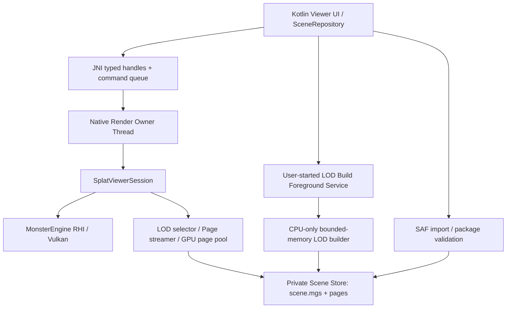

# MonsterEngine Android Vulkan Viewer 技术方案

日期：2026-10-17（北京时间）。版本：1.0。状态：需求追问已收敛，供后续AI分阶段实施；本文不是实现完成或运行验收报告。

源码依据：`D:/code/MonsterEngine`，调查时HEAD `e275df73277eb58d65e2a9fe6221ee7f707815b8`，包含用户未提交改动。参考：本地Filament HEAD `764fe6cac9bdb4ba24d3d852344dfa04a5f70f75`。不能仅用HEAD代替实施前工作区快照。

本轮已完成：grill-me/Codex入口适配、grilling安装、根目录CODE_WIKI.md与AGENTS.md生成、源码与环境调查、需求追问及本文。未完成：Android工程、SDK native工具补装、APK构建/部署、应用内Vulkan探针、模拟器渲染、手机性能验收。未修改引擎生产代码，未初始化spec-forge实现流水线。

关联文档：[Code Wiki](../../CODE_WIKI.md)、[构建入口](../../AGENTS.md)、[总计划](3DGS渲染性能优化总计划.md)、[本地环境审计](Android_Environment_Audit.md)、[Filament参考审计](Android_Filament_Reference_Audit.md)。

## 1. 用户已确认的决策与范围

| 编号 | 决策 | 后续AI必须遵守的边界 |
| --- | --- | --- |
| D01 | 保留MonsterEngine渲染内核 | Kotlin＋SurfaceView＋JNI＋单一C++渲染owner线程；Filament/Khronos为参考，不链接Filament |
| D02 | 首版为本地Viewer | 能力报告、内置小场景、PLY导入、触摸相机、画质配置、诊断导出 |
| D03 | 首版含大场景LOD/Streaming | 后续回答覆盖早先“不导入分页目录”的建议；场景总高斯数不限于10万，运行驻留仍受预算约束 |
| D04 | 首版支持手机将大PLY构建为LOD | 不得仅提供桌面预处理路线并把手机构建后置 |
| D05 | 手机构建采用有界内存分块算法 | 叶节点完整保留，代理复用现有数学语义，独立builderVersion；不要求与旧桌面代理逐字节一致 |
| D06 | 首版含后台长任务构建 | 用户启动、进度通知、取消、持久化检查点；遵守系统限额，被终止后可恢复，不承诺无限运行 |
| D07 | 分页资源可通过本地ZIP包导入 | 建议扩展名.monsterlod，手机解包到私有目录；首版不做HTTP流式 |
| D08 | Android 8/API26起，Vulkan1.2渲染门槛 | arm64-v8a真机、x86_64模拟器；Int64等实际需求不足时仍可显示/导出诊断；双uint32排序后续扩展 |
| D09 | 初始渲染预算 | 内置3万–10万高斯；最长边≤1280、像素≤921600；active≤10万、sort≤200万、temporary≤256MiB，可配置 |
| D10 | 生命周期 | 后台停止渲染，Surface重建保留场景；内存压力可释放重载；device lost每次故障事件最多自动重建一次 |
| D11 | 验收分层 | 模拟器功能与真机GPU/性能分开；目标真机30FPS、30分钟持续测试待设备确定 |
| D12 | 阶段交付 | M0–M2形成首版；M2内部必须含LOD分页、手机构建和后台恢复；M3/M4为优化与发布 |

账号、支付、云管理、网络场景、SPZ、Android GLES回退、NEON性能优化、第二图形后端和完整编辑器不进入首版。普通点云PLY不自动转成高斯。手机支持大输入不是无限大小承诺：数量/磁盘/元数据/内存上限须在UI提前可见，超限需准入拒绝。

## 2. 已核查事实与关键风险

### 2.1 MonsterEngine

| 位置/符号 | 当前事实 | 适配要求 |
| --- | --- | --- |
| CMakeLists.txt | viewer为Windows target；从vcxproj提取生产清单，链接Win64 GLFW/Vulkan .lib/OpenGL | 显式跨平台target清单，保留桌面生产覆盖，不把整个桌面清单链接进.so |
| CoreTypes.h、MonsterEnginePCH.h | 都定义平台宏，Android会命中__linux__ | 单一平台头；Android优先；审计所有#if/#ifdef |
| FRunnableThread.cpp | 使用#ifdef PLATFORM_WINDOWS；PCH可能将宏定义为0 | 改为数值判断；仅把宏置0不足以屏蔽windows.h |
| Math/VectorRegister.h | ARM分支include MonsterMathNeon.h，但仓库无该文件 | 首轮提供受控FPU回退及数学一致性验证，不取消编译器ARM宏 |
| Core/Window.cpp | WindowFactory固定GLFW | Android外部Surface宿主，不创建GLFW窗口 |
| Application::run | 阻塞poll/update/render桌面循环 | Android不能在UI线程调用run；抽取无窗口session |
| Engine.cpp | MemorySystem与Application内FMemoryManager分开初始化 | 明确两套allocator生命周期，失败路径逆序清理 |
| RHI.cpp、VulkanAPI/Utils/RHI.h | 平台includes、loader和Surface主要针对Win32/Xlib | 补Android函数表、扩展、ANativeWindow及device函数加载 |
| VulkanDevice.cpp | instance固定Vulkan1.2，逻辑设备shaderInt64固定true | Probe先行；支持项、请求项、实际启用项分别记录 |
| VulkanDevice.cpp / VulkanDevice_Swapchain.cpp | 都含交换链相关实现 | 先核实生产target实际编译项与符号，避免双定义或修改未启用片段 |
| FSplatPipeline | 已有capacity preflight、async GPU统计、completion token | 复用，维护真实submission与资源pin语义 |
| cmake/SplatLODStreaming.cmake | 已有glslc离线编译，target-env=vulkan1.2 | 复用；补Android assets复制和shader清单/哈希 |
| FSplatPLYLoader | 严格PLY解析，但LoadCPU持有全量vector | 抽出有界迭代解析；不要在render owner或UI同步加载大文件 |
| FSplatLODBuilder | 完整source＋indices/scratch＋多组Proxy临时vector | 不是移动端有界构建器；需新磁盘分块调度和可恢复工作协议 |
| FSplatSceneFormat | 二进制scene.mgs与pages/*.mgsp；manifest支持v1–5，page v1 | 复用真实格式；不要将scene.mgs当JSON；手机新builder建议写v3 |
| SplatSceneApplication::loadModel | SH FP16目前仅全量A支持，LOD/Streaming不支持该模式 | 首版分页路径使用FP32 SH，不能宣称P02自动覆盖LOD |

排序键仍为uint64_t；48位排序轮数优化不等于不需要shaderInt64。scatter声明subgroup扩展，但主体使用32位shared flags和bitCount；最终需求以离线SPIR-V capabilities/指令和真实管线创建为准，不按扩展注释硬加能力门槛。

### 2.2 本地环境

- Studio：`D:/Android/Android Studio/bin/studio64.exe`；SDK：`D:/Android/Android SDK`。
- 已有API36、Build Tools36.1.0/37.0.0、Studio JBR21；该SDK根下未见NDK/CMake/cmdline-tools，构建前需补齐。
- MuMu已运行，系统API35，宣告ABI x86_64/arm64-v8a/x86，当前页大小4096。
- 系统vkjson返回Vulkan1.3与Int64，但deviceName为Adreno640、vendorID为0x10DE；属于模拟器自报，不能计入Adreno真机证据。
- `pm list features`未列Vulkan，但vkjson可枚举；Manifest不要用required Vulkan feature提前过滤掉诊断安装。由应用内native探针裁决。
- `D:/7_Tool/rdc-cmp`是已有RDC导出分析工具；其存在不表示Android抓帧链路可用。Python3.11绑定、目标APK与捕获链路需另测。

## 3. 目标架构与模块边界



### 3.1 建议target

| target/模块 | 职责 | 禁止反向依赖 |
| --- | --- | --- |
| MonsterCore | 平台、日志、内存、容器、数学、CPU数据接口 | 不依赖Activity、GLFW或桌面editor |
| MonsterVulkan | loader/device/commands/resources/Swapchain | 不依赖Viewer UI |
| MonsterSplatRuntime | GPU管线、相机状态、LOD/Streaming与session | 不依赖ImGui和Android widget |
| SplatLODCoreCPU | 场景格式、PLY解析、proxy数学、builder；扩展现有target | 不依赖Vulkan loader/设备/GLFW |
| MonsterEngine | 原Windows可执行入口及桌面UI/样例 | 不把main.cpp带入Android |
| monster_android | JNI共享库，连接平台适配与共享内核 | 不链接Filament、Win32 .lib/OpenGL桌面库 |
| android :app | Kotlin界面、Surface、文件和服务 | 不每帧复制高斯数据到JNI |

可以先用OBJECT/STATIC库渐进拆分，统一POSITION_INDEPENDENT_CODE；target名称可依仓库风格调整，但职责与依赖边界不得合并回大而全桌面exe。先建立当前生产源清单快照，再迁移为cmake显式清单；不一次重构与Android无关的全部Engine模块。

### 3.2 共享Viewer Session

从SplatSceneApplication提取 `FSplatViewerSession`（拟新增），拥有相机、当前场景、FSplatPipeline、selector/streamer/pagePool、离屏输出与present绑定。接口建议：

```cpp
Result Initialize(IRHIDevice&, ResourceProvider&, const ViewerConfig&);
Result OpenScene(const SceneDescriptor&, SceneGeneration);
void ApplyCameraInput(const CameraInputState&);
void ApplySettings(const ViewerSettings&);
FrameResult TickAndRecord(const FrameRequest&);
void OnSubmitted(FGPUCompletionToken);
Result ResizeInternal(uint32_t width, uint32_t height);
void Suspend();
void ReleaseScene();
void Shutdown();
```

这组接口是目标契约，不是已有API。Android和Windows均调用同一session。Benchmark、Win32程序哈希、ImGui、FFmpeg、桌面键鼠工厂仍在桌面壳层；相机与运行配置可序列化核心共享。不要把onRender整段复制成Android专属第二套渲染器。

### 3.3 线程与所有权

- 一个native owner线程创建/调用/销毁Engine、RHI与session。UI Choreographer只通过轻量JNI提交frameTime和有界命令；owner没有Surface时等待，不忙轮询。
- UI/Choreographer与C++ owner之间只保留一个待执行帧token，合并过期token；配置和MOVE合并，DOWN/UP/CANCEL保序。不要再启动HandlerThread帧循环或调用Application::run。
- Filament sample-cpp-viewer使用HandlerThread＋Choreographer作为调用线程；这里只复用单owner/握手原则，所选native owner不是原样复制其线程代码。
- 构建service拥有独立CPU job线程，页面I/O另有有界worker；这些线程不能销毁GPU对象。
- JNI句柄建议registry ID＋generation，避免用失效裸指针jlong；所有入口检查状态，release幂等，C++异常在JNI边界转Result。
- 保存JavaVM，不跨线程保存JNIEnv；AssetManager/native回调需要强引用和明确销毁时点。UI回调切回主线程，避免owner等待UI同步回调产生死锁。
- 一个进程内只创建一个全局allocator/logging runtime；后台构建和Viewer以lease计数共用，Activity关闭不能释放仍被service使用的全局设施。

## 4. Android平台基础与构建

### 4.1 平台适配

新增统一Platform.h（位置按Core风格定），先__ANDROID__再Windows/Linux；各PLATFORM_*统一数值0/1，清理#ifdef误用。PCH只包含该头。审计线程命名、文件大小、时间、路径、console/debug输出、page size与huge pages。

ARM首版显式使用现有FPU后端；公开数学API需用Clang/ARM64实编验证，缺失函数补齐，不能只增加一个include开关就宣布兼容。NEON另行优化。内存分配保持16/32字节对齐要求；OS页大小用sysconf获取，allocator内部分桶64KiB不是OS页大小，两者不可混淆。Android默认不请求huge pages。

### 4.2 工具链固定

M0建议验证以下**候选组合**，通过clean build后写入version catalog/wrapper/ndkVersion/cmake version和依赖锁；本轮没有安装或构建确认，不称其已可用：

| 项目 | 候选 | 说明 |
| --- | --- | --- |
| AGP / Gradle | 8.13.2 / 8.13 | 官方8.13兼容表；不追随latest浮动 |
| Kotlin | 2.3.10 | 官方KGP兼容表覆盖AGP8.13.2/Gradle8.13；M0仍需确认依赖解析 |
| SDK | compile/target36，min26 | API级别不代表设备Vulkan1.2已满足 |
| Java | Studio JBR21运行Gradle，Java/Kotlin字节码17 | 固定Gradle JVM；核实兼容，必要时单独配置JDK17 |
| NDK | 30.0.16248370 | 本次官方LTS页面与本地Filament对应值；M0验证C++20/libc++与shader工具 |
| CMake | 3.22.1 | 满足仓库≥3.20；若所需特性不满足再固定更高版本 |
| Build Tools | 35.0.0或已装且验证通过的36.1.0 | 候选，不使用37仅因本地存在；记录最终选择 |
| ABI | arm64-v8a、x86_64 | 真机/模拟器分别出包，首版不支持32位 |

工具安装、许可证与网络镜像使用显式本地配置，不提交绝对SDK路径。Gradle wrapper连同校验和提交；不依赖全局Gradle。NDK头文件/Clang用于Android；桌面Vulkan SDK只作为host Shader工具来源之一。

采用单一libc++策略；建议JNI shared链接c++_shared并确认APK内仅一份匹配版本。调试版、可profile版、正式版分开；正式版不强依赖validation layer。Vulkan loader使用系统libvulkan.so，采用现有函数表加载机制并完整审计直接vk*调用；避免混用互不兼容的loader规则。

### 4.3 Shader与assets

复用SplatShaders离线构建，显式host glslc，不能在Android交叉编译target中误把host工具当ARM程序执行。保存include依赖，补充projection color/SH等间接include，保证增量重编正确。对最终SPV运行spirv-val及capabilities/local-size/shared-memory审计，生成shader-manifest.json。

assets包含SPV、默认配置和可合法分发的小场景；ResourceProvider提供字节读取与配置定位，或将校验后的SPV原子解压到版本化私有缓存以复用文件读取。不能依赖桌面环境变量/生成绝对目录；不在手机运行glslc/dxc。

NDK r28+默认16KiB ELF对齐，仍要检查全部.so、APK ZIP对齐以及真实16KiB环境；MuMu当前4KiB只覆盖4KiB运行。AAB打包验证属于M4，不用APK可安装代替发布产物验证。

## 5. Vulkan能力探针与支持判定

### 5.1 分层探针

探针不能调用强制shaderInt64的完整viewer设备初始化后才开始报告。独立最小native probe：

1. Android设备/ABI/OS/page size、app/source身份；捕获.so载入失败，让Kotlin也能导出部分诊断。
2. 加载Vulkan，用vkGetInstanceProcAddr(nullptr, "vkEnumerateInstanceVersion")取得可选函数；不存在按loader1.0处理。低于1.2可保留部分诊断后正常结束，但标记未完成设备探测，不能调用尚不可用的核心features2入口。
3. 枚举instance extensions/layers，创建所需最小instance；枚举所有physical devices，不默认第一块就是目标。逐设备检查properties.apiVersion≥1.2；loader版本足够不代表设备版本足够。
4. 获取properties2/features2/内存/queues/formats；以零初始化结构建立合法pNext链，只查询声明支持的结构。
5. Surface可用后创建VK_KHR_surface＋VK_KHR_android_surface表面，检查present、formats、modes及usage；无Surface时报告surfaceProbe=pending。
6. 通过需求清单选择graphics＋compute＋present；首版优先同队列族，分离队列族仅在已正确处理ownership时启用，否则明确拒绝该组合。
7. 按已查询支持项创建逻辑设备，运行小buffer/compute/present smoke；“查询成功”和“管线实际执行成功”分别记录。

### 5.2 必要/可选能力

| 项目 | 首版判断 |
| --- | --- |
| Vulkan1.2＋Android Surface/Swapchain | 渲染必要；不存在则App进入诊断模式 |
| shaderInt64 | 现有排序必要，必须先查再启用；不需要shaderBufferInt64Atomics便不启用 |
| Compute limits | 匹配实际256线程工作组、Raster16×16、各轴与共享容量 |
| Buffer/descriptor | 每个真实buffer range、单stage与set数量、push constants、alignment和dispatch上限逐项匹配 |
| rgba8离屏输出 | R8G8B8A8_UNORM的storage＋sampled实际format feature；不假设swapchain支持storage |
| subgroup | 按实际SPV需求判定，报告大小和operation；不把32位bin flag分块当硬件subgroup32假设 |
| timestamps | optional；queue validBits、period、availability验证，不能将CPU耗时伪装为GPU区间 |
| memory budget | optional；有扩展时读heap budget，无则标记unavailable并用保守配置 |
| FP16 arithmetic/storage | 首版FP32默认；packed half存储不必然需要这些feature，按SPV审计 |

设备支持不按营销名称白名单决定。驱动workaround有精确vendor/device/driver范围、原因、回归证据和可撤销配置。

### 5.3 报告协议

建议schemaVersion=1，至少包括：app版本/commit/worktree快照、APK/so/SPV/config hash；ABI/translation/emulator标记；loader/instance/device API；vendorID/deviceID/deviceName/driver信息；queues/features/limits/formats；required/supported/requested/enabled差异；surface检查；smoke结果；每个失败阶段与VkResult；timing/memoryBudget的available字段。

不得只输出单个supported=true。建议状态：diagnosticsOnly / renderEligible / graphicsSmokePassed / splatSmokePassed / streamingPassed。系统vkjson是辅助证据，app原生查询才是运行配置依据。报告不包含原始模型、用户文件名或绝对私有路径，默认以内容hash和内部scene ID定位。

## 6. Surface、Swapchain与错误状态机

渲染条件为 resumed && surfaceReady && extentNonzero && engineReady && sceneReady && !fatalError。pause、detach、scene release、device lost是不同事件。

```text
Uninitialized -> Diagnostics -> ReadyNoSurface -> SurfaceReady -> Rendering
Rendering -> Paused / ReadyNoSurface / Reconfiguring
AnyDeviceState -> DeviceLost -> Recovering(最多一次) -> ReadyNoSurface 或 Error
AnyState -> ShuttingDown -> Destroyed
```

### 6.1 Surface generation与销毁握手

- attach：ANativeWindow_fromSurface取得一份引用，绑定surfaceGeneration；owner检查本代有效并标记windowInUse必须在同一个共享锁/原子协议中完成，再锁外创建surface/swapchain。UI invalidation与owner开始使用之间不能留check-then-use竞态。
- resize：合并同代事件，0尺寸暂停；查capabilities并clamp extent，维护Surface大小、viewport、internal render大小三个概念。
- detach：UI先使本代不可再attach，停帧token；高优先消息到owner，停止acquire/submit，完成GPU及presentation相关慢路径，销毁framebuffer/view/swapchain/surface，release window后回执。
- `surfaceDestroyed`返回前必须保证旧窗口不再被后端使用。仅排队post detach不满足契约；持有window引用也不等于可继续渲染已销毁Surface。
- 队列优先detach/quit/control，解析、哈希、压缩、整批上传不占owner长任务。正常帧不能waitIdle；detach/重建可先用审计过的慢路径，避免错误地把普通submit fence当作presentation全部完成。
- acquire使用有限timeout，VK_TIMEOUT/VK_NOT_READY作为无提交跳帧并回到控制队列；高优先detach不能打断已经进入无限等待的vkAcquireNextImageKHR，不能照搬无限timeout。其他可能阻塞的fence/driver等待亦需诊断和明确退出路径。
- 等待期间不持有owner需要的锁；owner不等待UI同步回调。超时不能直接返回并让旧GPU工作继续。驱动永久卡死应进入诊断故障路径，记录ANR/终止风险，不承诺所有驱动故障均可进程内恢复。

### 6.2 呈现与帧同步

将当前void present封装成可观测FrameSubmitResult（可渐进添加接口），区分未提交、成功提交、present结果和completion token。只有真实新submission token能传入pipeline/pagePool::MarkFrameSubmitted。

首轮离屏rgba8 Compute输出→graphics fullscreen pass→swapchain，使用合法barrier/layout，核对色彩空间，避免重复sRGB转换。不直接对swapchain storage写入。acquire OUT_OF_DATE跳帧重建；SUBOPTIMAL合并重建；SURFACE_LOST要求重建Surface；DEVICE_LOST进入恢复。

按frame slot管理command pool、UBO、descriptor、acquire semaphore、submit fence和读回；等当前slot实际完成后才能重用。present等待的renderFinished binary semaphore优先按swapchain image index管理，其复用必须有presentation已消费的依据，不能只看普通submit fence。具体销毁/重建策略按Khronos规范及已启用特性审计。

acquire成功之后的pause/resize/cancel分支必须完成资源协议：acquire semaphore需被合法消费或经已证明安全的退出路径回收，不能直接丢弃并下帧重用；acquired image需受控submit/present，或按实际支持的swapchain maintenance/recreation规则归还/销毁。owner不允许在成功acquire后因普通业务取消而任意early return。提交失败不推进有效帧、不标记上传完成；不能在fence已reset但未submit时让下一帧无限等待。

presentation资源回收优先查询并启用swapchain maintenance1的present fences，按其保证回收。无该特性时，queue/deviceWaitIdle加销毁是常用兼容实践，Khronos明确指出核心API对presentation完成存在理论缺口；不能写成跨所有驱动的规范保证。正常resize可采用已验证的新旧链回收方案，但永久detach没有后续新链present，必须独立测试并记录该目标驱动的兼容限制。M0报告该能力；M1未验证关闭安全性的设备不能标为商业支持通过。详见[官方Swapchain Semaphore Reuse](https://docs.vulkan.org/guide/latest/swapchain_semaphore_reuse.html)。

场景对象先于device销毁；GPU page pin、正在上传的staging和retired Swapchain按真正完成状态释放。暂停后若未提交已record命令，应明确cancel/discard，不能伪造完成token。

## 7. 场景导入、私有资源库与输入

### 7.1 Scene Store

使用SAF选择文件，content URI通过ContentResolver有界复制，不当作filesystem路径。目录建议：files/scenes/<id>/、files/build-jobs/<id>/、cache/import/<id>/；只有校验完成并原子提交的scene出现在场景列表。

输入包括小PLY、大PLY和.monsterlod包。记录hash/大小/来源类型/导入版本；用户可取消/删除；删除时若渲染或构建持有lease，先取消并等待相应owner安全退出。完成任务只发布scene descriptor，不从worker直接切GPU场景。

### 7.2 PLY解析

复用现有属性与激活语义，支持源码已有ASCII/little/big-endian格式；提取共享HeaderProbe＋StreamRecords，LoadCPU变为其兼容collector，确保原桌面测试不退化。检查header、stride/数量乘法、短读、NaN/Inf、四元数、SH布局，保留原始行ID。

小场景可在预算内CPU加载后分块上传；大PLY明确进入“构建LOD”流程，估算磁盘/内存并让用户启动后台任务，不偷偷截断。不能把100000000条原parser硬限当手机产品支持规模。

### 7.3 .monsterlod包装

ZIP根目录建议包含新增package.json、既有scene.mgs、pages/*.mgsp及可选preview。package.json只是外层描述，不能修改二进制协议为JSON。字段：packageVersion、manifestPath、manifestHash、总解压字节、文件数、可选构建报告。

解包拒绝绝对路径、..、盘符、重复规范化路径、符号链接、不支持的压缩/加密形式；校验实际累计解压量、条目数、可用空间及取消。随后LoadManifest/ValidateManifest，验证每个引用文件的offset＋byteSize、SHA256/DecodePage。既有格式上限之外追加移动端准入，避免按manifest可允许的256MiB直接分配全部结构。

导入成功后原子rename并更新场景索引；失败清理本任务临时目录，不影响旧场景。读pages按本地独立文件/范围读取；首版不直接从ZIP随机流式解码。至少提供桌面打包工具和手机产物导出入口，避免格式只有导入没有生成方式。

### 7.4 触控和界面

首版：内置示例、导入、场景列表、构建任务页、Viewer、设置、设备报告/诊断导出。单指orbit，双指pan/pinch，重置视角；处理pointer ID、ACTION_CANCEL、旋转/多窗口和viewport缩放。手势不直接操纵GPU对象。

显示内部渲染尺寸、帧率和当前质量档；高级统计可展开，不在一般流程展示底层VkResult。设置持久化schema版本、请求值/实际值分离；预算变化可能重建pipeline，先评估峰值，不能旧/新资源同时越界。

## 8. 首版大场景LOD/Streaming

### 8.1 接入已有真实链路

以现有D动态streaming语义为主，复用FSplatSceneFormat、FSplatLODSelector、FSplatPageStreamer、FSplatGPUPagePool。不要采用全叶驻留B或全部page pinned的C模式来冒充大场景流式。旧manifest v1–5按当前解析器兼容，未启用fusion时忽略计算扩展；过大可选metadata仍计入内存准入。

每帧按当前实现顺序抽取并固化测试：取得residency→selector选择完整cut→更新wanted requests→ProtectSelection→有界Tick上传→更新实际ready snapshot与BuildActiveSet→pipeline→真实提交→MarkFrameSubmitted→完成后回收。具体调用次序以抽取后的源码回归证明，不为适配新增另一套不一致的选择器。

核心不变量：父子互斥覆盖；祖先ready兜底；子集完整ready再替换；上传/被引用页等完成后才回收；scene/residency/slot generation防ABA；CPU transferred lease在payload真正释放后归还。

### 8.2 初始配置与准入

以下是D09基础上新增的**实施起始配置**，M0/M2实测后记录有效值，不宣称适合所有手机：

| 项目 | 初始建议 |
| --- | --- |
| activeCapacity / sortCapacity | 100000 / 2000000 |
| temporaryGPUBytes | 256MiB，包含真实pipeline临时backing |
| sceneGPUBytes / stagingBytes | 128MiB / 16MiB，按实际分配及maxStorageBufferRange检查 |
| cpuCacheBytes / reads | 64MiB / 1–2线程 |
| maxUploadBytesPerFrame | 2MiB起，同时设owner CPU上传时间预算；单页允许跨帧上传 |
| qualityPixels / hysteresis | 2–4px起 / 0.2；不承诺此值满足最终画质 |
| FP32默认 | SH FP32、原Raster、radix32、fusion关闭；tight/压缩/batch64各自单变量验证 |

全局RAM是共享的；CPU缓存、builder、decoded ready、GPU backing、staging、swapchain、系统开销需统一账本，不能简单相加当“独立显存”。build与Viewer默认互斥重负载：构建时释放GPU场景或保留轻量界面；并发查看须单独预算准入。

预查根节点pinned页能完整放入source/active/sort/CPU progress预算；不能只检查文件总大小。builder应限制根代表大小；不兼容包拒绝并报告最低所需容量。source slab按字节换算实际slot数，不等同activeCapacity。

### 8.3 失败与背压

I/O重试有界；坏细页停止该分支细化并保留完整祖先，根页坏则停止打开。容量不足先保持祖先、降低desired质量/预取，不等待无期限请求。允许degraded但必须有原因/计数；不能把整帧清黑当“无缺块兜底”。

sort溢出不能越界，也不能把半排序图当正常；可保留上一张完整图并通知调度器降低复杂度，下一帧重新构造完整有效集合。内存压力先停预取/减CPU缓存/回收非pin页，仍不足释放场景。后台取消非必要请求，service构建进度不依赖Viewer继续渲染。

## 9. 手机大PLY→LOD：有界内存构建器

### 9.1 不直接搬用旧Build

旧CLI先LoadCPU全量，再Build；Construction又持有indices、scratch及递归Proxy数组。build-report里的估算已提示O(N)离线工作集。6百万×sizeof(FSplatGaussian)本身约GiB量级，再加代理足以破坏手机预算。因此新增 `FSplatStreamingLODBuilder`（暂名），复用数学和格式，重新设计I/O与任务调度。

首版不做训练/剪枝；所有原始高斯必须恰好出现一次于叶节点，originalId保持输入行号；代理不能取代叶节点保存。GPU驻留压缩和磁盘构建格式不捆绑。本地page v1每记录252B＋24B header，C++struct通常有额外padding；临时文件不能直接dump struct并假设跨ABI一致。

### 9.2 工作预算和流程

建议初始build working-memory硬预算256MiB，单job、1–2 CPU worker，所有vector/索引/缓冲/压缩和metadata都计入。先支持百万级及Bicycle约613万条作为计划验收规模，具体可运行规模由磁盘准入和真机测量决定，不承诺构建秒数。

阶段A：SAF源复制与hash→私有原始文件；以有界解析批次输出规范化中间记录，统计centers/support/SH与行数。每个chunk有schema、record count、CRC/hash和durable offset；不得把整个文件读到ByteArray/vector。ASCII恢复点保存解析器状态或回到已知record边界，不能任意seek字节。

阶段B：磁盘空间分区。任务表记录节点、父子关系、中心/支持边界、记录range/chunk和数量。对大节点流读，以center bounds中点稳定分到最多8个子文件；叶阈值建议8192，page≤8192。保持originalId和确定性分区顺序，提交子文件后才将父任务标记完成。

对中心完全相同/浮点退化导致不能继续分区的节点，按originalId稳定均分为逻辑子节点；bounds允许重叠但覆盖关系与parent唯一性保持正确。记录独立builder分区策略，不能循环产生同一大节点；依据输入量预留足够深度，达到配置/协议深度上限且无法有界处理时明确失败，不无界分配。

阶段C：叶节点输出。分块EncodePage，完整保留激活后的原始属性；逐页SHA256。叶表示的条目可在叶阈值内进入局部工作集。叶identity、count、bounds写入任务metadata；不需要全量原始source vector。

阶段D：bottom-up代理。把旧cpp内匿名空间的协方差/Area/Merge/Support/Morton等数学提为可测试CPU模块；每个parent读取已完成的最多8个child representation。新增每节点代理数量上限（建议8192，可为根单独更低），使局部输入≤8倍上限；必要时分批归约，严格核算排序/临时容器峰值。

每个proxy的累计geometry/appearance误差和质量权重写入**构建临时sidecar**；现有runtime pages不存这些累计量，不能只读child Gaussian就把历史误差置0。沿现有moment matching/opacity/SH策略归约，更新各proxy累计误差，再得到node RMS误差、coverageAreaUpper和centerBounds/support（并含所有后代）。几何bounds取完整保守union，不能只用代理中心范围。

代理分组和数量策略与旧builder不同，使用独立builderVersion（如MonsterEngine-MobileLOD-1-Bounded），buildConfig包含分区/退化处理/归约顺序/上限和数学版本；不要伪称旧builder。runtime输出使用现有manifest v3/page v1；fusion group不进入该构建路径。

阶段E：验证/发布。生成小型page元数据和node表；元数据也计费，可用SQLite/append日志存任务索引，在最终序列化时检查manifest上限和装载预算。复用ValidateManifest和DecodePage抽检/全检；根页pinned、sourceCount=leafCount、child owner/tree/covariance/SH语义正确。manifest最后写入临时文件、落盘、原子发布scene；随后才能清理中间数据。

### 9.3 磁盘准入与检查点

空间同时包含原始复制、252B/条规范化数据、父子分区临时重叠、最终叶＋代理页、checkpoint和可选ZIP。按阶段live-set计算保守上界并保留安全余量；每次开始大分区/归约/解包前重查StatFs，不只启动时查一次。清理成功消费的父spool可减峰值，但必须在子任务durable commit之后。

任务状态：Created→Copying→Normalizing→Partitioning→BuildingLeaves→Reducing→Validating→Publishing→Completed；另有Paused/Cancelled/Failed/WaitingForResources。进度显示阶段与真实字节/记录数，不伪造单调精确ETA。

checkpoint含job schema、source hash/长度、parser/config/builder hash、已完成chunk/page hash、任务DAG、当前可回滚stage和资源占用。采用事务＋原子rename/fsync规则；文件完整但状态未提交可验证后接纳，半写文件丢弃重做。cancel是安全点请求，不直接kill线程；进程突停最多重做未提交的工作单元。

配置/源码算法版本变化后不得盲续旧checkpoint；解释不兼容并提供重新构建。构建输入存私有稳定文件，不能依赖已失效的外部URI读取授权。文件修改通过长度/hash检测，避免续到另一个输入。

### 9.4 构建结果正确性

先在Windows以同一新builder运行小/中fixture，再跨ARM64对比，不用旧builder代理作为逐字节oracle。叶集合按originalId对齐，属性符合共享parser结果；tree/coverage/页面hash/预算为硬门限。新builder代理的浮点结果跨CPU可容差比较，必须有图像质量实验，不以manifest可读代替画质。

对于常见视角和近场，分别记录高质量全叶reference、新builder多档LOD误差、active/sort和加载时序。旧builder可作为质量参考，不要求相同代理。误差元数据与实际图像指标分别报告，不能将RMS几何误差当像素PSNR保证。

## 10. 后台构建服务与系统约束

用户已确认长任务必须后台运行，并接受系统限制下可恢复。方案选**用户在可见Activity发起的dataSync前台服务**承载本地文件处理；常驻通知显示阶段/进度、暂停/取消/返回。Manifest声明FOREGROUND_SERVICE，API34+补FOREGROUND_SERVICE_DATA_SYNC及foregroundServiceType="dataSync"；dataSync无额外运行时前置权限。API26创建notification channel，通过startForegroundService启动，服务创建后五秒内startForeground，再执行复制/hash/native初始化等耗时工作；service-type重载使用版本分支或AndroidX ServiceCompat。

API33+的POST_NOTIFICATIONS授权需有拒绝分支：拒绝不阻止FGS启动，仍必须提交通知，但抽屉可能不显示，系统Task Manager仍可见。因此App任务页必须保留暂停/取消入口，不能只依赖通知按钮。target≥31的后台启动限制仍适用；不从普通后台回调无条件启动。

不从BOOT_COMPLETED自动启动dataSync任务；进程重启后展示可恢复任务，由用户在合法前台入口继续。FGS不等于不可杀：强停、低内存、厂商策略、温控和系统超时都必须依赖durable checkpoint恢复。Android15+、targetSdk≥35时，dataSync在应用后台每24小时累计最多6小时，同类型服务共享；用户带App回前台会重置计时。额度耗尽再次后台启动可能抛ForegroundServiceStartNotAllowedException。onTimeout(int,int)后仅有几秒stopSelf，不能在回调里先做长checkpoint或join长native计算，需依赖平时已持久化检查点。

API33+ Task Manager“停止”可能结束整个进程且不调用应用清理回调；与设置里的强行停止、LMK、普通Activity销毁分别测试。不依赖onDestroy保存最后有效进度。native取消/暂停轮询分解到解析批次、partition块和proxy merge小步；大reduce函数不能成为不可中断黑箱。

WorkManager长运行worker也有平台配额边界，尤其Android16；不将“setForeground”描述为无限后台执行。本首版直接FGS＋持久化job store，短清理/状态维护可后续引入WorkManager；不轮流创建服务绕过限额。

service不持有Activity/Surface，单job串行；状态持久化，UI只是观察者。长CPU计算在service worker，stop/pause原子信号由native每chunk/partition/reduction安全点检查。适度唤醒需求采用有界、可释放的partial wakelock，CPU线程数量/优先级受控；低电/温控按策略暂停或降并发，所有锁随暂停/完成/失败释放。

后台任务可继续而Viewer已暂停，两者全局内存通过BudgetCoordinator协调。服务成功后用通知引导用户打开场景，不能从后台直接抢占界面。最终发布前核对所选渠道对FGS用途声明和版本要求；本文不承诺已获渠道审核。

## 11. 遥测、诊断与画质

复用pipeline异步timestamp及pagePool统计。每帧记录frame/scene/surface/config generation、active/actualSort、degraded、CPU record/present区间、GPU Pass（available时）、bytes uploaded、CPU缓存/backing及page lifecycle。完成token和timestamp回读按原frame关联。

GPU Pass不简单相加当WholeFrame（嵌套区间会重复）。App completed frames、present提交、显示帧节奏和CPU帧间隔分别命名。Choreographer节奏先正确，Swappy在M3独立接入测量；不同时由两者重复控制帧率。

截图优先读回内部离屏输出，完成后在worker编码；用于桌面/Android同分辨率、同相机、同配置配对。UI截图另留作体验证据；PNG读回的颜色空间必须明确。画质门限在M2预注册，建议先对确定性tiny fixture要求属性/排序语义精确，再用跨GPU图像差异建立容差；不预先承诺所有场景逐像素相等。

诊断包：capabilities.json、effective-config.json、app/so/SPV身份、scene hash、frame/streaming CSV、build-job report、错误摘要和可选截图。默认不导出原始场景、私有路径或外部文件名；用户通过系统分享导出。

RenderDoc仅在具体错误/性能问题需要时使用。先确认可调试包、设备支持、Vulkan layer与捕获是否实际成功，再用rdc-cmp正确Python3.11环境导出。抓帧运行和正式性能采样分开，validation开销单列。

## 12. 验收矩阵与完成定义

| AC | 必须验证的行为 | 平台/证据 |
| --- | --- | --- |
| AC01 | 干净checkout可按锁定工具构建两个ABI；缺依赖明确失败 | 构建日志、APK/so/SPV hash、toolchain lock |
| AC02 | 能力不足/无loader/无Surface也能查看部分报告；不崩溃 | 原生probe＋受控故障注入，报告分层状态 |
| AC03 | 基础图形与完整3DGS运行；输出非空、方向/颜色/相机正确 | 模拟器截图/读回＋Windows固定相机reference |
| AC04 | PLY合法输入/坏属性/短文件/大数/取消/预算失败 | CPU fixture＋Android SAF导入；拒绝原因可理解 |
| AC05 | Surface创建销毁、旋转、0尺寸、锁屏、前后台重复20次 | 无旧代访问、无死锁、validation报告、资源计数 |
| AC06 | 快速切换20次/取消加载，迟到worker结果不污染新场景 | generation trace、CPU lease/GPU token审计 |
| AC07 | 大场景sourceCount显著高于驻留/active上限，真实分页漫游 | 请求/读取/上传/驱逐曲线，祖先兜底与父子互斥检查 |
| AC08 | page错误/慢I/O/背压/sort溢出保持安全完整输出或明确错误 | 故障fixture、降级计数、无越界/永久黑块 |
| AC09 | 新手机builder叶不丢不重、page格式可读、代理误差不重置 | CPU oracle、ID属性对齐、ValidateManifest与图像实验 |
| AC10 | builder内存随规模保持配置内，磁盘不足可恢复失败 | 10万/100万/约613万逐级实测；RSS/受控working set/磁盘曲线 |
| AC11 | 构建切后台持续、通知取消、进程终止恢复、超时退出 | API26/34/35/36能力覆盖，至少目标系统真机；checkpoint故障点测试 |
| AC12 | .monsterlod打包/导入/导出；拒绝越界路径与超大解包 | 包fixture、hash校验、私有目录事务检查 |
| AC13 | device lost一次重建；失败后诊断和手动重试 | 可控故障模拟；真实驱动故障若未发生须说明 |
| AC14 | CPU/GPU统计、截图、有效配置及身份可导出 | 自动校验schema、frame关联、hash与缺失项 |
| AC15 | 原Windows渲染、正式CPU/GPU/integration不退化 | 对应改动范围的构建/测试；不复制历史数量 |
| AC16 | 4KiB与16KiB原生库/包兼容 | ELF/ZIP检查＋16KiB环境运行；MuMu4KiB不代替 |
| AC17 | 真机30分钟持续性能与稳定性 | 设备确定后锁场景/分辨率/质量/热状态；30FPS目标另下结论 |

M0–M2首版必须有小场景、预构建包流式、手机构建产物流式、后台恢复四条独立证据。只有小场景成功不能将首版全部记完成。模拟器通过、ARM编译通过、ARM真机通过分开打标。

小fixture正确性先行，禁止每次无差别重复长测；大规模与持续测试在相应阶段/配置变更后执行。设备缺失可记录Pending，不以WARN包装成真机PASS。Android API26最低兼容和Vulkan1.2实际可用是两个维度，需补旧系统设备/AVD覆盖。

## 13. 实施工作包与依赖

| 包 | 依赖 | 工作/修改位置 | 完成出口 |
| --- | --- | --- | --- |
| J00 | 无 | 工作区快照、当前Windows生产target/测试基线、工具链锁候选验证 | 可复核原状与构建说明 |
| J01 | J00 | Platform头、PCH/条件编译、FPU/allocator/日志/线程 | ARM64/x86_64共享核心编译，无Win32/X11泄漏 |
| J02 | J00 | android/ Gradle app、JNI registry、报告UI、probe | M0：两个ABI诊断APK |
| J03 | J01,J02 | VulkanAPI/Utils/Device/Swapchain生命周期及结果接口 | M1：三角形/立方体＋Surface回归 |
| J04 | J01 | 显式CMake库清单、Shader resource provider、session抽取 | Windows共享session继续工作 |
| J05 | J03,J04 | 小场景3DGS、触摸、设置、读回与遥测 | M2a：完整小场景 |
| J06 | J04 | SceneStore、SAF、package校验、桌面打包与导出 | 可事务导入PLY/分页包 |
| J07 | J05,J06 | D模式LOD/Streaming、预算、generation与慢I/O | M2b：大场景包真实流式 |
| J08 | J01,J06 | 流式PLY解析、proxy数学提取、bounded builder/检查点 | 桌面CPU算法oracle＋手机CPU构建 |
| J09 | J02,J08 | FGS、通知、job store、超时/kill恢复、BudgetCoordinator | M2c：后台手机构建 |
| J10 | J07,J09 | 手机构建→发布scene→LOD Viewer完整链 | M2首版交付，不缺大场景分支 |
| J11 | J10 | Swappy/质量调节/真机调参/持续功耗分析 | M3测量报告及明确采用范围 |
| J12 | J10 | 签名、AAB/渠道包、兼容矩阵、依赖授权与升级 | M4商业发布候选 |

工作包是技术依赖建议，不自动启动pipeline；后续to-spec/任务分解时保留AC映射。代码实现按用户另行授权的阶段执行，不能用“商业化”一次囊括未确认的账号/服务器工作。

J04抽取风险较大，先以Windows通过的shared session落地再接Android；J08先写跨平台纯CPU实现和小数据oracle，避免边写Android service边调数学和磁盘协议。并行开发仅在文件所有权和接口明确后采用，验证仍需整合结果。

## 14. 建议新增/改动文件导航

以下名称为方案，不代表文件已存在：

```text
android/{settings.gradle.kts,build.gradle.kts,gradle/libs.versions.toml,gradlew.bat,...}
android/app/src/main/{AndroidManifest.xml,java/.../MainActivity.kt,...}
android/app/.../{ViewerController,SceneRepository,SceneImportController,LodBuildService,BuildJobStore}
Include/Core/Platform.h
Include/Renderer/Splat/SplatViewerSession.h
Source/Renderer/Splat/SplatViewerSession.cpp
Include/Renderer/Splat/LOD/{SplatStreamingLODBuilder,SplatProxyMath}.h
Source/Renderer/Splat/LOD/{SplatStreamingLODBuilder,SplatProxyMath}.cpp
Include/Platform/Android/{AndroidRenderHost,AndroidResourceProvider,AndroidCapabilities}.h
Source/Platform/Android/{AndroidRenderHost,AndroidResourceProvider,AndroidCapabilities,AndroidJNI}.cpp
cmake/{MonsterSources,MonsterAndroid}.cmake
Tools/SplatScenePackage/...
Tests/Android/{capabilities,lifecycle,import,streaming,build_jobs}/...
```

必须检查/调整的既有文件：CMakeLists、SplatLODStreaming.cmake、CoreTypes/PCH/VectorRegister、FRunnableThread、Application/Engine入口、RHI.cpp、VulkanRHI/API/Utils/Device/Swapchain、Shader读取、SplatPLYLoader、SplatLODBuilder数学、SplatSceneApplication session调用。用户已有SplatGPUPagePool.cpp修改不得覆盖；若需改其接口先审计当前差异。

## 15. AI实施禁区与风险处置

- 不用空壳APK、系统vkjson或Filament DEFAULT sample运行代替MonsterEngine Vulkan运行。
- 不把手机LOD构建简化成全量LoadCPU＋旧Build，再声称内存有界；也不只保留预构建包路线。
- 不把场景总数/active/source slot/sort entries混为一谈；根兜底和最小progress工作集必须准入。
- 不宣称SH FP16已支持分页；首版FP32保底，压缩衔接为独立后续专题。
- 不在Surface销毁回调只post消息便返回；不超时后继续访问旧窗口；不在正常帧waitIdle。
- 不把新builder代理宣称与旧builder完全一致；不能丢叶数据、重置累计误差或只保存proxy bounds。
- 不把Android后台长任务当无限执行；不通过重复启动服务绕过系统限制；不依赖Activity生存维持job。
- 不把十万条小fixture成绩外推为613万手机构建/流式成绩；不能把编码视频FPS当实测FPS。
- 不提交SDK路径、设备序列号、APK/大型采集文件或私密模型；可提交脱敏schema/摘要/可重现脚本。
- 所有Pipeline PASS必须有实际命令、退出码和有效产物；构建器、模拟器和真机各自注明未执行项。

### 尚待环境确定而非需求悬而未决的事项

目标真机型号/驱动/内存、最终总RAM预算、构建磁盘支持规模、画质数字门限、持续帧率门限及渠道签名身份尚未提供。这些在对应阶段锁定并记录，不能阻止M0调研/构建准备，也不能伪造为已验收。当前需求范围已按本轮回答完整包含手机大PLY、后台构建与大场景流式。

## 16. 参考依据与读取顺序

1. MonsterEngine根CODE_WIKI/AGENTS→本方案→实际生产源；旧开发文档仅辅助。
2. 本地Filament `android/samples/sample-cpp-viewer`：MainActivity.kt、SampleRenderThread.kt、SampleAppJni.cpp、AndroidAssetLoader/DisplayManager。
3. 本地Filament `libs/filamentapp/src/FilamentApp2.cpp`及VulkanPlatformAndroid/VulkanPlatformSwapChainImpl：核对窗口解绑、后端同步和销毁次序；精确行号见参考审计。
4. [Khronos AndroidWindow](https://github.com/KhronosGroup/Vulkan-Samples/blob/main/framework/platform/android/android_window.cpp)、[AndroidPlatform](https://github.com/KhronosGroup/Vulkan-Samples/blob/main/framework/platform/android/android_platform.cpp)、[构建指南](https://github.com/KhronosGroup/Vulkan-Samples/blob/main/docs/build.adoc)。其GameActivity入口只作平台需求参考。
5. [Khronos Swapchain Recreation](https://docs.vulkan.org/samples/latest/samples/api/swapchain_recreation/README.html)：presentation回收与重建。
6. [Android 16KiB指南](https://developer.android.com/guide/practices/page-sizes)、[NDK下载](https://developer.android.com/ndk/downloads)、[AGP8.13兼容表](https://developer.android.com/build/releases/agp-8-13-0-release-notes)、[Kotlin/Gradle兼容表](https://kotlinlang.org/docs/gradle-configure-project.html)。版本事实为2026-10-17阅读快照，实施时固定可复核版本。
7. [FGS类型](https://developer.android.com/develop/background-work/services/fgs/service-types)、[FGS时长限制](https://developer.android.com/develop/background-work/services/fgs/timeout)、[长运行Worker限制](https://developer.android.com/develop/background-work/background-tasks/persistent/how-to/long-running)。上述后台约束直接影响首版设计。
8. [Frame Pacing](https://developer.android.com/games/sdk/frame-pacing)：M3再接入；性能能力以实际设备支持为准。

引用/复制开源代码时固定commit和许可证，第三方素材独立核查。Filament Apache-2.0及Khronos示例许可不自动覆盖数据集素材。rdc-cmp只在有真实RDC和匹配运行环境后启用。
