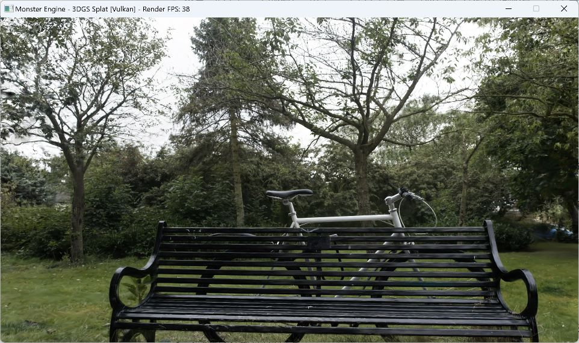

# SH FP16 resident storage (P02, first round)

SH coefficients can use packed IEEE binary16 storage while preprocessing and SH evaluation remain FP32. Set `shStorageMode` to `0` (FP32, default) or `1` (packed FP16). First-round FP16 support is limited to full-resident mode A without fullLeaf or projected fusion. LOD/streaming remain FP32. Invalid/nonfinite or out-of-range FP16 inputs are rejected.

This commit also includes the batch64 Raster prerequisite, retained behind `rasterSharedMemoryMode=1`; the global Raster default remains 0.

## Validation and Bicycle comparison

Release build and five focused SH host/Vulkan checks passed. A tool identity-check issue was fixed and its two focused checks passed. One paired Bicycle run used the same Release executable/shaders, 6,131,954 Gaussians, 1920x1080, fixed camera, SH3, batch64, tight2, radix32, VSync/fusion off, 3 seconds warmup and 8 seconds sampling per mode.

| Metric | FP32 | FP16 |
| --- | ---: | ---: |
| Source backing allocation | 1,496,196,784 B | 907,529,200 B |
| SH backing allocation | 1,177,335,168 B | 588,667,584 B |
| Preprocess GPU mean | 3.921297 ms | 3.782959 ms |
| Raster GPU mean | 6.944470 ms | 6.913571 ms |
| WholeFrame GPU mean | 25.663272 ms | 26.196041 ms |
| Mean frame interval | 26.554976 ms | 26.865511 ms |
| FPS (1000 / mean interval) | 37.6577 | 37.2224 |
| Eligible timing frames | 301 | 298 |

Source backing decreased by **561.40 MiB (39.34%)**. These are actual engine buffer allocations, not driver/process VRAM. Temporary backing remained 2,067,998,240 B. This single short pair does not establish a frame-rate improvement.

Separate matching linear RGBA8 captures had RGB MAE 0.00001745188816, PSNR 71.646978 dB, maximum difference 1/255 and 27,518 changed pixels. Alpha was identical. The preregistered engineering thresholds (MAE <= 1/255, PSNR >= 40 dB, max <= 16/255, no visible corruption) passed.

CPU SH validation/packing cost was about **39.5 seconds** in this implementation. Its timing overlaps initial upload; the costs must not be added. FP16 remains optional and FP32 remains the default. Android, dynamic views, sustained performance and compressed LOD/streaming were not validated.

## Actual full-window screenshots

These original window captures include native live FPS titles. The title readings are separate approximately one-second observations, not the timing-pair averages above. Internal rendering was 1920x1080; the capture tool returned 962x570 window images.

FP32, native title 38 FPS:



FP16 storage / FP32 computation, native title 36 FPS:


## Reproduction

Build Release and its production shaders using the repository build instructions. Supply locally available Bicycle assets in a copy of [comparison-config.example.json](tools/comparison-config.example.json). From the repository root, run:

```powershell
./devDocument/3DGS/GPUResidentCompression/tools/run_comparison.ps1 -Executable <Release-executable> -ShaderDirectory <compiled-shader-directory> -OutputRoot <new-output-directory> -Config <local-config.json>
python ./devDocument/3DGS/GPUResidentCompression/tools/analyze_comparison.py <new-output-directory>/run-manifest.json --output <summary.json>
```

The launcher runs one timing pair and a separate validation-enabled raw capture pair. Capture complete native windows separately for presentation. Private local paths, raw logs, dataset files, local workflow records and personal planning documents are intentionally excluded from this public report.
