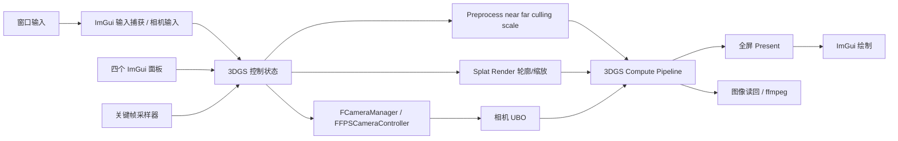

# MonsterEngine 3DGS ImGui 控制系统开发文档

> 状态：已实施；功能测试通过，部分人工交互验收见第 13 节  
> 创建日期：2026-10-02  
> 最后更新：2026-10-04  
> 目标程序：`MonsterEngine.exe --splat [模型.ply]`  
> 主要参考：本地 `D:\code\me-viewer-refs\3dgs-vulkan-cpp`；[Vulkan 原生 3DGS Splat Pass 开发文档](./Vulkan原生3DGS_splat_pass开发文档.md)

## 1. 目标与交付

在现有 `SplatSceneApplication` 中加入可实时操作的 ImGui 控制台，完成相机、渲染参数、性能信息和关键帧序列的控制；支持以固定帧率导出无界面的 3DGS 动画视频。交付包含功能代码、自动测试、构建运行记录及实际程序截图。第 1–8 节保留评审时的设计与验收目标，第 9 节起记录实际实现、偏差、排障和测试结果。

验收时四个面板均能在 3DGS 画面上显示并工作：**性能、相机、渲染、摄像机序列**。现有场景渲染与右键环顾须保持正常。

## 2. 现状与差距

| 范围 | 当前代码事实 | 开发工作 |
| --- | --- | --- |
| 应用与相机 | `Include/SplatSceneApplication.h`、`Source/SplatSceneApplication.cpp` 已接入 `FCameraManager` 和 `FFPSCameraController`；WASD、右键拖动、滚轮缩放可用。现有 Q/E 为下/上移动，空格为上移。 | 接入 UI；统一状态读写；改为目标按键；增加 roll。 |
| ImGui | `FImGuiContext`、`FImGuiRenderer`、`FImGuiInputHandler` 已存在。`CubeSceneApplication` 有集成示例，但初始化当前被注释。 | 在 3DGS 应用独立接入并验证 present pass 后的叠加绘制、输入捕获、resize 和资源释放。 |
| 裁剪 | `FCameraUniforms` 存投影矩阵；`FPreprocessPushConstants` 有 near、far、culling；`FSplatPreprocessPass::execute` 当前把 `culling` 写死为 1。应用的投影 near/far 写死为 0.1/1000。 | 参数化开关和裁剪距离，并保持投影矩阵与预处理参数一致。 |
| 线框及缩放 | `Shaders/Splat/Render/splat_render.comp` 只实现填充式 EWA alpha blend；渲染 push constant 只有图像宽高。 | 加入高斯轮廓调试模式及高斯缩放参数，贯通 C++/GLSL 布局。 |
| 图块 | 渲染 shader、网格计算、相关 pass 使用固定 16×16。参考项目的 TileSize 控件也被禁用。 | 面板显示只读 `16×16` 和原因，避免出现无效滑块。真正动态切换需要重建多个 shader/pipeline/buffer，单独列为后续扩展。 |
| 性能 | RHI 暴露 `IRHIDevice::getMemoryStats`；应用有帧 delta。 | 显示 FPS、帧耗时、GPU 内存；确认返回值的统计口径，不可用时标注不可用。 |
| 参考序列 | 参考 `Sequence.cpp` 使用位置和标量线性插值、角度最短路径插值；无循环、持久化和真正的视频导出实现。 | 实现独立序列模型、平滑轨迹、循环、时间轴和固定步长导出。 |

仓库当前有与 3DGS 相关的未提交改动；实施时先比对工作区状态并保留这些改动，不覆盖现有调试修复。

## 3. 交互与参数定义

### 3.1 面板

| 面板 | 控件与行为 |
| --- | --- |
| 性能 | 当前 FPS、帧时间（毫秒）、GPU 已用与可用内存、分辨率、加载高斯数；采样平滑后展示，内存按约 1 秒刷新。 |
| 相机 | 位置 X/Y/Z、Yaw/Pitch/Roll、FOV 30–120°、鼠标灵敏度 0.01–0.4、移动速度 1–10；可输入数值，改变后下一帧生效。 |
| 渲染 | 距离裁剪开关、near/far、线框开关、高斯缩放；图块尺寸显示 `16×16（固定）`。near 默认 0.1、far 默认 1000，约束 `0 < near < far`。线框缩放为正值，建议 UI 范围 0.01–10。 |
| 摄像机序列 | 进入/退出序列、添加/覆盖/删除关键帧、编辑时间、按时间排序、时间轴拖动、播放/暂停/停止、循环、导入/保存序列、导出视频与进度/错误提示。 |

### 3.2 操作约定

- W/A/S/D：前进/左移/后退/右移；C/空格：上移/下移；Q/E：相机 roll 左/右。移动方向按相机局部轴计算。
- 鼠标右键拖动：Yaw/Pitch 环顾；鼠标滚轮：FOV 缩放。触控板双指拖动若平台窗口层报告为鼠标移动且右键状态可用，则走同一路径；若驱动只报告滚轮，保留滚轮缩放并在 UI 帮助文本说明该平台差异。测试时记录实际 Windows 设备行为。
- ImGui 文本框/滑块取得键盘或鼠标焦点时，屏蔽相应相机输入；右键环顾启动时不能把 UI 控件拖拽误判为相机拖拽；释放右键、切窗后清理状态。播放时序列是相机及可动画参数的唯一写入源，手动导航暂停或停止播放后再生效。
- Esc 继续退出；按钮文字和提示以中文展示，若现有字体缺少中文字形则加载支持中文的字体并验证截图。

### 3.3 线框定义

3DGS 没有传统三角形网格。此处“线框”定义为**屏幕空间高斯椭圆轮廓调试显示**：利用 render pass 已有的 conic、中心和 opacity，对设定等值线附近着色，背景保持透明/原背景。高斯缩放影响椭圆范围，并且必须同步影响 preprocess 的投影包围盒、tile 覆盖和 render 的 conic 评价，避免裁切或排序缺项。它不依赖 Vulkan 多边形线框特性。普通填充模式下缩放也应可见且无裁切。

### 3.4 裁剪语义

near/far 控制摄像机深度范围，更新预处理裁剪及投影矩阵。关闭“距离裁剪”时仍保留数值有效的投影 near/far，以免投影退化；预处理跳过可选的距离检查，但必要的近平面数值防护和视锥安全检查仍在。实施时先核对 shader 当前 `culling` 分支，确保开关实际改变可见高斯数，而不破坏屏幕边界和负 Z 约定。

## 4. 关键帧系统

### 4.1 数据模型

`FSplatControlState` 作为每帧应用到相机/渲染管线的唯一参数快照；`FSplatCameraKeyframe` 包含：时间（秒）、位置、Yaw/Pitch/Roll、FOV、near/far、裁剪开关、线框开关、高斯缩放。灵敏度和移动速度属于操作偏好，不随关键帧动画。序列文件采用带 `version` 字段的 JSON，保存时间单位、帧率建议值及关键帧数组；读取时验证有限数、范围与顺序，错误文件不覆盖内存中的有效序列。

关键帧时间须非负且严格递增。UI 编辑时间后按时间重新排序；相同时间不接受，并在面板提示。零帧/一帧只允许预览，不开始播放或导出。

### 4.2 插值与播放

- 位置：采用带端点处理的 centripetal Catmull–Rom（或等效连续三次曲线），得到连续速度；提供线性模式用于对比与避免轨迹过冲。先在测试中覆盖重复位置、短间隔和边界段。
- 旋转：用与相机坐标约定一致的四元数插值（Slerp），Yaw 跨 ±180° 走短路径，避免 Euler 角跳变；显示时再换算为 Yaw/Pitch/Roll。Pitch 保持有效范围，roll 完整连续。
- FOV、near、far、高斯缩放：按段插值并限制在有效范围；对 FOV 等镜头参数提供平滑缓入缓出曲线。布尔项（裁剪和线框）在到达**后一关键帧时间点**时切换，区间内保持前一关键帧值。
- 用单调时钟累计实时播放时间；`sample(t)` 必须是无副作用纯函数。首末帧精确命中；到末尾时按循环开关回到起点或停止并保持末帧。暂停保留当前时间，停止回到首帧。拖动时间轴立即预览。
- 序列模式退出时保留关键帧；保存/导入是显式操作。播放和导出对关键帧列表采用稳定快照，防止运行中编辑导致索引失效。

### 4.3 视频导出

导出采用固定时间步长 `t = frameIndex / fps`，与实时帧率无关；可选 24/30/60 FPS，默认 30 FPS。固定输出尺寸为导出开始时的当前渲染尺寸。逐帧将**不含 UI** 的 3DGS 输出图像复制到 staging buffer，等待对应 GPU 完成后编码；处理 Vulkan 图像布局、行间距、RGBA 通道及垂直方向，限制在途读回缓冲数，避免长动画堆积内存。

视频使用本机 `ffmpeg` 子进程接收原始 RGBA 帧并编码为 H.264 MP4（`yuv420p`，适合通用播放器）。启动前检查可执行文件和目标路径；编码失败、中途取消、窗口关闭时回收子进程与临时文件，面板显示明确错误。导出时暂停实时操控，锁定序列快照和分辨率，按确定性时间采样；导出结束恢复原相机状态。目标包括首帧和末帧，帧数定义为 `ceil(duration × fps) + 1`，最后一帧显式采样 `duration`，并在测试中检查时间戳无重复/漏帧。导出路径和编码参数可在 UI 输入；不把 `ffmpeg` 作为项目编译依赖。

## 5. 集成方案



建议新增 `Include/Renderer/Splat/SplatControlState.h`、`Include/Renderer/Splat/SplatCameraSequence.h` 及对应 `Source/Renderer/Splat/` 实现，将状态校验、插值、文件 I/O 与 UI 分离；3DGS 应用仅编排顺序。具体命名实施时可按现有目录规范调整。

每帧顺序：收集输入 → ImGui `BeginFrame` 并绘制面板 → 处理序列/状态校验 → 更新 FPS 相机及 CameraManager → 构造相机 UBO 与渲染设置 → 在命令录制前更新必要 descriptor → 计算 3DGS → present 全屏图 → 同一帧叠加 ImGui → `endRenderPass` / present。要检查当前 RHI `setRenderTargets` 自动开始 render pass 的行为和 `FImGuiRenderer::RenderDrawData` 的 pipeline 切换，避免在 render pass 外绘制或清空已绘制画面。输入事件均先转发 `FImGuiInputHandler`，再依 `WantCaptureKeyboard/WantCaptureMouse` 决定相机消费。

参数传递采用 `FSplatPipeline` 的显式设置接口，不使用参考工程的全局 `g_renderSettings`。near/far、culling、scale 从状态统一传到 preprocess；线框/scale 传到 render。更新 shader push constant 后同步更改 CPU 结构、layout 大小、SPIR-V 编译脚本与打包资源。Resize 时同步重建图像尺寸相关资源并刷新 ImGui renderer，序列数据不丢失。关闭时先等待在途 GPU 命令，再按顺序释放导出缓冲、UI 和 splat 资源。

性能面板优先复用 `getMemoryStats`，核对其统计是否为当前设备已分配字节；若只统计引擎分配，就标注“引擎 GPU 分配”，不声称系统总显存占用。FPS 取平滑窗口内呈现帧数/耗时，帧时间取同一窗口的平均值，避免 `1 / 0`。

## 6. 实施顺序与关键文件

1. **状态与相机**：建立参数快照/校验，接通 FOV、速度、灵敏度、位置、旋转与目标按键；为 roll 明确更新相机 basis 和 view matrix。
2. **UI 接入**：在 `SplatSceneApplication` 接入现有 ImGui context、renderer、input handler；完成四个面板、输入捕获和性能显示。
3. **渲染控制**：扩展 `SplatPipeline`、`SplatPass`、`SplatRenderPass`、`splat_preprocess.comp`、`splat_render.comp`；修复 clip/push constant 一致性；重编译 SPIR-V。
4. **序列**：实现关键帧纯采样器、JSON 导入/保存、编辑/播放/循环与时间轴。
5. **导出**：增加 GPU 图像读回与 ffmpeg 视频编码、进度/取消和失败清理。
6. **测试与实机验证**：自动测试、Debug/Release 构建、实际启动、操控检查、截图及视频探测。

主要修改位置预计包括 `Include/SplatSceneApplication.h`、`Source/SplatSceneApplication.cpp`、`Include/Renderer/Splat/`、`Source/Renderer/Splat/`、`Shaders/Splat/`、`Source/Tests/` 和 shader 构建脚本。尽量复用已有 RHI 接口；若图像复制/同步缺少能力，再做最小 RHI 扩展并加集成测试。

## 7. 测试与验收

| 层级 | 用例与通过标准 |
| --- | --- |
| 状态单测 | FOV/速度/灵敏度/near/far 的边界和非法输入；`near < far` 始终成立；布尔开关生效；序列 JSON 往返一致、坏文件不污染当前数据。 |
| 插值单测 | 0/1/2/N 帧，首末帧精确值、Yaw 跨 180°、roll、重复位置、非均匀时间间隔、循环接点、时间轴跳转、布尔项切换时刻和停止行为。 |
| 渲染集成 | UI 改 FOV/near/far/裁剪/scale/线框后 3DGS 画面下一帧可见变化；shader CPU/GPU 结构大小一致；不同分辨率与 resize 后无越界或 validation 错误。 |
| 输入集成 | WASD、Q/E roll、C/空格、右键拖动、滚轮；拖动 UI 滑块与输入文本时相机不误动；播放期间参数由序列控制。 |
| 导出 | 2 秒/30 FPS 序列输出有效 MP4；`ffprobe` 检查帧率、帧数、宽高；抽取首/中/末帧比对预期视角；缺少 ffmpeg、取消和编码失败均有可读错误且无残留占用。 |
| 实机视觉 | 启动 `MonsterEngine.exe --splat resources\point_cloud\bonsai_30k.ply`；保存四面板全景截图、线框与普通模式对比截图、播放过程截图；人工核对布局、字形、可读性、画面覆盖关系和 GPU 内存标签。 |

截图与测试日志放在本次开发的验证目录，最终回复提供可点击文件路径及构建/运行命令。测试失败先修复并复测，直到功能闭环。现有工作区改动可能影响构建，测试记录将注明基线状态与本次变更的归属。

## 8. 评审关注点

1. **图块尺寸**：按参考实现保持固定 16，仅显示只读状态；动态重建图块管线不纳入本次范围。
2. **线框语义**：采用高斯投影椭圆轮廓，而非三角形 raster wireframe。
3. **视频依赖**：导出 MP4 使用本机 `ffmpeg`，无编译时依赖；缺少时 UI 明确提示。
4. **序列文件**：提供 JSON 导入/保存，便于重启后继续编辑和测试复现。
5. **轨迹平滑**：位置采用三次曲线、旋转用四元数；在线性模式中可规避个别镜头路径过冲。

评审通过后按第 6 节实施，并以第 7 节逐项验收；实际结果见下文。

## 9. 实际开发流程与架构

### 9.1 开发流程

1. 阅读本地参考工程和已有 Vulkan 3DGS pass 文档，确认 ImGui、FPS 相机、RHI 和 shader 的现状；保留工作区原有改动。
2. 新增 `FSplatControlState` 统一描述相机及渲染参数，并以 `ClampToValid()` 保证 FOV、near/far、速度和高斯缩放等约束。UI、动画和相机输入最终都写入这份状态。
3. 在 `SplatSceneApplication` 初始化 ImGui context、Vulkan renderer 和 input handler，按“更新参数 → 执行 3DGS compute → 全屏呈现 → 叠加 ImGui”的顺序录制命令。输入由 ImGui 先接收，并依据捕获标志决定相机是否处理。
4. 扩展 preprocess/render push constant 与 shader，使距离裁剪、近远面、线框轮廓、高斯缩放真实作用于 GPU 管线；同步重新编译 SPIR-V。
5. 将序列插值和 JSON I/O 放入 `FSplatCameraSequence`，将固定时间步长采样、图像读回和 FFmpeg 进程放入 `FSplatVideoExporter`。应用类负责协调状态与 UI，不在 shader 或序列模块中读取 ImGui 状态。
6. 使用 Debug/Release 构建、状态/序列测试、GPU 输出图像差分、MP4 解码、Vulkan validation 和真实桌面截图反复验证。验证脚本及临时输出集中在 `Source/Tests/3DGSControl/`。
7. 2026-10-04 增加 UI 可见性接口、F1 切换和 `--splat-no-ui` 启动参数，并增加真实窗口像素对比测试。

### 9.2 运行时数据流与模块边界

| 模块 | 实际职责 | 关键文件 |
| --- | --- | --- |
| `SplatSceneApplication` | 初始化四面板；处理键鼠、窗口、可见性；从 UI/序列得到参数；设置相机与渲染管线；呈现和性能信息 | `Include/SplatSceneApplication.h`、`Source/SplatSceneApplication.cpp` |
| `FSplatControlState` | 默认值、合法性和约束；相机和渲染设置的统一快照 | `Include/Renderer/Splat/SplatControlState.h` |
| `FSplatCameraSequence` | 关键帧编辑、播放、循环、纯函数采样、版本化 JSON | `Include/Renderer/Splat/SplatCameraSequence.h`、对应 `.cpp` |
| `FSplatVideoExporter` | 按 `frameIndex / fps` 采样；Vulkan 图像读回；向 FFmpeg 管道写帧；取消、失败清理 | `Include/Renderer/Splat/SplatVideoExporter.h`、对应 `.cpp` |
| `FSplatPipeline` 及 pass/shader | 将 near/far、距离裁剪、线框和缩放参数传给 GPU；产生不含 UI 的颜色图 | `Include/Renderer/Splat/`、`Source/Renderer/Splat/`、`Shaders/Splat/` |
| ImGui context/renderer/input | 字体、输入事件、draw data 和 Vulkan 绘制 | `Source/Editor/ImGui/` |

每帧先读键鼠与 UI，播放或导出时由序列采样覆盖可动画参数，再校验状态、同步相机、录制 3DGS 命令并呈现。MP4 从叠加 UI **之前**的 3DGS 输出读回，所以导出不含面板。显示开关只控制 ImGui 的帧构建、GPU 绘制和输入捕获；关闭面板时 3DGS 和序列继续运行。

### 9.3 序列数据和插值

关键帧保存位置、Yaw/Pitch/Roll、FOV、near/far、裁剪开关、线框开关、高斯缩放和时间。鼠标灵敏度、移动速度是操作偏好：内存中的控制状态包含它们，但当前 JSON 不保存这两项，也不对它们做平滑动画。位置支持平滑 Hermite 切线插值与线性模式；旋转转四元数做 Slerp；标量用缓入缓出；布尔值在后一个关键帧的时刻切换。播放持有关键帧快照，编辑时不会改变正在播放的轨迹。导入先完整解析和验证，再替换有效序列。

可直接导入 `resources/3dgs_sequences/bonsai_demo.json`（0、2、4、6 秒共四帧）。在“摄像机序列”面板点击“进入序列 → 载入示例 → 播放”；自行录制时依次设定相机、填写新关键帧时间、点击“添加关键帧”，完成后“保存 JSON”。两帧以上方可播放或导出。导出 FPS 是视频固定采样率，实时播放 FPS 由机器吞吐决定。

## 10. UI 可见性接口

公开接口位于 `SplatSceneApplication`：

```cpp
void SetControlUIVisible(bool visible);
bool IsControlUIVisible() const;
```

默认 `true`。宿主代码可以在 `run()` 前或运行中的主线程调用 `SetControlUIVisible(false)`；运行中按 **F1** 显示或隐藏四个面板。命令行 `MonsterEngine.exe --splat resources/point_cloud/bonsai_30k.ply --splat-no-ui` 以隐藏状态启动，之后仍可按 F1 显示。隐藏时停止 ImGui `BeginFrame/EndFrame`、跳过 `RenderDrawData`，不再让旧的 `WantCaptureKeyboard/Mouse` 阻挡相机；切换时清空待处理输入和按键状态，并重置右键环顾状态，避免再次显示时出现误拖动。关闭显示不释放 ImGui/Vulkan 资源，因此恢复不需要重建管线。键盘回调链是 GLFW → `EKey::F1` → `onKeyPressed` → setter，GLFW 的 F1 映射需要显式注册。

## 11. 开发中问题、原因与处理

| 现象/问题 | 排查结果 | 处理与验证 |
| --- | --- | --- |
| ImGui 面板出现倒置、乱码或位置异常；用户截图中按钮文字为白色方块 | ImGui 顶点/片元 shader 与当前投影、顶点数据布局不匹配；默认中文字形集只覆盖常用汉字 | 修正 ImGui shader/renderer 对接并重编译 SPIR-V；字体改用 `GetGlyphRangesChineseFull()`；通过字形单测与桌面截图检查“渲染”“帧间隔”等标签。 |
| 线框变成满屏大椭圆、画面失真 | 高斯屏幕椭圆的 scale、预处理覆盖图块和 render conic 评价必须一致；仅修改轮廓 shader 会让大量高斯覆盖错误区域 | 将缩放与裁剪贯通 preprocess 和 render；限制线框预览采样；使用 GPU 图像差分检查线框开关和缩放效果。 |
| Debug 程序多次弹出 `abort() has been called`；高分辨率下内存压力明显 | Vulkan 分配和 descriptor 更新错误路径需要更严格校验；最大化 4K 窗口会放大排序缓冲与输出纹理规模 | 修复缓冲初始化有效性判定、资源绑定/回收及 descriptor 录制路径；窗口最大化但内部 3DGS 渲染分辨率受限（当前 4K 桌面为 1600×840），并收紧默认每高斯图块排序容量。Debug 实机、视频导出和 validation 场景不再复现这些报错；极端高斯缩放仍需关注排序容量上限。 |
| 调高 FOV 到 90° 以上时滑块数值变化、画面却不对应 | FPS 相机自己的 `MaxFOV` 仍限制旧范围 | 应用控制状态时把相机范围设为 30–120°，再设置 FOV；单测和 GPU 图像测试覆盖。 |
| 编辑选中关键帧的时间可能导致索引错位 | 改时间后关键帧按时间重排，旧引用和索引不再可靠 | 编辑前复制选中帧，重排后重新计算选中索引；覆盖时间编辑、JSON 往返和播放快照测试。 |
| MP4 在奇数图像高宽时编码失败 | H.264 `yuv420p` 要求编码输出宽高为偶数 | FFmpeg 滤镜补齐奇数边界，读回仍按实际渲染尺寸；导出脚本解码并检查文件有效性。 |
| 面板显示的约 52 FPS 与早先不足 20 FPS 不一致 | 当前数值是整个 3DGS 画面循环的吞吐，含 UI 和呈现；窗口可为 3840×2019，但内部渲染是 1600×840，测试条件不同 | 名称改为“3DGS 画面 FPS”，面板同时显示窗口与内部渲染尺寸，并注明并非独立 GPU pass 耗时；预热 5 秒后测得 5 秒平均约 55.985 FPS。对外比较性能必须统一模型、分辨率、设置与计时口径。 |
| 初次添加 F1 开关后单测通过，但真实窗口按 F1 无反应 | `GLFWInputManager::convertGLFWToKey()` 原先未映射 `GLFW_KEY_F1`，事件变成 `EKey::Unknown` | 加入映射；`test_ui_visibility.py` 实机截图测试验证隐藏启动、F1 显示、F1 再隐藏。 |

问题表记录已定位并处理的开发现象，不代表所有平台、模型和驱动组合都已经覆盖。保留 `validation/` 中的图像、日志、MP4 和测试脚本便于复现。

## 12. 构建、运行及测试证据

在 `D:\code\MonsterEngine` 下构建：

```powershell
& 'C:\Program Files\Microsoft Visual Studio\2022\Professional\MSBuild\Current\Bin\MSBuild.exe' MonsterEngine.sln /t:Build /p:Configuration=Debug /p:Platform=x64 /m
& .\x64\Debug\MonsterEngine.exe --test-splat-controls
& 'C:\Users\Administrator\.cache\codex-runtimes\codex-primary-runtime\dependencies\python\python.exe' Source/Tests/3DGSControl/test_gpu_control_effects.py
& 'C:\Users\Administrator\.cache\codex-runtimes\codex-primary-runtime\dependencies\python\python.exe' Source/Tests/3DGSControl/test_ui_visibility.py
```

2026-10-04：Debug/Release 构建、相机/序列单测、六帧 GPU 参数差分、MP4 解码和 Vulkan validation 均通过；UI 可见性实机测试通过，性能面板截图的像素变化分别为显示 76.8、重新隐藏 0.0。详见 `Source/Tests/3DGSControl/README.md`。截图包括 `validation/ui_hidden.png`、`ui_visible_after_f1.png`、`ui_hidden_again.png` 和 `final_ui_visible.png`。`test_ui_visibility.py` 会启动并关闭独立测试进程，不修改用户的序列文件。

## 13. 当前范围与后续验收

固定图块 16×16 仅只读展示，动态 tile size 需要重建 shader、网格尺寸和缓冲布局，未实现。GPU 内存标签为引擎资源池分配量，不能当作系统总显存占用。屏幕 FPS 是整帧画面吞吐，独立 GPU pass 耗时需要额外 GPU timestamp 测量。全套旧有 `--test-all` 基线含既存失败或挂起，不能宣称项目所有历史测试通过。

自动测试已覆盖参数状态、序列/JSON、主要 GPU 效果、视频有效性和 UI 显示切换；逐个真实鼠标点击所有 ImGui 控件、触控板手势、拖动窗口后 resize、导出取消与 FFmpeg 缺失时的 UI 提示仍需针对目标设备做交互验收。用户可先用示例 JSON 和 F1 显示开关复测常用工作流。

## 14. 窗口尺寸与 FPS 口径调整（2026-10-04）

用户在 3840×2019 最大化窗口中看到内部渲染 1600×840 和约 47 FPS，询问两种尺寸为何不同。原实现为了避免 4K 下排序缓冲与输出图像占用过大，将大窗口的 3DGS 渲染限制在约 1600×900 以内，并由 fullscreen present pass 放大到交换链窗口；1600×840 与 3840×2019 的宽高比接近，因此画面不会明显拉伸。这是有意的动态分辨率策略，但降低了细节清晰度，也让 FPS 不能直接和原生分辨率测试比较。

根据这次反馈，默认窗口改为**非最大化 1920×1080**。在该启动尺寸下，内部 3DGS 渲染也是 **1920×1080**，便于直观看效果与按相同分辨率测性能。用户仍可手动最大化窗口；当前 resize 路径会更新 swapchain 和 ImGui，内部 3DGS 图像保持初始化时的尺寸，因此放大窗口后仍可能出现“窗口尺寸 ≠ 渲染尺寸”。性能面板同时显示两者，供测试时记录。此调整改变性能测试条件，不应把新旧 FPS 当成同一配置的优化或退化。

面板的“3DGS 画面 FPS”来自 `Application::tick()` 的整帧循环计数：以约 1 秒窗口计算 `frameCount / elapsedTime`，正常渲染时每轮包括输入/更新、3DGS pipeline、ImGui、提交与 present 调用。它是程序在当前配置下的画面循环吞吐；不是单独 GPU compute pass 的时间，也不是显示器已实际扫描出的帧数。新默认配置预热 5 秒后测得 5 秒平均 **48.382 FPS**，日志 `Source/Tests/3DGSControl/validation/benchmark_1920x1080.log`。此前大窗口、1600×840 内部渲染为 55.985 FPS，两者计算负载不同。截图 `validation/ui_1920x1080.png` 确认窗口和内部渲染均为 1920×1080；Debug 构建、控制单测、六帧 GPU 参数/MP4 测试和 F1 显隐测试通过。
